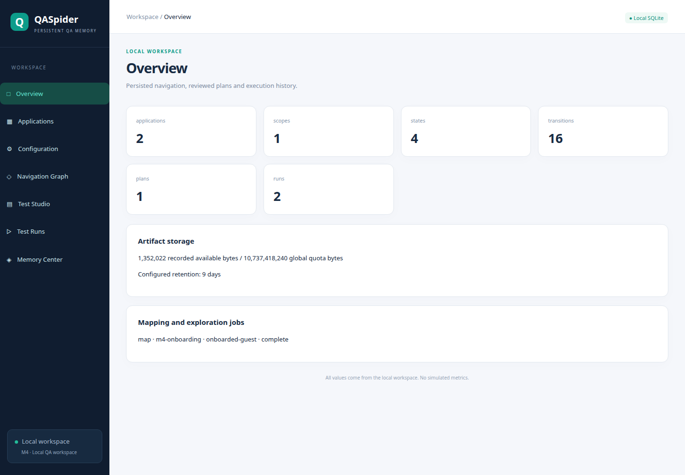

# QASpider — Story-driven QA

Local-first QA following the approved QASpider V2 architecture. **M0–M5.1 are implemented for the local beta scope.** QASpider maps safe navigation into SQLite, verifies candidate transitions by replay, accepts explicit batch approval, and replays approved paths without AI. The React Navigation Graph displays actual persisted records. M2 adds reviewed story plans, an isolated Codex CLI planning adapter, deterministic scenario execution, Test Studio and persisted Test Runs. M3 adds governed build comparison, targeted discovery, candidate review and reversible navigation promotion. M4 adds the official MCP SDK v2 server, explicit scoped authorization, persistent discovery jobs, Applications, Configuration and Overview.

## Start locally

```sh
npm ci
npm run start
```

`start` builds the project and opens **Studio at http://127.0.0.1:4319/**. Complete administrator setup/login, then use Projects → Create Project. The default approved workspace directory is `.qaspider/projects`. Previously enabled Studio-managed MCP processes restart with Studio. Ctrl-C stops Studio and its managed processes.

The development benchmark is optional:

```sh
npm run start:demo
```

This starts Studio plus the benchmark at **http://127.0.0.1:4317/**. Both demo services stop on Ctrl-C or if either fails; existing servers are never reused. Only demo mode generates a shared private benchmark fixture token when `BENCHMARK_FIXTURE_TOKEN` is unset. Generated tokens are never printed.

Configure `QASPIDER_PROJECTS_ROOT`, `QASPIDER_STUDIO_PORT`, or `QASPIDER_BENCHMARK_PORT` before starting to change the relevant defaults.

To start services separately:

```sh
npm run start:studio -- --projects-root /absolute/project-directory --port 4319
npm run start:benchmark
npm run --silent start:mcp -- --workspace /absolute/workspace --authorization /absolute/authorization.json
```

Build first when running services separately (`npm run build`). MCP uses **stdio**: an external MCP client normally launches its own process using the configuration from Studio Settings → MCP. You do not need to run `start:mcp` manually or enable the Studio toggle for that client. `start:mcp` is an optional command shortcut; use `--silent` to keep npm banners out of the protocol.

**Settings → MCP** also provides an optional Studio-managed process with Enable/Disable/Restart, PID, last successful health check and failure status. Status refreshes every five seconds while the panel is open, using real protocol pings. The toggle applies only to that project's Studio-managed process; it cannot start, stop or monitor independently launched client processes. It creates no network MCP endpoint. Enable state persists across Studio restarts. Disabling stops that process and cancels any jobs owned by it; other project services are unaffected.

A valid project authorization file is required. **Initialize MCP authorization (no grants)** creates a new private file with an empty grants list and never overwrites an existing file. Add explicitly reviewed scopes/actions locally before using application tools. Neither startup nor enabling MCP invents grants. Restart a managed process after changing its authorization file to load the new grants.

## Install and verify

Use Node **24.x** and npm:

```sh
npm ci
npm run typecheck
npm run build
npm test
npx playwright install chromium
npm run test:smoke
```

On minimal Linux systems, Chromium may need OS dependencies (`npx playwright install-deps chromium`) installed through your normal system administration process. Set the same `PLAYWRIGHT_BROWSERS_PATH` for installation and execution when using a custom cache; implementation validation used `/tmp/qaspider-playwright`. Build before smoke tests: the harness starts the compiled benchmark and serves the built viewer.

## Map the local benchmark

Start the fixture application in a separate terminal:

```sh
BENCHMARK_FIXTURE_TOKEN=local-test-only-token npm run benchmark
```

Open `http://127.0.0.1:4317`. Seed accounts are `admin@example.test` and `user@example.test`, both with the **benchmark-only** password `benchmark-password`. Accounts/sessions are in memory; QASpider's navigation memory is separately persisted on disk. Never use real credentials in this benchmark or expose it through a proxy/tunnel.

From the project root:

```sh
node_modules/.bin/qaspider init
node_modules/.bin/qaspider doctor
node_modules/.bin/qaspider map http://127.0.0.1:4317/ --role guest --build demo-1 --config examples/navigation-guest.json --depth 2 --actions 800
```

For authenticated mapping, configure the referenced environment variables in your terminal or secret manager. These values are for the benchmark only:

```sh
export QASPIDER_ADMIN_EMAIL=admin@example.test
export QASPIDER_ADMIN_PASSWORD=benchmark-password
export QASPIDER_USER_EMAIL=user@example.test
export QASPIDER_USER_PASSWORD=benchmark-password
node_modules/.bin/qaspider map http://127.0.0.1:4317/ --role admin --build demo-1 --config examples/navigation-admin.json --depth 2 --actions 800
node_modules/.bin/qaspider map http://127.0.0.1:4317/ --role user --build demo-1 --config examples/navigation-user.json --depth 2 --actions 800
node_modules/.bin/qaspider view
```

Open the plain local URL printed by `view`. M5.1 replaces URL bearer tokens with Studio administrator setup/login and HttpOnly, SameSite=Strict cookies. No password or session token is printed or placed in browser storage. The server binds loopback and enforces Host/Origin and CSRF checks. Use the Projects page to select a workspace; it remains independent from applications/environments inside it. See [Studio setup and recovery](docs/STUDIO.md).

Each mapping command gets a fresh browser context. Authentication requires explicit URL, exact permitted POST endpoint, field/submit locators, and an authenticated-ready assertion. Only that endpoint may receive a POST during bootstrap; discovery cannot submit forms. Imported `storage-state` roles resolve their file via an environment-variable reference, check stored origins, and require a ready assertion. No cookies, storage-state files, input values or credential values are stored in the graph. For a non-public tenant, an explicit `tenantReady` locator assertion is mandatory; it must identify the intended account/tenant. Tenant switching itself is not implemented.

For another permitted QA application, use `init --name "Application" --origin http://localhost:3000 --workspace /path/to/workspace` and supply explicit application-specific navigation/authentication configuration. Existing repository interfaces can configure additional environments and roles. `init` retains the internal application ID `benchmark`; the supplied name/origin identify your application. Do not point discovery at an application you have not authorized.

## Inspect, approve and replay

```sh
node_modules/.bin/qaspider graph
node_modules/.bin/qaspider graph --role guest --build demo-1
```

`graph` without a role lists known scopes. With a role it returns logical locations, semantic states, actions/transition conditions, verification status, scoped run history and approval history. Use state and transition IDs from this output or the viewer:

```sh
node_modules/.bin/qaspider approve --role guest --build demo-1 --transitions TRANSITION_ID_1,TRANSITION_ID_2 --reviewer your-name
node_modules/.bin/qaspider path --role guest --build demo-1 --from SOURCE_STATE_ID --to DESTINATION_STATE_ID
node_modules/.bin/qaspider replay --role guest --build demo-1 --from SOURCE_STATE_ID --to DESTINATION_STATE_ID --no-ai
```

These are ID placeholders, not commands to run literally. The viewer also supports selecting verified transitions and approving a reviewed batch. Every batch is atomic: every item must belong to the exact scope, be safe, have successful replay verification, and retain available supporting evidence. One invalid item rejects the entire batch. Business/security expectation changes cannot be approved through navigation tools.

Replay uses approved edges only, checks live normalized URL, visible headings and semantic state before/after every action, and records proof for each step. A mismatch fails the replay and makes the edge suspect; it does not change requirements or silently repair the path. Weighted path selection penalizes past failures and older verification. Source states away from the seed require an approved entry path too. No provider is instantiated by navigation commands; `--no-ai` documents the unconditional behavior.

## Scope, normalization and budgets

All graph data is partitioned by **Application × Environment × Role × Tenant × Build × Feature flags**. Commands accept `--workspace`, `--environment` (default `development`), `--role`, `--tenant` (default `public`), `--build` (default `development`), and optional JSON `--flags`. A scope's seed/normalization/auth-navigation configuration is immutable; use a new build for changed configuration.

Semantic fingerprints contain normalized URL, visible headings/dialogs, and named controls including expanded/selected/disabled/checked state. Input values and arbitrary body text are excluded. Email addresses, known session/credential values, ISO UTC timestamps and UUIDs are masked. Query parameters are omitted unless listed in `relevantQueryKeys`; known volatile keys can be followed without becoming state identity. Sensitive query keys and URLs containing credentials are rejected. Configure `volatileSelectors` for app-specific changing UI and `privateSelectors` for content that must be excluded/masked. Hashes aid retrieval; live semantic cues and action eligibility still need verification. Normalization cannot establish business correctness.

Discovery follows eligible HTTP(S) links and explicitly configured `safeControls` only. Ambiguous locators, unknown form controls, download/new-window links, destructive labels/routes and unauthorized origins are refused. Prefer stable test IDs, then exact accessible roles/names. The live element and target are rechecked before clicking. Service workers and WebSockets are blocked; browser HTTP requests are origin/method restricted, including redirects. Safe classification cannot prove that an application's GET endpoint is side-effect-free; use only authorized development/QA targets. Production mapping/replay is blocked.

Default limits: depth **3**, **100 states**, **300 actions**, **3,000 HTTP requests**, **10 minutes**, **10-second action timeout**, and **1 second between actions**. Override with `--depth`, `--states`, `--actions`, `--requests`, `--timeout` (milliseconds), `--action-timeout`, or `--interval`. Restoring source paths, authentication actions and verification replays consume budget. Richer benchmark maps use the explicit 800-action limit above. A budget stop retains partial knowledge and reports `budget-exhausted`; Ctrl-C reports `cancelled`. Neither is a successful completed map. Unknown/ambiguous attempts retain evidence; a completed exploration job does not mean every control was explored or establish product test PASS results.

## Storage and evidence

| Module | Responsibility |
| --- | --- |
| `packages/core` | Validated scopes, policy, providers/fake provider, semantic normalization, graph contracts/pathfinding |
| `packages/storage` | Checksummed migrations, scoped SQLite repositories, artifact lifecycle and quota enforcement |
| `packages/navigation` | Bounded Chromium discovery, live replay, authentication bootstrap, protected viewer server |
| `packages/qa` | Scoped planning context, approved scenario execution, owned fixtures, jobs and protected reports API |
| `packages/providers` | Real Codex planning adapter and synthetic isolation gate |
| `packages/cli` | Workspace/navigation commands, stories, plan review/approval, test execution/replay, reports and provider diagnostics |
| `apps/viewer` | React/Vite Navigation Graph, Test Studio and Test Runs backed by actual SQLite records |
| `apps/benchmark` | Loopback navigation/authentication fixture with controlled test-only endpoints |

The build emits `dist/`, copies SQL migrations and bundles the viewer. Initialization creates `.qaspider/memory.db` and private artifact storage. Migration **001** is unchanged. Migration **002** adds scopes, logical locations, states, actions, transitions, navigation runs, verification attempts and navigation approval audit records. M0 databases upgrade without replacing existing configuration. Migration **003** adds immutable story/requirement and plan revisions, explicit approvals, scenario results/attempts/assertions, fixture reservations and durable job status. Approved proposals contain the exact scenario definitions; each run pins a plan revision and its content hash. Migrations 001/002 remain unchanged. Learning and FTS are deferred.

Managed artifacts default to **14-day retention**, **1 GiB/run**, **10 GiB/workspace** and local trace capture. Configure via `SettingsRepository.setSettings`. Navigation records sanitized semantic observations, masked screenshots, explicit replay proof and local traces. The viewer displays JSON evidence and conditions; screenshots are retained as referenced artifacts. Raw trace downloads are denied by the viewer because traces can contain cookies/request data. They remain local private artifacts, never provider context or Git content.

`ArtifactStore.put` prunes expired inactive artifacts before allocation. Navigation completes artifact lifecycle automatically on normal completion, failure, budget stop and cancellation. Metadata tombstones survive expiry/deletion. Active artifacts from abrupt process termination and physical orphan files require operator reconciliation; no automatic interrupted-run resumption is implemented. Quota exhaustion fails evidence collection rather than evicting unexpired history. Development smoke traces/workspaces under ignored `test-results/` are separate from managed workspace retention.

Files use `0600`, private directories `0700`; symlink/traversal checks and SQLite IMMEDIATE transactions protect artifact allocation. `doctor` reports missing credential-reference names, never values. Environment variables or storage-state files remain outside graph memory. Redaction relies on declared private areas, known credentials/session values and semantic extraction; inspect application-specific privacy needs before recording data.

## Benchmark fixtures and validation

Fixture endpoints require `x-fixture-token`, accept POST only and exist only in the local benchmark:

- `/__fixtures/reset`: reset accounts, sessions, counters and navigation variation.
- `/__fixtures/setup`: `{ "email": "fixture@example.test", "role": "user" }`; creates a fixture with the benchmark password.
- `/__fixtures/cleanup`: `{ "email": "fixture@example.test" }`; idempotent and refuses seed deletion.
- `/__fixtures/stats`: inspect registration/destructive-visit counters.
- `/__fixtures/change`: `{ "aboutTitle": "Changed destination" }` or `{ "duplicateEmailDefect": true }`; inject a controlled navigation or duplicate-email defect. Reset restores correct behavior; the duplicate defect never overwrites seed accounts.

Without an explicit fixture token, the benchmark generates an unreported token. Smoke tests start their own server and never reuse an existing application. Acceptance covers independent guest/admin/user discovery, volatile query deduplication, actual process restart, AI-free CLI replay, batch approval through the viewer, live destination mismatch, scoped evidence, limits/cancellation, backend role denial and storage-state secret isolation. Test outputs include SQLite memory, proof JSON, a graph UI screenshot and Chromium traces.

Historical M0 validation is in `validation/m0-report.json`. M1 validation and its exact file inventory are in `validation/m1-report.json`.

## Story planning, review and execution (M2)

Use the same workspace/build/tenant/roles as your approved M1 map. `examples/m2/context.json` uses the acceptance workspace's `m1-smoke` build; adjust it to your mapped build before starting a new demo. `examples/m2/registration.md` is an explicit six-criterion benchmark story, and `examples/m2/policy.json` declares the permitted registration/read endpoints and owned fixture lifecycle. Review these files for your target. Do not put credentials in stories, plans or policy files.

The existing signed-in **Codex CLI** is used for planning only. Set `QASPIDER_CODEX_BIN` to its absolute executable path if it is absent from PATH. `QASPIDER_CODEX_MODEL` defaults to `gpt-6.1-sol`. The installed CLI must support the required flags/features; unsupported versions fail closed. Sign in through your normal Codex CLI workflow. QASpider copies only its authentication file into a fresh private temporary Codex home and removes that worker afterwards. No direct API-key setup or app credentials are passed to the child.

```sh
node_modules/.bin/qaspider provider validate
node_modules/.bin/qaspider story import --file examples/m2/registration.md --context examples/m2/context.json
node_modules/.bin/qaspider story list
node_modules/.bin/qaspider plan generate --story STORY_REVISION_ID --policy examples/m2/policy.json
node_modules/.bin/qaspider plan show --plan PLAN_REVISION_ID
```

The ID labels are placeholders. Planning validates the real executable against a synthetic loopback Responses endpoint first. The check verifies ignored user/project configuration, disabled MCP/tools/hooks, structured output, a controlled worker directory, process timeout and cancellation. The captured model request must expose **zero tools** and no configuration canary. Each adapter instance validates before receiving application context and checks the executable hash before its planning call. Before future adapter, isolation or context-construction changes, run `npm run verify:provider` both before and after editing. This rebuilds and exercises the actual CLI against a synthetic loopback endpoint, retains private request/process receipts under `.qaspider/provider-validation/`, verifies process exit after timeout/cancellation, and captures synthetic credential/raw-artifact redaction evidence. `validation/m2-isolation-recheck.json` contains hashes and receipt references; the original real-planning validation record remains unchanged. These verification receipts are developer evidence, separate from managed run artifacts; retain them privately and do not publish raw requests or replace runtime validation with a saved result. The acceptance validation record is in `validation/m2-provider-validation.json`; it is evidence, not a reusable bypass token. Current supported CLI flags are documented in [Codex configuration](https://learn.chatgpt.com/docs/config-file/config-reference) and [noninteractive use](https://learn.chatgpt.com/docs/non-interactive-mode); installed capability checks govern execution.

The provider receives bounded, sanitized requirement and navigation summaries, relevant state IDs, declared locator/endpoint permissions and approved-path availability. Raw artifacts, cookies, storage-state files and application credential values are excluded. Stories and page content are untrusted data. The adapter cannot execute returned text; only strict typed proposals reach review. Synthetic test providers are explicitly labeled in plans/reports and are never the dashboard's default provider.

If a relevant feature is unknown and the reviewed policy enables `discovery`, planning can invoke targeted safe exploration: depth 2, at most 12 states, 60 actions, 200 requests and 30 seconds. It filters eligible navigation by story-title keywords and preserves the full M1 origin/authentication rules. New edges remain unapproved; review them in Navigation Graph before execution. Missing scopes require explicit initial mapping. Retrieval uses scoped keyword matching rather than embeddings or AI-driven exploration.

Review/edit the proposal in Test Studio or save an edited **proposal object** to a JSON file:

```sh
node_modules/.bin/qaspider plan edit --plan PLAN_REVISION_ID --file reviewed-proposal.json
node_modules/.bin/qaspider plan approve --plan PLAN_REVISION_ID --reviewer your-name --requirements REQUIREMENT_ID_1,REQUIREMENT_ID_2
node_modules/.bin/qaspider test run --plan PLAN_REVISION_ID
node_modules/.bin/qaspider report --run RUN_ID
node_modules/.bin/qaspider test replay --plan PLAN_REVISION_ID --scenarios SCENARIO_ID --no-ai
```

Every edit creates an immutable revision; approval pins the latest displayed revision and hash. Each cited requirement needs explicit approval, including any AI-inferred expectation. Source Markdown, line references and earlier revisions remain intact. A new story revision never changes earlier approved runs. The executor never calls a provider; `test run` and `test replay` are both deterministic. CLI execution returns nonzero for FAIL/BLOCKED/INCONCLUSIVE while preserving the full report.

Execution reuses approved M1 paths and checks live entry/transition/destination conditions. Each attempt starts a fresh role session; production is blocked. Only approved typed fills/clicks and text/visibility/HTTP-status assertions are supported. POST permission is limited to an exact declared endpoint during its approved submit action; read assertions require exact scoped GET grants and reject redirects. Unknown form submissions are blocked. Inputs use unique reserved fixture emails and generated passwords; cleanup always runs, including on failure/cancellation. Only owned fixture reservations can be cleaned. Cleanup errors leave an `orphan` reservation and classify the attempt BLOCKED for operator reconciliation.

Reports retain PASS, FAIL, BLOCKED, INCONCLUSIVE, FLAKY and NOT RUN. A missing prerequisite or policy denial is BLOCKED; an automation/evidence uncertainty is INCONCLUSIVE; contradictory explicit behavior is FAIL. An approved optional retry can identify FLAKY when completed attempts disagree. Unselected/cancelled scenarios remain NOT RUN. PASS requires every approved assertion, its exact expected value and retained evidence. Screenshots mask inputs/email; full local traces remain private and are referenced in reports, never exported by the viewer. Test artifacts use M0 quotas/retention, with child navigation artifacts charged to the parent test-run budget; a quota/evidence failure cannot become PASS.

Start `qaspider view`, open its plain local URL, log in, select the project, and use **Test Studio** to enter a story, select scoped roles, review permissions, generate a plan, edit scenarios and approve requirements/the exact plan. **Test Runs** shows persisted progress, assertions, fixtures, screenshots and trace references. No metrics/results are simulated. The fixture token and authentication reference values must be set in the viewer's environment before starting execution. Progress polling and cancellation apply to jobs started by that viewer process.

The earlier `--scenarios registration-valid` replay intentionally selected one scenario; the other five were correctly NOT RUN, not failures. A later fresh CLI process replayed **all six approved scenarios** without `--scenarios`: all six passed, with a configured provider canary proving no Codex invocation. See `validation/m2-full-suite-replay.json`.

`validation/m2-demo-evidence.json` records the actual Codex acceptance run: six PASS on the correct benchmark, five PASS/one FAIL with the duplicate defect, and a PASS/remaining NOT RUN on an AI-free replay after reopening SQLite. `validation/m2-defect-report.json` retains the complete defect report, `m2-generated-plan.json` the original draft, and `m2-plan-review.json` the explicit review decision. Private SQLite/screenshots/traces are under the workspace named in the evidence file. The negative M1 guest probe was reverified and reapproved while preserving its failed attempt and evidence; see `validation/m2-preflight.json`.

Limitations: typed browser actions and explicitly declared HTTP status checks are the M2 execution vocabulary; no arbitrary JS, shell, database assertions, MFA automation or general fixture adapters are included. Fixture endpoints follow the benchmark setup/cleanup contract and must be explicitly configured for another authorized target. Abrupt process termination needs operator reconciliation of running jobs/runs, active artifacts and reservations; automatic crash resumption is deferred. Privacy masking still depends on declared private areas and known secrets, and full traces require local care. Requirements are not automatically changed when a product fails.

## Deferred

M3: learning agents, build-change analysis and governed memory promotion/revision workflows. M4: **MCP TypeScript SDK v2**, remaining dashboard screens and release hardening. No M3/M4 implementation or MCP dependency is included.

Licensed under Apache-2.0; see `LICENSE`.

## M3 — Governed learning and Memory Center

M3 compares immutable build scopes and proposes navigation changes with replay evidence. Open **Memory Center** in the local viewer to inspect real change sets, impacted scenarios, candidates and append-only decisions. Select matching base/head scopes (same application, environment, role, tenant and flags; different builds). Comparisons preserve historical graphs. Failed live replay marks its transition suspect and retains its original evidence.

Targeted exploration uses explicit terms, configured safe controls and normal navigation budgets. The new head-build field can create a build scope from a mapped base entry point. A complete exploration proposes experimentally verified transitions; it does not approve them. Review the candidate's scope, provenance, evidence references and graph before selecting **Approve verified navigation batch**. Every item must have available scoped replay evidence and remain safe. Rejection records a decision without promoting paths.

Each navigation promotion records previous/new statuses and can be rolled back. Rollback revokes that promotion atomically; it refuses overlapping later revisions or edges whose verification status has since changed. Evidence, candidates, decisions and original requirements remain intact. Expectation proposals require individual approval with their matching authoritative source. Endorsement is recorded separately; applying an expectation still requires an explicit new story/plan revision and approval through Test Studio.

CLI equivalents (scope IDs come from `graph`):

```sh
node_modules/.bin/qaspider diff --base BASE_SCOPE_ID --head HEAD_SCOPE_ID --reviewer local-owner
node_modules/.bin/qaspider explore --file examples/m3/explore-registration.json
node_modules/.bin/qaspider memory list --scope HEAD_SCOPE_ID
node_modules/.bin/qaspider memory approve --scope HEAD_SCOPE_ID --ids CANDIDATE_ID --reviewer local-owner --reason 'Reviewed replay evidence'
node_modules/.bin/qaspider memory rollback --scope HEAD_SCOPE_ID --revision REVISION_ID --reviewer local-owner --reason 'Revoke navigation promotion'
```

All commands accept `--workspace`. `memory reject` uses the same options as `approve`; `memory approve-expectation` requires one `--ids` value, `--reviewer` and exact `--source`. Discovery and navigation replay remain AI-free. There is no autonomous expectation mutation.

The benchmark's token-protected `/__fixtures/change` accepts `registrationConsent: true` to insert a local presentation-only consent dialog. This is an explicitly configured safe navigation control, not a business-rule consent assertion. `tests/smoke/learning.spec.ts` demonstrates change detection, targeted discovery, UI approval, separate-process replay, duplicate-email defect detection and rollback. Raw Chromium evidence remains private in ignored `test-results/`.

## M4 — MCP v2 and workspace dashboard

The local dashboard includes **Applications**, **Configuration**, **Overview**, **Navigation Graph**, **Test Studio**, **Test Runs** and **Memory Center**. Applications creates persisted application/environment/role records and starts bounded mapping jobs. Credentials are configured outside the app and referenced by environment-variable names. Configuration edits artifact quotas, retention and trace capture. Overview counts actual stored records. Switch back to Navigation Graph after a mapping job completes to load its newly persisted scope.

Application IDs, environment IDs and role IDs are immutable through onboarding; repeating identical input is safe. Use new IDs for a changed scope rather than repurposing historical records. Advanced auth locators, safe controls and private selectors use the same strict navigation configuration as the CLI.

```sh
node_modules/.bin/qaspider onboard --file examples/m4/onboarding.json
node_modules/.bin/qaspider configuration
node_modules/.bin/qaspider overview
node_modules/.bin/qaspider settings --file workspace-settings.json
node_modules/.bin/qaspider serve --mcp --authorization examples/m4/mcp-authorization.json
```

The server uses the official split TypeScript SDK **v2.4.0** (`@modelcontextprotocol/server`), over stdio. No network MCP listener is started. Stdout is reserved for protocol messages. The operator must supply a strict authorization file; there are no default grants. Example grants are exact app/environment/build/role/tenant/feature-flag scopes. Add only the actions your client needs: `read`, `plan`, `execute`, `explore`, `propose`. Multi-role stories require permission for every role. Review the file before launching an external agent; possession of the process connection alone grants no scope access.

Tools: `get_app_context`, `find_path`, `plan_tests`, `run_tests`, `explore_feature`, `get_report`, `propose_memory_update`, `get_job`, `cancel_job`. Planning still runs the synthetic Codex isolation gate before context sharing. Execution requires an exact approved plan and its policy. Exploration uses configured origins, controls, identity and budgets; results remain unapproved. MCP cannot onboard applications, approve plans/requirements/memory, read arbitrary paths, retrieve raw traces or change accepted expectations. Reports expose evidence references; raw browser evidence stays private. Use the local owner CLI/dashboard for explicit review and approval.

CLI, dashboard and MCP use the same application, QA, learning, navigation, storage and policy services. Discovery jobs and their results persist in migration 005; graceful cancellation is supported. Abruptly terminated jobs still need operator reconciliation and are not automatically resumed. Build before `npm test`: the MCP integration test exercises the compiled CLI through the actual SDK client, not a mocked protocol.

## M5 — Local beta readiness

The owner explicitly approved Codex as the required beta AI provider; Claude Code and Gemini CLI are optional and deferred. Neither executable is available here, neither integration is verified, and no additional provider was installed or authenticated. Provider-independent interfaces and synthetic contract tests remain intact.

| Provider | Beta status | Evidence |
| --- | --- | --- |
| Codex CLI | Verified planning adapter; runtime isolation required | Actual CLI synthetic tool/config/timeout/cancellation/sanitization receipts; original M2 live planning |
| FakeProvider | Synthetic fixtures only | Contract and browser tests; no real AI |
| Claude Code | Deferred, disabled, unverified | Executable unavailable; no adapter verification |
| Gemini CLI | Deferred, disabled, unverified | Executable unavailable; no adapter verification |

See the [step-by-step local demo](docs/DEMO.md), [development/setup and reproducible benchmarks](docs/DEVELOPMENT.md), [contributing](CONTRIBUTING.md), [security reporting](SECURITY.md), [unpublished beta release notes and M6 criteria](docs/BETA_RELEASE_NOTES.md), and [M5 measured validation](validation/m5-report.json) and [benchmark methodology/results](docs/BENCHMARKS.md). The repository-root GitHub workflow validates deterministic workflows without AI credentials. Actual Codex isolation remains a separate local release gate. Nothing has been pushed or published.

To start Studio, run `npm run cli -- view --workspace /path/to/your/workspace --port 4319`, open the plain local URL printed in your terminal, and select **Test Studio**. Start the benchmark separately when testing it. Port conflicts currently produce a generic navigation error; select a free port.



This screenshot comes from the actual Chromium onboarding/MCP acceptance test. Its plan is an explicitly synthetic fixture; its navigation, executions, counters and artifact bytes are real persisted data. It contains no bearer URL or account information.

## M5.1 — Authenticated multi-project Studio

```sh
mkdir -p /path/to/approved-projects
npm run cli -- studio --projects-root /path/to/approved-projects --port 4319
```

Create the first local administrator, then log in. Projects created by `qaspider init` register automatically in the same user registry. Studio can create/import only beneath the explicitly approved project root. Each project retains its own SQLite database and artifacts. Archive removes it from the active registry without deleting project files. A header switcher remounts project screens and keeps in-flight work attached to its original project.

Settings includes project artifact configuration, actual MCP stdio diagnostics, project-pinned client configuration, global AI defaults and project overrides. Sanitized context sharing defaults off for registered projects; enable it explicitly before planning. The Codex executable must be approved through the operator's QASPIDER_CODEX_BIN/PATH before starting Studio. Restricted verification uses synthetic data only and does not replace the runtime gate. Claude/Gemini remain deferred and unverified.

See [Studio operator/developer guide](docs/STUDIO.md) and [M5.1 validation report](validation/m5-1-report.json). Existing pre-M5.1 processes must be stopped/restarted to load the new login system. Old bootstrap fragments are not accepted by Studio.
