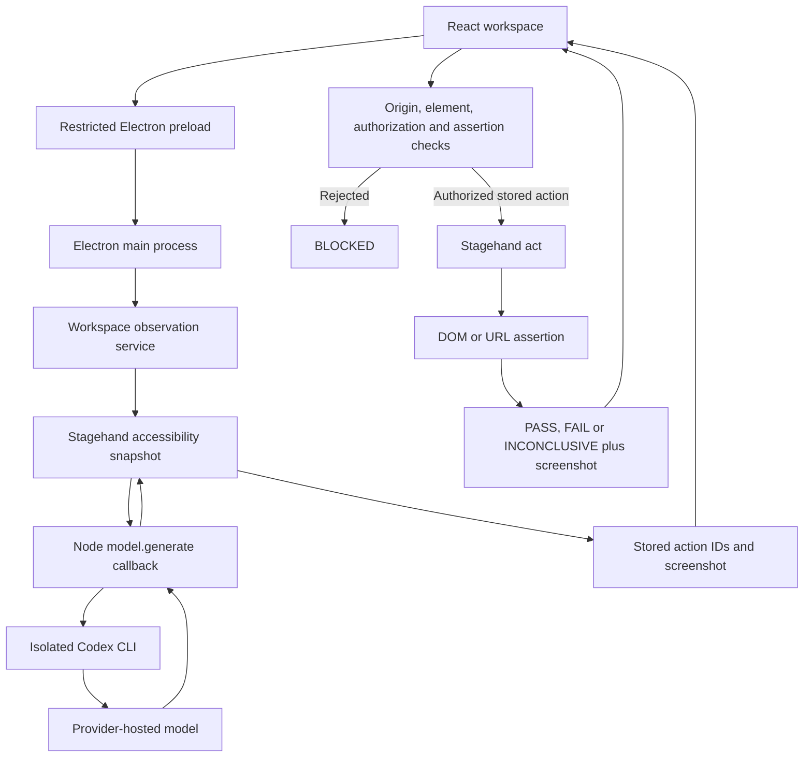

# Milestone 2 — Browser intelligence

The desktop now supports one interactive browser observation followed by one explicitly authorized click and one declared assertion. Stagehand owns browser observation and execution. A small Codex CLI adapter supplies inference through Stagehand's supported custom-model interface. No previous knowledge, navigation, planning or orchestration engine is imported.

## Try the controlled demo

Use Node 24, local Chrome/Chromium, and an authenticated Codex CLI. The standalone CLI was installed and verified as `codex-cli 0.164.0`; it is separately installed, not added to the desktop npm runtime dependencies.

```sh
# Terminal 1, repository root
npm run desktop:demo

# Terminal 2, repository root
npm run desktop
```

If setting up another machine, install the official CLI with `npm install -g @openai/codex@latest`, then sign in with `codex login`. A CLI version must support `--ignore-user-config`, `--ignore-rules`, `--strict-config`, `--ephemeral` and schema output, and pass QASpider's runtime isolation probes. Merely having a binary installed is insufficient.

In the **Browser testing workspace**, enter:

- Application URL: `http://127.0.0.1:4319`
- Observation instruction: `Find the Save demo button. Return only its click action.`
- Select the discovered Save demo action.
- Assertion type: **Exact visible text**.
- Assertion selector: `#status`.
- Expected value: `Saved`.
- Check the authorization box and choose **Execute selected action**.

The demo changes only its temporary DOM. Before the click, `#status` reads `Ready`; afterward it reads `Saved`. PASS is based on that observed transition plus Stagehand's execution result, not on the model's opinion. Observe again before another action. All supported clicks require explicit authorization because DOM markup cannot prove that JavaScript handlers or GET endpoints lack side effects.

For controlled login-page observation, enter `http://127.0.0.1:4319/login` and ask to find the Username field, Password field and Sign in button. The fields start empty and POST requests to the demo are rejected. Stagehand can propose actions for these controls, but M2's existing policy blocks filling fields and submitting forms. This fixture verifies inspection, not successful authentication. `npm run desktop:verify-login` repeats the live Electron/Codex observation and writes a separate receipt to `validation/desktop-m2-login.json` plus `test-results/desktop-live/m2-login.png`.

Node-side configuration, inherited when starting Electron:

| Variable | Meaning |
| --- | --- |
| `QASPIDER_DESKTOP_PROVIDER` | `codex` by default. `none` disables AI observation while retaining plain capture. Other unsupported values also leave observation unavailable. |
| `QASPIDER_CODEX_BIN` | Optional absolute Codex executable path. Otherwise the current PATH is searched. Example: `QASPIDER_CODEX_BIN="$(command -v codex)" npm run desktop`. |
| `QASPIDER_CODEX_MODEL` | Model name, default `gpt-6.1-sol`, matching the repository's existing Codex configuration. Availability is verified by the actual inference request; failure is displayed. |
| `CHROME_PATH` | Optional local Chrome/Chromium executable. |
| `QASPIDER_DESKTOP_HEADLESS` | `1` hides only the test browser; Electron still requires a display. |
| `QASPIDER_DEMO_PORT` | Demo server port, default `4319`. |

The renderer receives no credentials, CLI configuration or executable paths. Credentials remain in the existing Codex login store and a private temporary copy used for each inference, removed afterward. No OpenAI or Anthropic agent SDK is added. The future provider interface is `prepare()` plus `generate(stagehandRequest, signal)`; Gemini is not implemented or silently substituted.

If `http://localhost:3000` reports `ERR_CONNECTION_REFUSED`, start your development application's server or correct the port. Chromium can display an internal `chrome-error:` page for failed connections; QASpider identifies that as a navigation failure rather than a redirect or AI-provider failure. Cross-origin redirect failures show the blocked destination origin and the allowed origin. Enter the intended final application URL to explicitly choose a different origin; the application never silently expands the allow rule.

## Stagehand 4.3 explained

The installed `node_modules/@browserbasehq/stagehand/dist/index.mjs` and `index.d.mts` define the API we use. The bundled `dist/extension/service-worker.js` contains its browser runtime and inference flow.

`localBrowser.launch()` finds Chrome, creates a temporary browser profile and launches a process with a debugging port. `Stagehand.create({ browser })` sets up the browser runtime connection. `stagehand.close()` releases the Stagehand session; `browser.close()` releases Chromium and its profile. QASpider attempts both, including on startup and navigation errors. Visible Linux Chromium uses the previously verified built-in fallback UI toolkit to avoid GTK font-schema startup crashes.

`observe(instruction)` captures an accessibility snapshot, asks the model to identify actionable elements, then resolves returned accessibility IDs to concrete selectors. The result is `{ data: actions, metadata }`. This is a proposal list, not an execution or authorization. Empty lists remain empty; provider errors never become invented observations.

`act(instructionString)` requires inference to choose actions. `act(actionObject)` replays a concrete discovered action. M2 permits only validated, argument-free click objects and configures `selfHeal: false` when creating Stagehand. The renderer cannot submit an unrestricted natural-language action or a replacement selector. The installed API does not accept `selfHeal` as a per-call `act` option; it belongs in instance configuration.

`extract(instruction, schema)` uses inference to produce structured content from the page. It is useful for understanding data, but is not used for this milestone's verdicts. Plain navigation, screenshot capture, exact URL checks and visible-text reads do not require inference.

When using a custom model, Stagehand's browser runtime sends an `llm.generate` request through its RPC connection. The Node SDK registers the supplied `model.generate` callback and returns its result to the runtime. Our adapter supports structured text requests only and returns an assistant response with `outputFormat: 'json_schema'` and `structuredContent`. Image or tool messages and unsupported request formats are rejected explicitly.

References: [Stagehand models](https://github.com/browserbase/stagehand/blob/main/packages/docs/v4/configuration/models.mdx), [observation and action objects](https://github.com/browserbase/stagehand/blob/main/packages/docs/v4/basics/observe.mdx), [Codex noninteractive execution](https://learn.chatgpt.com/docs/non-interactive-mode).



## Where reasoning and permissions happen

AI reasoning happens at the Codex provider's hosted model. Stagehand supplies the task, accessibility snapshot and response schema. The adapter serializes that text and sends it through Codex CLI. Observation therefore shares the observed page's accessible text with that provider; it is not local model inference. Screenshots stay in QASpider and are not passed to this text-only adapter.

Before any page context reaches the CLI, a synthetic loopback probe checks that no model-visible tools are enabled and that canary user/project instructions are absent. Separate timeout and cancellation probes verify process termination. Synthetic wire requests and process receipts are retained privately under `.qaspider/desktop-provider-validation/`. The gate is rerun for a changed executable identity; configuration is isolated for every inference. Read-only sandboxing alone is not treated as disabling tool access.

Codex runs from a fresh empty working directory and temporary `CODEX_HOME`, with tools, MCP servers, plugins, hooks, rules and project instruction discovery disabled. Only required environment keys are inherited. The process has time and output limits; its result must parse as structured JSON and validate against Stagehand's requested schema. Unexpected CLI events, unsupported capabilities or malformed results make observation unavailable. There is no automatic provider fallback and no shell command constructed from page text.

The background workspace stores the proposals with opaque IDs. At execution it checks the observation ID, action ID, exact page URL, current origin, navigation version, selector uniqueness, element identity, current markup, visibility, enabled state and click policy. A replaced element with identical markup is still rejected by its handle identity. Links must have an HTTP(S) destination within the same origin. Form-associated controls, new-window targets, downloads, unsupported elements and non-click methods are blocked. A required authorization boolean is checked in Node, not just by a disabled React button. The IPC input schema rejects extra natural-language instructions or executable payloads.

Browser request interception retains the M1 exact-origin rule for main-page requests, including redirects. It is not a comprehensive network sandbox for workers, out-of-process frames, WebSockets or popups. Test controlled applications. Explicit authorization permits the uncertain side effects of the selected click; it is not proof that arbitrary application JavaScript is harmless. M2 intentionally supports a narrow subset of actions instead of pretending every observed action is safe.

## How assertions produce verdicts

The user declares either an exact final URL within the allowed origin or exact visible text at a selector. Selectors are used as read-only browser locators; user-supplied JavaScript is never evaluated. A selector must resolve to one visible element for a successful text assertion. Missing or hidden text does not match; an ambiguous or invalid selector cannot supply reliable evidence.

The expectation is read before clicking. If it already matches, no click runs and the verdict is INCONCLUSIVE: an existing result does not establish an action outcome. After a confirmed Stagehand action, the service polls for up to four seconds. A successful action plus a changed, matching expectation gives PASS; a confirmed action with an unmet expectation gives FAIL. Failure to confirm execution, assertion-reading errors, screenshot failure or cleanup failure gives INCONCLUSIVE. Invalid permissions, stale proposals and unsupported actions give BLOCKED before execution.

The verdict verifies only the declared visible outcome. It does not establish backend persistence, authorization correctness or causal certainty beyond the captured before/after evidence. Business-specific assertions require a later explicit design, not an invented PASS.

| Outcome | Controlled example |
| --- | --- |
| PASS | Save demo clicked with authorization; `#status` changes from `Ready` to `Saved`. |
| FAIL | Do nothing clicked with authorization; expected `Saved`, observed `Ready` until the deadline. |
| BLOCKED | The authorization boolean is false, the action ID is invented, the page changed or the action cannot be validated. |
| INCONCLUSIVE | Expected `Ready` already held before execution, assertion selector matched multiple elements, or evidence/cleanup failed. |

## File and function walkthrough

| File | Important functions and responsibility |
| --- | --- |
| `electron/browser.mjs` | `validateTarget()` enforces URL input. New `openBrowserSession()` shares the verified Chromium/Stagehand lifecycle, network rule, viewport and idempotent `close()` between capture and observation. It closes partially acquired resources on startup failure. `captureTarget()` still runs without a model, captures evidence and closes automatically. |
| `electron/codex-provider.mjs` | `CodexProvider.prepare()` locates the CLI, checks configuration and login presence, and enforces synthetic isolation validation. `validateIsolation()` runs canary, structured-response and process-termination probes with retained synthetic receipts. `generate()` validates the request modality/budget, prepares isolated authentication and schema files, runs inference, validates the structured answer and deletes temporary resources. `runCli()` uses `spawn` with `shell: false`, limits output/time, kills the process group on timeout/cancellation and waits for exit. `codexArgs()` supplies the fixed isolation flags. `output()` rejects failed/tool CLI events and parses the final agent message. `temporary()` creates private per-call directories. `executable()` resolves the configured absolute path or PATH. `withEndpoint()` and `sendSyntheticResponse()` support the loopback capability/test server; endpoint injection is available only in Node tests, never through IPC. |
| `electron/action-policy.mjs` | `classifyClick()` implements the narrow link/button policy. `inspectAction()` resolves the current DOM element and records a handle plus markup/state details. `validateAssertion()` accepts only exact text/URL assertions and checks expected URL scope. `readAssertion()` reads browser facts and returns `{ matched, actual }`. |
| `electron/workspace.mjs` | `TestingWorkspace.observe()` closes a previous session, prepares the provider, opens the application, calls real Stagehand observation and stores validated proposals. `execute()` validates the selected IDs, rechecks the DOM and authorization, reads the precondition, calls `act` with the stored action object, verifies the result and returns evidence. `evidence()` captures the current URL and PNG. `close()` invalidates IDs, cancels/awaits pending inference and closes the browser. A five-minute idle timer limits abandoned observation sessions. There is one session, no workflow scheduler. |
| `electron/main.mjs` | Adds a configured provider and workspace. The fixed-channel `handle()` wrapper enforces the exact local main-frame sender and one active operation. Starting M1 capture first closes an idle observation session. Shutdown waits for the active operation and closes any idle browser before quitting. Invalid model configuration is surfaced during observation instead of preventing plain capture from launching. |
| `electron/preload.cjs` | Adds only `observe`, `execute` and `closeSession` to the existing narrow bridge. It exposes no raw IPC or process API. |
| `src/Workspace.tsx` | Defines plain result/bridge types. `Workspace()` holds the form, selected proposal, authorization, expectation and up to ten action records in the current UI session. `observe()` requests inference; `execute()` submits only IDs, authorization and the declared assertion; `closeSession()` releases an idle browser. The UI shows provider identity, blocked actions, observed screenshot, verdict and action evidence. Changing the action/expectation clears authorization. |
| `src/main.tsx` / `src/style.css` | Keep the existing model-free capture interface and add the testing workspace and small responsive styles below it. |
| `demo/server.mjs` | `createDemoServer()` serves the controlled page. It provides a local-only Save button, a no-op button, a same-origin destination and actions that should be blocked. The CLI entry starts it on loopback. |
| `scripts/verify-live.mjs` | Explicit opt-in live verification using the real Electron UI, selected Codex CLI and the controlled demo only. It chooses the discovered action, authorizes the local DOM change, verifies PASS and saves a screenshot and a safe receipt. It is not part of default automated tests. |
| `scripts/verify-login.mjs` | Explicit opt-in live observation of the controlled login form. It verifies the three real discoveries are displayed, form actions are blocked and the session closes. It saves separate login evidence without executing authentication or overwriting the original action-validation receipt. |
| `tests/workspace.test.mjs` | Focused policy, unsupported provider-input, configuration, unavailable-provider and failure-cleanup tests. |
| `tests/intelligence.spec.mjs` | Real Chromium/Stagehand/Codex CLI with a clearly synthetic loopback inference endpoint. The fixture returns actual accessibility IDs from Stagehand's prompt, not canned application observations. Tests verify all four outcomes, unauthorized/stale rejection, navigation assertions, provider failure and cleanup. A real Electron test verifies the unavailable state. No synthetic provider is selectable in production UI. |
| Existing `tests/browser.test.mjs` / `tests/desktop.spec.mjs` | Preserve M1 validation, screenshots, redirects, startup errors, visible Linux browser support, cleanup, concurrency and quit-during-capture tests. |
| Root/workspace package manifests and lockfile | Add demo/live-verification commands and declare the existing Zod dependency directly. No model agent SDK or orchestration dependency is introduced. |
| `validation/desktop-m2-live.json` | Safe receipt of an actual controlled-demo live inference/action assertion run. CLI/provider raw data and synthetic gate receipts stay private. |

## Example result and failure behavior

Actual live validation found this action through Codex inference and Stagehand:

```json
{
  "selector": "xpath=/html[1]/body[1]/button[1]",
  "description": "Save demo button",
  "method": "click",
  "arguments": []
}
```

After explicit authorization, the recorded assertion and outcome were:

```json
{
  "assertion": { "kind": "text", "selector": "#status", "expected": "Saved" },
  "actual": "Saved",
  "outcome": "PASS"
}
```

The observation instruction does not become an action-execution instruction. It is processed by Stagehand's model callback, and its proposed action still passes through QASpider's permission checks. Unknown selectors/actions, unsupported methods and unauthorized requests remain blocked. An unavailable provider produces a clear message and no invented list of elements. An empty successful observation is shown as zero discovered actions.

Browser startup/navigation, provider sign-in/connectivity, malformed structured output, stale DOM, timeouts, assertion-reading failures, screenshot capture and cleanup can all fail. Error paths attempt browser cleanup; pending CLI inference is cancellable and temporary credentials are deleted in `finally`. The action session closes after every execution attempt, including BLOCKED; observe again to retry. Idle sessions close after five minutes or when plain capture starts or Electron exits. The UI may still show an expired observation until execution rejects its ID; it never grants execution from an expired session.

## Verification and milestone boundary

Completion checklist, verified on 2026-10-25:

- [x] Stagehand inspects a controlled login page: live Codex/Electron verification discovered Username, Password and Sign in. See `validation/desktop-m2-login.json`.
- [x] The desktop displays real observation results: the live login check verified all three rendered rows and the observed screenshot.
- [x] An authorized action executes: the controlled Save demo click changed `#status` to `Saved`. See `validation/desktop-m2-live.json`.
- [x] Unauthorized actions are blocked before execution: the Chromium test verifies zero calls to `stagehand.act` when authorization is false.
- [x] An assertion correctly fails: clicking Do nothing with expected `Saved` returns FAIL with actual `Ready`.
- [x] Screenshots and execution details are captured: observation/action screenshots and action/assertion/actual-value records are present.
- [x] Existing desktop behavior passes: the full smoke suite includes the original capture, redirect, visible-browser, cleanup and shutdown cases.
- [x] Main execution flow is explained: the architecture diagram and file/function walkthrough above cover UI, IPC, inference, permissions and assertions.

The login item verifies inspection of empty controls. Filling credentials and submitting a login form remain blocked under M2's current policy; successful authentication is not claimed.

```sh
npm run desktop:test
npm run desktop:smoke
npm run typecheck --workspace @qaspider/desktop
npm run typecheck
npm test
npm run verify:provider

# Explicitly opt in to live provider inference on the controlled demo:
npm run desktop:verify-live
```

The smoke suite needs local Chromium, a display for Electron and visible-browser regression, and the selected Codex CLI. It uses synthetic inference and does not require real model sign-in. The live check requires a working Codex login and model access and can consume provider quota. Its screenshot is `test-results/desktop-live/m2-workspace.png` and receipt is `validation/desktop-m2-live.json`.

Verified on 2026-10-25: 34 desktop unit tests, 17 desktop smoke tests and all 76 existing repository tests passed. Desktop/root typechecks, JavaScript syntax checks, lockfile dry-run and the required synthetic provider verification passed. The separate live Electron check also passed using Codex CLI 0.164.0 against the controlled demo; the saved receipt records the real action, assertion and observed value.

No LangGraph, database, persistent memory, autonomous discovery, ticket manager, custom browser agent, worker pool or orchestration engine is introduced. Action history is limited to the current UI session; opening another application or restarting discards it. Further milestones require approval.
