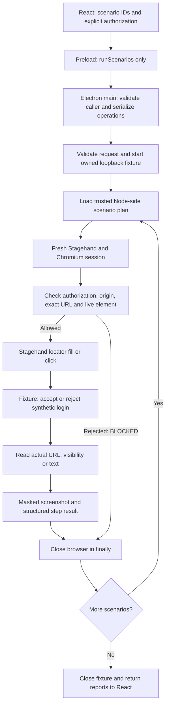

# Milestone 3: controlled QA scenarios

M3 adds sequential, deterministic login scenarios. It reuses Stagehand 4.3.0, the existing local Chromium session service, and Playwright's existing CDP connection for permission inspection, assertions and masked screenshots. No dependencies, inference providers, agent frameworks, databases or orchestration services were added.

## Try it

```sh
npm run desktop
```

Scroll to **Controlled QA scenarios · Milestone 3**. Authorize synthetic credential entry and submission, then choose **Run login scenarios**. QASpider starts its own loopback fixture on an available port; you do not need to start the demo server or configure a model. The ordinary capture and M2 observation workspaces remain available.

By default, both scenarios should PASS:

| Scenario | Browser behavior | Required expectations |
| --- | --- | --- |
| A: Valid credentials | Submit synthetic valid account | `/dashboard`, visible `#dashboard`, `#login-status` exactly `Signed in successfully` |
| B: Invalid credentials | Submit synthetic wrong password | `/login?error=invalid`, `#login-error` exactly `Invalid username or password.`, dashboard absent |

Select **Include a deliberately wrong dashboard expectation** to run a third scenario. It submits invalid credentials but expects `/dashboard`. It must report FAIL, and the overall summary must also say FAIL. The runner does not hide expected failures or reinterpret a failed assertion as PASS.

For manual fixture inspection, `npm run desktop:demo` still serves `http://127.0.0.1:4319`. That separately started server does **not** acquire submission permission in the scenario runner. M2 continues to reject all form actions even on this fixture.

## Browser sessions and framework responsibilities

A browser session owns Chromium, its temporary profile, pages, cookies and storage. `openBrowserSession()` creates that environment, installs the existing origin restriction and loads the approved page. `close()` releases it. M3 calls the service independently for each scenario; it does not reuse M2's observation browser. Closing the previous browser and opening a new one prevents the successful login cookie from affecting the invalid-login scenario. The runner also checks that the initial session has no cookies. This check fails closed instead of silently clearing unexpected state.

Electron runs the Node code and provides restricted IPC. React displays choices and reports. Stagehand performs navigation, filling and clicking. Playwright reads live element properties and assertion evidence through the existing browser connection, and masks form controls in screenshots. QASpider owns the small, explicit permission policy, scenario order and verdict rules. Chromium and the fixture implement the actual form submission and HTTP redirects.

Installed API references: `node_modules/@browserbasehq/stagehand/dist/index.d.mts`, `Locator` declaration, and `dist/index.mjs`, `src/locator.ts` section. In this installed 4.3.0 build, `page.locator('#password').fill(value, { timeout: 5000 })` sends a `locator.fill` RPC command with the value. `page.locator('#sign-in').click({ timeout: 5000 })` sends `locator.click`. Clicking a submit button uses normal browser form behavior. Neither operation needs model reasoning. M2's separate `observe()` path still uses Codex inference; M3 never sends credentials or page content to an inference provider.

## Complete flow



## Files and important functions

### `demo/credentials.mjs`

Contains only public, synthetic fixture account constants: `testAccount` and `invalidAccount`. Node uses them to validate the fixture login and fill approved fields. Plans refer to account keys (`valid` or `invalid`), never literal credential values. These constants are fixture source data, not saved user credentials. Do not replace them with production passwords.

### `demo/server.mjs`

`createDemoServer()` preserves the existing Save/Do nothing/navigation page and extends `/login`:

- `POST /login` reads at most 1 KB without logging or reflecting values. A matching synthetic account gets a random, in-memory session cookie and HTTP 303 to `/dashboard`.
- Wrong credentials clear any previous session token and redirect to `/login?error=invalid`. The new page contains empty inputs and the fixed error message.
- `GET /dashboard` requires the temporary cookie; otherwise it redirects to `/login`.
- Cookie flags are HttpOnly and SameSite=Strict. This is a loopback HTTP testing fixture, not a production authentication service.
- Closing the fixture clears its in-memory session set. Each scenario's fresh browser independently resets cookies and storage.

The fixture never echoes credentials into HTML or URLs. Its forms use POST. Response bodies are not included in reports. A content security policy keeps form destinations on the fixture origin and prevents framing.

### `electron/controlled-fixture.mjs`

`startControlledFixture()` binds the fixture to `127.0.0.1` on an available port. It returns a frozen object with `origin` and `close()` and registers that object in a private `WeakSet`.

`isOwnedFixture()` checks object identity. Matching a URL, element ID or page title cannot grant permission. `close()` revokes the capability, closes HTTP connections and stops the server. Only Node creates and retains this capability; IPC never returns it.

### `electron/scenarios.mjs`

`loginScenarios()` returns three small trusted plans. Every plan navigates to `/login`, asserts the initial URL, fills `#username` and `#password`, clicks `#sign-in`, then executes its required result assertions. The invalid plan also verifies that the dashboard is not visible.

Plans are normal data, executed in array order. There is no model-generated plan, action discovery, retry planner, parallel worker, navigation graph or general-purpose workflow engine. Adding a new controlled scenario means defining its explicit steps and reviewing its permission scope.

### `electron/scenario-runner.mjs`

`requestSchema` accepts only authorization and a bounded list of known scenario IDs. Unknown fields, duplicate IDs, arbitrary URLs, literal credentials and custom commands are rejected. `planSchema` validates the trusted plan's bounded steps; a plan must start with approved navigation and end with an assertion.

`checkPermission()` runs immediately before each navigation, fill or click. It requires:

1. Explicit authorization and a currently owned fixture capability.
2. Initial navigation only to the owned `/login` URL.
3. Before a fill or click, both the session target and current page must match the owned fixture; the current URL must be exactly `/login`.
4. Exactly one visible, enabled element with the approved selector.
5. The expected form ID, POST method and exact same-origin form action; no target-window, base-target or form-action/method overrides.
6. For fills, the approved input tag, name, field type and editable state. For submission, exactly the known submit button.

An unauthorized or changed form is rejected before Stagehand receives a click. The renderer cannot loosen these checks. The existing CDP origin restriction in `browser.mjs` still checks each page request and redirect hop. As documented in M1/M2, this is application scoping, not a complete OS/network sandbox.

`checkOrigin()` rechecks the fixture capability and current origin before reading assertions or taking evidence. `evaluateAssertion()` polls for up to two seconds. URL expectations compare the normalized exact URL; text requires a unique visible element and exact trimmed text; visibility compares a Boolean. Assertion selectors are limited to the fixture's approved evidence elements. Ambiguous selectors cause INCONCLUSIVE, rather than guessing which element matters.

`captureEvidence()` uses Playwright's screenshot masking for **all** input, textarea and select controls. Evidence is captured on navigation, submission and assertions, not after successful credential-fill steps. A failed or blocked operation also attempts one masked failure screenshot if the authorized origin is still available; unavailable evidence is explicitly reported. Every evidence entry has an opaque ID, step number, URL and PNG data URL. Evidence IDs are the screenshot references shown in the desktop. Screenshots and reports remain in renderer memory for the current run; no report database or automatic export is introduced.

`runScenario()` validates one plan and executes its steps in order. It opens a new browser on the navigation step, checks the cookie-empty precondition, fills approved synthetic values through Stagehand and waits for submission navigation. A failed, blocked or inconclusive step stops subsequent execution; remaining steps appear explicitly as not executed. The `finally` block always attempts to close an acquired browser. Startup cleanup remains the responsibility of `openBrowserSession()`, which already cleans up partially acquired resources.

The runner constructs a new report from safe fields. It never returns raw browser exceptions, DOM snapshots, cookies, CLI responses or Stagehand command envelopes. Fill results contain `[REDACTED]`. `redact()` also recursively removes known synthetic account values from textual reports as a final safeguard. PNG data is already protected by screenshot masks, not text replacement.

`summarize()` counts verdicts. Any FAIL makes the overall result FAIL; otherwise BLOCKED takes precedence over INCONCLUSIVE, then PASS. An empty run cannot PASS. `runScenarioSuite()` validates IPC input, starts the owned fixture, selects trusted plans, awaits each isolated scenario, aggregates reports and closes the fixture in `finally`. Fixture cleanup failure changes the suite verdict to INCONCLUSIVE.

### Electron and React changes

`electron/main.mjs` adds `desktop:run-scenarios` to the existing fixed IPC handler. The handler checks the local UI's exact main frame, rejects concurrent browser operations and keeps the active operation tracked during shutdown. It closes any idle M2 observation session before starting scenarios. App shutdown waits for the active suite and its cleanup.

`electron/preload.cjs` exposes only the named `runScenarios(request)` method. It does not expose Node, arbitrary channels, fixture capabilities or credentials.

`src/Scenarios.tsx` contains the request/report TypeScript interfaces and `Scenarios()` UI. Its `run()` sends IDs and authorization, then renders the returned steps, expected and actual values, verdict counts and expandable screenshot references. Changing the selected scenario set resets authorization; completing a run also resets it. IPC failure or an operation rejected by the concurrency guard becomes an explanatory INCONCLUSIVE UI result.

`src/main.tsx` mounts this component below M1 capture and M2 observation and extends the bridge type. `src/style.css` adds scenario controls, step/report layout and verdict colors. Existing browser service, provider, and M2 permission implementation are unchanged.

### Tests

`tests/scenario.test.mjs` covers the strict IPC boundary, missing authorization, spoofed fixture capabilities, invalid plans, recursive redaction and verdict aggregation.

`tests/scenarios.spec.mjs` exercises real Stagehand and Chromium: valid login, invalid login, incorrect expectation, session isolation, denied authorization, changed form destination, redacted results, screenshot masks, command errors, screenshot errors, startup errors and cleanup errors. It also launches real Electron, operates the React UI through preload/IPC, verifies both reports and screenshot rendering, and rejects a forged production URL request.

Run all desktop checks from the root:

```sh
npm run desktop:test
npm run typecheck --workspace @qaspider/desktop
npm run desktop:smoke
```

The smoke suite includes all existing M1 and M2 tests. The deliberately failing application scenario is expected to return FAIL, so its automated test passes when that failure is detected. The UI smoke screenshot is saved to ignored `test-results/desktop-m3-workspace.png`. Browser tests require a graphical session for Electron even when target Chromium is headless.

Validation on 2026-10-25: 39 desktop unit tests, 25 desktop smoke tests (including all 17 M1/M2 regressions), and 76 repository unit tests passed. Desktop and repository TypeScript checks passed. These scenario checks use actual local Chromium and Stagehand commands; M3 does not mock successful login or call an LLM.

## Completion checklist — 9/9

- [x] Valid login produces PASS with dashboard assertions and screenshot evidence.
- [x] Invalid login produces PASS when the declared rejection message appears.
- [x] An incorrect dashboard expectation produces FAIL with expected and actual URLs.
- [x] Unauthorized submission is blocked; the changed-destination test verifies zero Stagehand clicks.
- [x] Credentials are redacted from reports and IPC results, absent from captured Electron stdout/stderr and renderer console messages, and masked in screenshot controls.
- [x] Scenarios start without cookies and do not inherit a localStorage marker from the previous scenario.
- [x] A failed assertion retains its matching evidence ID, actual page URL and PNG after browser cleanup; the smoke test attaches the PNG as `failed-assertion-evidence`.
- [x] The real Electron desktop displays scenario verdicts, individual steps, expected/actual values and expandable screenshot evidence.
- [x] All 17 existing Milestone 1 and 2 smoke tests and the existing desktop unit tests still pass.

These checks are in `tests/scenarios.spec.mjs`, `tests/scenario.test.mjs` and the unchanged M1/M2 regression suites. The failure screenshot attachment is saved under ignored `test-results/desktop/` by Playwright. Raw application/browser protocol traffic is not collected for this checklist.

## Example data flow and verdicts

React sends this request; there are no credential fields:

```json
{"authorized":true,"scenarioIds":["valid-login","invalid-login"]}
```

Node starts a fixture, for example `http://127.0.0.1:49152`. The valid scenario fills its two approved inputs using Node-only account references. Its fill step returns:

```json
{"number":4,"kind":"fill","target":"#password","outcome":"PASS","expected":"[REDACTED]","actual":"[REDACTED]","message":"Approved browser operation completed."}
```

The successful login's URL assertion returns these substantive fields:

```json
{"number":6,"kind":"assert","target":"URL","outcome":"PASS","expected":"http://127.0.0.1:49152/dashboard","actual":"http://127.0.0.1:49152/dashboard","matched":true}
```

The next scenario opens a separate browser with no cookies. Its wrong password causes the fixture to redirect to the login error page. Verifying `Invalid username or password.` is a **passing negative test**. In the deliberately failing scenario, that same actual URL is compared with `/dashboard`; the URL assertion and scenario return FAIL.

| Verdict | Meaning |
| --- | --- |
| PASS | Every planned step completed, all required assertions ran and matched, evidence captured, browser cleanup confirmed |
| FAIL | A required assertion ran reliably and did not match before its deadline |
| BLOCKED | Permission, request or plan validation rejected execution |
| INCONCLUSIVE | Browser command, evidence, assertion processing or cleanup could not be confirmed; required work did not complete |

A click step can PASS while its scenario FAILS. Its PASS describes only that command. The scenario verdict depends on every required assertion and completion/cleanup checks.

## Limits and milestone boundary

The runner is intentionally limited to its owned synthetic fixture. It does not authorize arbitrary production login, user-supplied passwords, AI-generated commands, external authentication, CAPTCHA, MFA, autonomous planning, persistent memory or parallel scenarios. There is no new dependency license to review. Further milestones require user approval.
