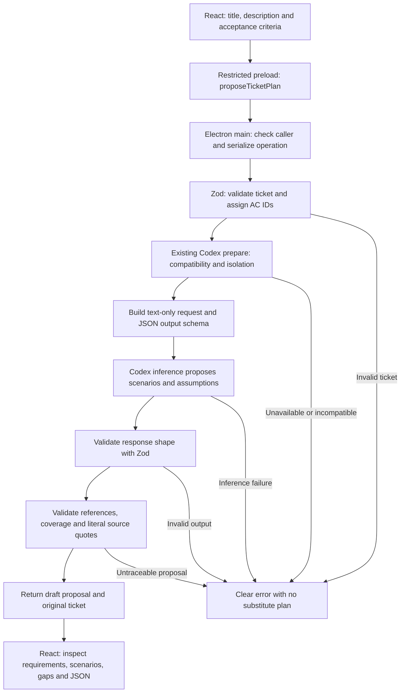

# Milestone 4.1: ticket understanding

M4.1 converts a natural-language QA ticket into a structured **draft proposal**. It does not approve a plan, open a target browser, run scenarios or produce PASS/FAIL execution results. The existing M1 capture, M2 observation and M3 controlled login scenarios remain available separately.

## Try it

```sh
npm run desktop
```

Scroll to **Ticket understanding · Milestone 4.1**. Enter a title, description and acceptance criteria, one criterion per line. Select **Propose test plan**. The existing Codex CLI must be installed, signed in, compatible with the adapter's isolation probes, and able to access the configured model. `QASPIDER_DESKTOP_PROVIDER=none` explicitly disables AI planning as well as observation. No new credential setup, SDK or provider is introduced.

The desktop displays original requirements, AI assessments and coverage gaps, AI assumptions, and linked scenarios with ordered steps and assertions. **Inspect structured draft JSON** exposes the validated proposal for inspection. There are no plan approval or execution controls. Editing any input clears the old proposal so it cannot be mistaken for a plan for the revised ticket.

The ticket is sent to the configured inference provider. Leave credentials out of tickets. The app keeps the current input/proposal in React memory, without a database, application memory, automatic report export or background planning. The optional verification script saves only its fixed public synthetic example.

## How the concepts fit together

A **ticket** is the change someone wants to validate. Its **acceptance criteria** are the supplied conditions that define acceptable behavior. QASpider retains those statements and assigns `AC-1`, `AC-2`, and so on in input order. These IDs are stable for the same input order, not persistent identities across edited tickets.

A **scenario** explores one criterion under one condition. **Steps** describe a tester's actions and expected intermediate outcomes. An **assertion** describes the final observation that would establish whether the scenario's expectation holds. At M4.1 these are descriptions, not runnable selectors or browser commands.

Positive tests check that the stated behavior works; this includes correctly rejecting an invalid registration when rejection is the requirement. Negative tests explore invalid inputs or forbidden behavior. Boundary tests explore relevant edges. Empty input is a meaningful edge for a required field, but a maximum length of 255 characters would be an invented rule unless the ticket states it.

An **assumption** is information the AI adds, such as the availability of an existing synthetic email account. It is not an acceptance criterion. Assumptions have `AS-1` IDs; affected scenarios reference them. All scenario prose is explicitly labeled AI interpretation. The original requirements remain separate and are reconstructed by Node from the supplied ticket, never from the model's echo of it.



## Reuse and the execution boundary

The existing `CodexProvider.prepare()` / `generate()` interface supplies text-only structured inference. Its CLI capability checks, disabled tools, isolated working directory, ephemeral authentication copy, timeouts, output limits, schema validation and cleanup are reused unchanged. The new planner sends no repository files, browser state, cookies, fixture credentials or previous reports. Ticket text is treated as untrusted task data; embedded instructions cannot grant browser or tool capabilities.

M3's small data-driven plans informed the proposal shape, but its executable schema is not reused for natural-language proposals. M3 requires specific navigation paths, approved fields, synthetic account references and fixture permissions. An M4.1 proposal instead contains descriptive steps and links to source criteria. Passing Zod validation does not grant execution permission. The new planner imports neither the browser service nor the scenario runner. Existing M3 IPC still accepts only its fixed controlled-scenario IDs.

The existing Electron IPC wrapper checks the exact local UI main frame and permits one active operation. Preload exposes only a named planning method; it does not expose Node or raw IPC. App shutdown waits for the active operation, including the adapter's bounded inference and cleanup. React renders model text as text, without HTML execution.

## Files, functions and interfaces

### `shared/ticket-plan.mjs`

This is the sole runtime ticket/plan validation implementation. It uses the already installed Zod; there are no new dependencies or licenses.

- `ticketInputSchema` accepts a strict title, description and 1–20 nonempty criteria. Field and collection size limits bound the request.
- `parseTicket(input)` validates and trims surrounding whitespace, then assigns criterion IDs while retaining the criterion wording and order. It does not extract new requirements from the description.
- `ticketDraftSchema` describes the model's response: assumptions, one assessment for each criterion, and scenarios. Every scenario has an ID, criterion ID, category, assumption references, preconditions, ordered descriptive steps and at least one assertion. Strict objects reject extra fields such as executable selectors.
- `ticketPlanSchema` adds Node-owned metadata (`version: 1`, `status: "draft"`, `proposalSource: "ai"`) and the original normalized ticket. The AI does not choose those fields.
- `validateTicketPlan(ticket, draft)` first performs Zod shape validation. It then checks unique scenario/assumption IDs, exactly one assessment per original criterion, valid criterion/assumption references, and truthful category coverage. A criterion marked testable requires a positive scenario. Ambiguous or unsupported criteria stay explicit gaps without scenarios. Each negative/boundary category either has scenarios and says `included`, or has an explanation for `not_applicable`/`unspecified`.

An assertion's `exactValue` and `sourceQuote` must either both be null, or both contain strings. A non-null exact value must occur literally in a source quote, and that quote must occur in the linked criterion or ticket description. Quoting another criterion does not satisfy that link. The final validator's return type is checked against the UI's `TicketPlan` contract by the desktop type check.

These checks establish shape, references and literal provenance, not semantic correctness. A model can still misunderstand a criterion, misclassify a boundary, or write an unsupported expectation in descriptive prose. The prompt prohibits those behaviors, while the UI marks the entire proposal as AI interpretation for human inspection. It never labels a proposal verified or executed.

### `electron/ticket-planner.mjs`

`ticketPlanningInstructions` requests positive, negative and relevant boundary scenarios; asks for clarification gaps; separates assumptions; prohibits invented messages, limits and executable details; and treats embedded ticket instructions as data.

`buildTicketRequest(ticket)` creates the existing adapter-compatible request: system instructions, one user text block containing the normalized ticket, an empty tools array, and a JSON Schema derived with `z.toJSONSchema(ticketDraftSchema)`. There is no hidden application context or browser state.

`TicketPlanner` receives a provider through its constructor. `propose(input)` performs these operations in order:

1. Validate the input before invoking the provider.
2. Require a configured provider and await `prepare()` before sending ticket context.
3. Call `generate()` once with the structured request. There is no repair loop or fallback scenario generator.
4. Validate the returned `structuredContent`, including cross-reference and source checks.
5. Return either `proposed` with a draft or a clear failure status without a plan.

Response statuses are `invalid-ticket`, `unavailable`, `invalid-output` and `proposed`. Raw CLI diagnostics, authentication details and malformed model output are not shown as UI error messages. Successful proposals include provider/model identity; synthetic test inference is explicitly marked.

### `electron/main.mjs` and `electron/preload.cjs`

Main creates `TicketPlanner` with the existing provider instance and registers `desktop:propose-ticket-plan` through the existing protected handler. Preload adds `proposeTicketPlan(ticket)`. This is the only new IPC method. The existing capture, observation, action and scenario handlers remain separate.

### `src/TicketPlanning.tsx`

`TicketInput` describes the request. `Coverage` describes whether a negative/boundary category is included and why. `TicketPlan` describes the validated draft; `TicketPlanResult` describes success and failure responses; `TicketBridge` describes the one preload method available to React. These are compile-time contracts, not an alternate runtime validator.

`TicketPlanning()` owns form state, busy state and the current response. Its `propose()` splits the criteria textarea into nonempty trimmed lines, calls preload, and displays the result. Input changes clear the old proposal; a failed request cannot silently retain a previous plan. Backend validation still rejects malformed or oversized IPC inputs even if a caller bypasses the form.

The rendered plan shows the original criterion beside its ID and AI assessment. Scenario cards link to those IDs and list assumptions, preconditions, steps, expected outcomes and assertions. Null exact values display **Unspecified in ticket**. Ambiguous/unsupported assessments and missing coverage remain visible. There are no approval or execution buttons.

### Other modified files

`src/main.tsx` mounts the planning section and extends the bridge type. `src/style.css` adds text wrapping, criterion styling and form spacing. `tsconfig.json` includes the shared JavaScript schema in the desktop's checked sources. Root and desktop `package.json` add only `desktop:verify-ticket` / `verify:ticket` scripts; no dependency installation is needed. READMEs link this walkthrough.

### Verification files

`tests/fixtures/ticket.mjs` provides explicitly synthetic input/output for tests only. It is not imported by the planner and is never a production fallback.

`tests/ticket-plan.test.mjs` checks valid input, multiple criteria, original wording, traceability, categories, assumptions, ambiguous/unsupported gaps, invalid references, invented messages, mismatched coverage, invalid structured output, missing providers and input-before-inference validation.

`tests/tickets.spec.mjs` uses the actual Codex CLI transport with a clearly synthetic loopback model endpoint to verify structured requests and rejection of invalid output. It also runs real Electron with no provider and checks the UI's unavailable/invalid-ticket responses. All M1–M3 smoke tests remain in the same suite.

`scripts/verify-ticket.mjs` is an explicit opt-in live check. It enters the public registration example in the real desktop, uses the existing Codex login, reads the generated JSON from the rendered UI, checks the plan and verifies it is displayed without approval/execution controls. It saves a separate public example receipt under `validation/desktop-m4.1-ticket.json` and a screenshot under ignored `test-results/desktop-live/m4.1-ticket.png`. It does not overwrite M2's original live-inference receipts. This command can consume provider quota:

```sh
npm run desktop:verify-ticket
```

## Checks and milestone boundary

The 2026-10-25 verification passed 55 desktop unit tests, 28 desktop smoke tests (including all 25 M1–M3 tests), both desktop/repository type checks, and 76 repository unit tests. The separate live desktop check produced seven scenarios for the public registration ticket, covered every criterion and all three scenario categories, displayed null exact values as unspecified, and requested no execution.

```sh
npm run desktop:test
npm run typecheck --workspace @qaspider/desktop
npm run desktop:smoke
npm run typecheck
npm test
```

The repository-required `npm run verify:provider` was run before and after introducing ticket context construction. It uses only synthetic loopback inference, preserves private wire/process/context receipts, and refreshes `validation/m2-isolation-recheck.json`. The desktop adapter additionally runs its own existing capability gate before ticket inference.

No LangGraph, persistent application memory, new browser framework, custom agent, plan approval or generated-plan execution was added. Further work requires a separately authorized milestone.

## Actual live input and generated output

The following is from the successful real desktop/Codex check at `2026-10-25T07:48:51.242Z`, not the synthetic response used by unit/smoke tests. Full input and output are saved in [the live receipt](../../validation/desktop-m4.1-ticket.json). Generated content can vary across runs.

```json
{
  "title": "Validate registration form",
  "description": "Check registration using an email address.",
  "acceptanceCriteria": [
    "Email is required.",
    "Duplicate email addresses must be rejected.",
    "Valid registration should succeed."
  ]
}
```

Node retained these exact three criteria as AC-1, AC-2 and AC-3. Codex proposed:

| Scenario | Criterion | Category | Generated title |
| --- | --- | --- | --- |
| S-1 | AC-1 | positive | A supplied email satisfies the required-field check |
| S-2 | AC-1 | negative | Reject submission with email omitted |
| S-3 | AC-1 | boundary | Required validation applies after email is cleared |
| S-4 | AC-2 | positive | Reject an email already registered |
| S-5 | AC-2 | negative | Different registration details do not bypass duplicate rejection |
| S-6 | AC-3 | positive | Complete registration with valid data |
| S-7 | AC-3 | negative | An incomplete registration does not report success |

The response explicitly treated availability of a registration form, valid synthetic data, an existing account and a way to inspect success as AI-generated assumptions AS-1 through AS-3. It marked duplicate-email equivalence boundaries as unspecified instead of inventing case/whitespace/alias rules. Its success scenario contained:

```json
{
  "id": "S-6",
  "criterionId": "AC-3",
  "category": "positive",
  "title": "Complete registration with valid data",
  "assumptionIds": ["AS-1", "AS-2", "AS-3"],
  "preconditions": [
    "The registration form is open.",
    "A complete valid registration fixture with an unused email is available.",
    "The registration success outcome can be observed."
  ],
  "steps": [
    {
      "instruction": "Complete all mandatory registration fields with valid data.",
      "expectedOutcome": "The form contains a complete valid registration."
    },
    {
      "instruction": "Submit registration.",
      "expectedOutcome": "Registration succeeds."
    },
    {
      "instruction": "Review the observable registration outcome.",
      "expectedOutcome": "The outcome confirms successful registration of the new account."
    }
  ],
  "assertions": [
    {
      "kind": "behavior",
      "description": "Valid registration creates the intended account and produces an observable success outcome; exact wording and destination remain unspecified.",
      "exactValue": null,
      "sourceQuote": null
    }
  ]
}
```

No step above was executed. For conceptual planning, unspecified exact messages/URLs do not make a clear success requirement ambiguous: it can have a proposed behavior assertion. By contrast, `Registration should be fast` without a measurable threshold stays a clarification gap. The model's interpretation and assumptions still need human inspection; Zod validation is not evidence that the application works.
