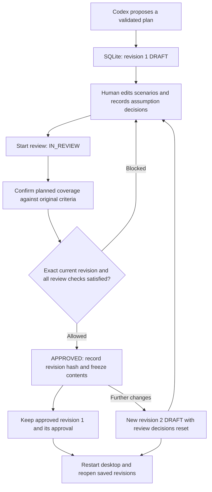

# Milestone 4.2: local test-plan review and approval

The ticket-planning workspace now saves generated plans locally and lets you edit scenarios, resolve assumptions, review planned coverage and approve an exact revision. It never executes a ticket plan. Plan approval does not grant any Stagehand or browser permission.

## Use it

```sh
npm run desktop
```

Generate a proposal in the existing ticket-planning section. It is saved as **revision 1, DRAFT**. Saved plans are listed in that same section; the most recently generated plan is reopened on startup.

1. Select **Edit S-…** to change a scenario's title, ordered steps, intermediate expected outcomes and final assertion descriptions. Add/remove steps as needed, then save or cancel. Only one scenario editor is open at a time. Saving edits returns the revision to DRAFT and clears the affected criterion's coverage confirmation.
2. Remove irrelevant scenarios with **Remove S-…**. Original criteria are never removed. The app shows removed scenario IDs and any resulting criterion gaps.
3. Confirm or reject each AI assumption with a review note. Every assumption referenced by a retained scenario is treated as behavior-affecting and blocking until confirmed. Rejected assumptions remain blockers. Unreferenced assumptions are still displayed and audited, but do not block retained scenarios.
4. Select **Start review** to enter IN_REVIEW. Review the original criteria alongside the retained scenarios, then confirm each criterion's planned coverage with a note explaining why its steps/assertions address the requirement.
5. **Approve Plan** becomes available only when those checks pass. Approval records the exact revision and content hash. Approved content and decisions become read-only.
6. To change an approved plan, select **Create new DRAFT revision**. This preserves the previous approved revision, copies its retained scenarios and human edits into the next revision, and resets assumption/coverage decisions for a fresh review. Save the new changes and review again.
7. Use **Saved revision** to inspect earlier versions. Historical versions are read-only. The approval history and review audit history remain in the same workspace.

Editing the ticket's title, description or acceptance-criteria input fields starts a separate proposal; it never rewrites a saved plan's source ticket. A changed or clarified requirement should be generated as a new proposal. Existing saved plans remain available in the list.

## Revisions, expectations and coverage

A revision is a numbered plan version. Draft edits update the current working revision, with a version counter and audit event for every save. Approval freezes that version's content. Further changes require a new revision number; the previous approval stays attached only to its original revision.

For a registration ticket, `Duplicate email addresses must be rejected` supports a rejection scenario. It does not establish the literal error message, email normalization rules or availability of an existing synthetic account. Human review checks the scenario's reasoning and its AI assumptions. Exact source-quoted assertions remain tied to the original ticket; the reviewer can edit conceptual assertion descriptions without silently changing ticket quotes.

Coverage is calculated from the **original criteria**, not scenario count or keyword mentions:

- **Proposed:** a retained, schema-valid scenario links to the criterion and has steps plus at least one nonempty assertion. Multiple scenarios for AC-1 count as one criterion with proposals.
- **Reviewed planned coverage:** the reviewer explicitly confirms that criterion with a note, at least one linked scenario remains, and all its referenced assumptions are confirmed.
- **Gap:** no retained scenario links to the criterion. An old AI assessment saying coverage was included cannot hide a removal.
- **Executed:** always **Not executed**, zero criteria verified by execution in M4.2. Approval and planned coverage cannot become PASS or executed coverage.

Removing the only AC-3 success scenario therefore creates an AC-3 gap. A different scenario mentioning “registration” does not cover it. Structural links and human confirmation support review; they do not prove the application works.



## Files and important functions

### `shared/plan-review.mjs`

`reviewContentSchema` reuses M4.1's scenario schema and adds bounded assumption decisions and criterion confirmations. Confirmed/rejected assumptions require notes; confirmed coverage requires a note.

`initialReview(original)` copies the generated scenarios and creates unresolved assumption decisions and unconfirmed criterion decisions. It is also used when forking an approved plan so approval cannot be inherited.

`validateReviewContent(original, input)` validates current review content. Retained scenarios must come from the original plan and keep their IDs, criterion links, categories, assumption references, preconditions and literal ticket quotes. Titles, steps, expected outcomes and assertion descriptions can change. Original criteria and assumptions cannot be replaced. Unlike generation validation, draft review permits scenario removal and coverage gaps; approval checks them separately.

`plannedCoverage(original, content)` derives per-criterion scenario IDs, proposal/review/gap state, blocking assumptions and the constant NOT_EXECUTED state. It does not trust generation-time coverage claims.

`approvalIssues(original, content)` lists missing scenario coverage, missing human confirmations and unresolved/rejected referenced assumptions. The same server-side checks drive UI blockers and approval enforcement.

### `electron/plan-store.mjs`

`PlanStore` is a small desktop SQLite repository. The existing `SqliteTestingRepository` was inspected but depends on the older application/environment/navigation/execution model, so it is not imported. The new store directly reuses `assertNoSymlinks()` and `privateDirectory()` from `packages/storage/src/filesystem.ts`. The installed Electron Node runtime supports that TypeScript utility import and built-in `node:sqlite`; both were verified locally. No new dependency or native-addon rebuild is required. Some Node 24 CLI builds print an experimental SQLite warning; the installed Electron runtime and automated checks successfully use the API.

The constructor opens the database, checks its schema version, enables foreign keys and a bounded busy timeout, and creates four scoped tables. The directory is private (0700) and the database is 0600 on supported file systems. Existing symlinks in the path or SQLite sidecars are rejected. Unknown schema versions fail closed rather than resetting saved data.

`atomic(operation)` uses BEGIN IMMEDIATE / COMMIT / ROLLBACK. Revision edits, approval records and audit events commit together. A failed validation or stale request leaves the saved revision unchanged.

`revisionHash(original, number, content)` uses canonical JSON with sorted object keys and SHA-256. It includes the original proposal, revision number and current scenarios/decisions. Approval is bound to that hash, not just a plan title. Each mutable save also advances the revision's version counter for optimistic concurrency.

`create(input)` reuses `ticketPlanSchema` and `validateTicketPlan()` to validate the generated proposal, stores the immutable original, initializes DRAFT revision 1 and records a generation event.

`list()` returns up to 100 recent plan summaries. `get(planId, revision?)` loads either a selected revision or the latest one, validates its review data, recomputes its hash and checks matching approval metadata for APPROVED revisions. It returns original source, current content, coverage, blockers, revision choices, approvals and audit history. Corruption/load errors are reported without discarding or overwriting the database.

`mutate(input)` validates a strict action and checks the latest revision number and version inside a transaction:

| Action | Behavior |
| --- | --- |
| `edit-scenario` | Save bounded title, steps/expected outcomes and assertion descriptions; preserve source references; clear affected coverage confirmation; return to DRAFT |
| `remove-scenario` | Retain original source for audit, remove the scenario from current content, clear affected confirmation and return to DRAFT |
| `assumption` | Save decision and note; clear confirmations for affected criteria and return to DRAFT |
| `start-review` | DRAFT → IN_REVIEW |
| `criterion` | Save a human coverage confirmation/note only in IN_REVIEW and only when its scenario/assumption prerequisites hold |
| `approve` | Require IN_REVIEW, the exact current hash/version, and no approval issues; atomically record approval and freeze the revision |
| `fork` | Require the latest revision to be APPROVED; create the next DRAFT with retained edited scenarios, reset decisions and no inherited approval |

Attempts to edit a historical or approved revision directly are rejected. SQLite triggers also reject updates/deletes to approved revision rows and updates to original proposal rows. `event()` appends the action and hash/state details to the audit history. `close()` releases the database handle during Electron shutdown.

### Database records

| Table | Important fields and purpose |
| --- | --- |
| `desktop_plans` | UUID `id`, immutable `original_json` containing original ticket/AI proposal, `created_at` |
| `desktop_plan_revisions` | `(plan_id, number)` key, optimistic `version`, lifecycle `status`, `content_json` with retained scenarios and review decisions, `hash`, creation/update times |
| `desktop_plan_approvals` | Approval UUID, exact plan/revision/hash, `approved_at`, `reviewer`; one approval per revision |
| `desktop_plan_events` | Ordered ID, plan/revision, action `type`, action/hash/status details, timestamp |

Assumption and criterion decisions live inside versioned `content_json` and are also recorded as audit events. They are not cross-ticket memories or reusable permission grants. `reviewer: local-user` identifies the local desktop action, not a separately authenticated reviewer identity. Timestamps are UTC ISO strings.

By default the file is `desktop-plans.sqlite` inside Electron's userData directory. `QASPIDER_DESKTOP_DATA_DIR` is a Node-side directory override used for isolated tests and walkthroughs; it is never accepted from the renderer. The file contains ticket and plan text, so the existing UI asks users to keep credentials out of tickets. No browser cookies, fixture passwords, provider auth or raw model transport is stored in these tables.

### Electron IPC

`electron/main.mjs` lazily creates the store. A successfully generated M4.1 proposal is saved before the UI receives its review snapshot; a save failure never claims a reviewable revision was created.

The existing protected IPC handler still validates the exact local UI frame and serializes operations. New `desktop:list-plans`, `desktop:get-plan` and `desktop:review-plan` channels expose only scoped store methods. `reviewReply()` converts persistence/validation failures into a safe error reply. The app closes the store on `will-quit`, after any active operation finishes. No planner/provider prompt or browser permission changes were necessary.

`electron/preload.cjs` exposes `listPlans()`, `getPlan(request)` and `reviewPlan(request)`, without raw database, file-path or arbitrary IPC access.

### React and interfaces

`src/review-types.ts` defines the renderer contracts: `ReviewContent`, `ReviewSnapshot`, `ReviewAction`, `ReviewReply`, `SavedPlan` and `ReviewBridge`. The request references plan ID, revision and version; approval additionally includes the hash.

`src/TicketPlanning.tsx` retains generation in the same section and loads saved plans on mount. `refreshPlans()` refreshes the saved list, and `openPlan()` retrieves a revision and its original ticket. A new proposal clears the visible previous result while it is generated. Input edits never modify saved source records. Successful generation sets the returned review snapshot. Storage errors are visible rather than silently replacing existing data.

`src/PlanReview.tsx` provides review in that workspace:

- `PlanReview()` renders state/hash, revision selector, coverage, original criteria, blockers, assumptions, scenarios and approval/audit history. Its `mutate()` sends the current revision/version and displays the returned authoritative snapshot.
- `ScenarioEditor()` edits one scenario locally until Save or Cancel. Saving is blocked if values fail backend validation. Other review actions are disabled while an editor is open.
- `AssumptionDecision()` edits a decision and note, showing the saved decision separately from unsaved input.
- `CriterionDecision()` collects a human coverage note and confirmation. No missing scenario or rejected assumption can be overridden by this button.

Values different from the original AI proposal are labeled **Human-edited** per title, step, expected outcome and assertion description. Unchanged values are labeled AI-generated. Restoring an original value displays it as unchanged, while the edit remains in the audit history. Original criteria are shown both in the coverage section and beside their linked scenarios.

The scenario-proposal JSON view is explicitly not an approval record. A separate **Inspect validated revision and approval data** view includes actual review contents, revision/version/hash, decisions and approval history. `src/style.css` adds compact review controls and wrapping for hashes and notes; there is no separate Review Center or approval dialog.

## Tests and demonstration

`tests/plan-review.test.mjs` covers scenario editing/removal, source preservation, proposed-versus-reviewed coverage, critical assumption decisions, exact-hash approval, immutable approved rows, approval invalidation through revision creation, edits during review, stale requests, missing assertions, and reopening persisted approved/draft revisions.

`tests/reviews.spec.mjs` uses real Electron with a separate temporary database. It seeds an explicitly synthetic validated proposal, edits it through React/IPC, resolves an assumption, confirms coverage, approves revision 1, creates/edits revision 2, restarts Electron, and verifies both saved versions and the matching approval hash. All earlier smoke tests remain in the suite. `playwright.config.ts` assigns isolated temporary plan storage so regression runs do not touch user plans.

```sh
npm run desktop:test
npm run typecheck --workspace @qaspider/desktop
npm run desktop:smoke
npm run typecheck
npm test
```

For the full real-Codex walkthrough:

```sh
npm run desktop:verify-review
```

`scripts/verify-review.mjs` uses only the public synthetic registration example and the existing Codex login. It generates a plan, edits a scenario title and expected outcome, records synthetic review decisions, approves revision 1, creates/edits revision 2, restarts Electron and retrieves both versions. It asserts that approved content/hash and original criteria are preserved, revision 2 has no inherited approval, and every criterion remains NOT_EXECUTED.

The script's review clicks are an automated walkthrough, not claims that someone verified a real registration fixture. It retains its isolated private database under ignored `.qaspider/desktop-m42-live/`, saves screenshots under `test-results/desktop-live/`, and writes a separate synthetic demonstration receipt to `validation/desktop-m4.2-review.json`. It does not overwrite M4.1's original live generation receipt.

M4.2 stops here: no generated ticket execution, browser authorization through approval, LangGraph, cross-ticket memory or autonomous orchestration is implemented. Further milestones require user approval.

## Captured results and screenshots

Verification on 2026-10-25 passed **64 desktop unit tests**, **29 desktop smoke tests** (including all 28 M1–M4.1 regressions), **76 repository unit tests**, and both desktop/repository type checks. The full review UI was also rechecked after the final label/status refinements.

The live walkthrough completed at `2026-10-25T14:37:46.623Z` using real Codex inference for the public registration ticket. It generated seven scenarios, then performed synthetic review clicks through the real React → preload → IPC → SQLite path. [The receipt](../../validation/desktop-m4.2-review.json) records the actual results:

| Walkthrough step | Actual result |
| --- | --- |
| Generate registration proposal | Seven scenarios saved as revision 1 DRAFT; all three original criteria retained |
| Edit scenario and expected outcome | First title became `Reject registration without an email (human reviewed)`; edited fields displayed Human-edited |
| Resolve assumptions | Review notes saved; referenced assumptions confirmed for this synthetic review demonstration |
| Review and approve revision 1 | All three criteria showed reviewed planned coverage; revision 1 APPROVED with hash `0af69dd10ab8ff34be42f03828eb14442305c250dd508768ed3e39c3da322001` |
| Change approved plan | Created revision 2 DRAFT, then changed its first title to `Reject registration without an email (human reviewed) — revised` |
| Approval invalidation | Revision 2 had no inherited approval and hash `ee9d173b5cd9666a80ecdb0894c6358a2ce62f0b561bf7cac915a841af376a68`; review confirmations were reset |
| Restart desktop | Latest revision 2 reopened as DRAFT; selected revision 1 reopened as APPROVED with its original content, decisions, hash and approval unchanged |
| Executed coverage | NOT_EXECUTED for all three criteria in both revisions; no browser execution requested |

Screenshots from the walkthrough and persisted revisions:

- [Revision 1 approved](../../test-results/desktop-live/m4.2-approved.png)
- [Revision 2 DRAFT requiring review again](../../test-results/desktop-live/m4.2-draft2.png)
- [Approved revision 1 retrieved after restart](../../test-results/desktop-live/m4.2-reopened1.png)

The private database is retained at the receipt's `privateDatabase` location. To reopen that demonstration manually, set `QASPIDER_DESKTOP_DATA_DIR` to its **directory**, then run `npm run desktop`. Normal launches use Electron userData and do not automatically import this isolated demonstration database. Screenshots are ignored local artifacts; rerunning `desktop:verify-review` produces a new private demonstration database and refreshes its separate receipt/screenshots.
