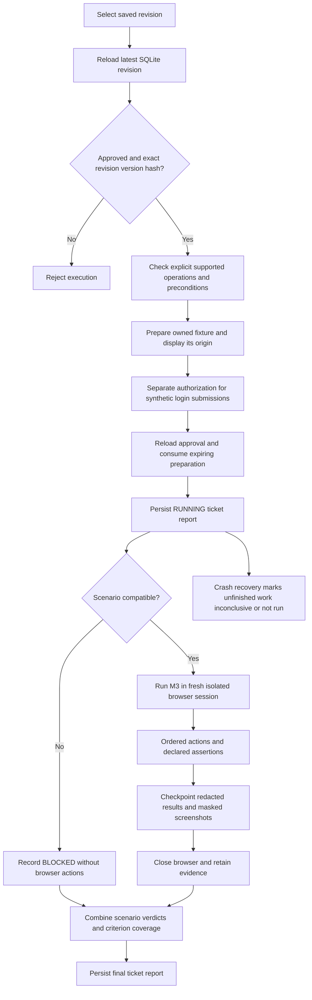

# Milestone 4.3 — approved test-plan execution

M4.3 executes an exact approved revision through the existing M3 runner and Stagehand sessions. Execution stays in the existing ticket workspace. It adds no browser engine, model-driven action inference, agents, cross-ticket memory, workflow system or worker scheduling.

The current M3 runner supports only the owned controlled **login** fixture. Registration prose cannot safely become login commands. Unsupported scenarios remain BLOCKED; configuration requirements cannot be satisfied by checking an approval box. Supporting another application requires an explicitly authorized later change.

## Learn the path

SQLite stores the immutable original ticket/proposal, numbered plan revisions, review decisions and approval rows. `PlanStore.get()` validates the revision and recomputes SHA-256 over canonical original proposal + revision number + reviewed content. Its approval row must contain that same hash. The request also carries the current version counter. Execution reloads the **latest** revision both during preparation and immediately before browser work. A newer DRAFT makes an old approved revision stale for execution, while preserving it for inspection. Edits require a new revision and renewed review.

Approval answers “Do these scenarios and expectations represent this ticket?” Browser authorization answers “May the runner fill and submit these synthetic credentials at this specific owned origin?” Neither one implies the other.

For a registration ticket with “Email is required”, “Duplicate email addresses must be rejected”, and “Valid registration should succeed”, approval may establish good planned coverage. It still provides no registration URL, selector, existing synthetic email, password or success destination. The existing registration fixture assumption has no supported binding; its prose steps/assertions are unsupported. Preparation displays these problems. Executing that approved registration revision records BLOCKED scenarios, zero verified criteria, and a non-PASS ticket report. It never runs the login fixture as a substitute.



## Use the workspace

1. Run `npm run desktop`. Open a saved plan in ticket planning.
2. Use a DRAFT revision to supply explicit supported instructions and assertions; review/approve the exact expectations. Existing approvals are never rewritten by compatibility checks.
3. Select **Prepare approved execution**. Review every scenario's EXECUTABLE, CONFIGURATION_REQUIRED or UNSUPPORTED classification. Check the environment, actual permitted origin, fixture availability and synthetic credential availability.
4. Separately authorize synthetic credential fills and submissions at that origin, then select **Execute Approved Plan**. The preparation is single-use and expires after five minutes. Preparation starts a fixture server, but no browser actions.
5. Watch persisted scenario progress, verdicts, expected/observed results, assertion counts, screenshot references and ticket coverage in that same workspace. Saved reports reopen after restart. Repeat executions create separate reports; they never merge unrelated attempts into a PASS.

The original ticket schema has no external ticket-key field. The saved plan UUID serves as the ticket identifier; an external key such as `QA-43` can be included in the title. No requirement is inferred from that identifier.

## Explicit mapping, without guessing

Instructions use JSON matching existing M3 navigation/fill/click schemas. Expected outcomes for navigation and click are explicit M3 assertions. Fill outcomes must be exactly `[REDACTED]`: this is an operation receipt, not proof of the business requirement. Final assertions are still required. Their descriptions contain explicit assertion JSON, with a matching outer kind (`url`, `text`, or `visibility`). Conceptual `behavior` assertions remain unsupported. Literal source-quoted values cannot conflict with the executable expectation.

A complete supported success scenario has these approved values:

| Field | Approved value |
| --- | --- |
| Step 1 instruction | `{"kind":"navigate","path":"/login"}` |
| Step 1 expected outcome | `{"kind":"url","expected":"/login"}` |
| Step 2 instruction | `{"kind":"fill","selector":"#username","account":"valid","field":"username"}` |
| Step 2 expected outcome | `[REDACTED]` |
| Step 3 instruction | `{"kind":"fill","selector":"#password","account":"valid","field":"password"}` |
| Step 3 expected outcome | `[REDACTED]` |
| Step 4 instruction | `{"kind":"click","selector":"#sign-in"}` |
| Step 4 expected outcome | `{"kind":"url","expected":"/dashboard"}` |
| Final assertion kind | `url` |
| Final assertion description | `{"kind":"url","expected":"/dashboard"}` |

Other supported checks are `{"kind":"visible","selector":"#dashboard","expected":true}` and text assertions such as `{"kind":"text","selector":"#login-status","expected":"Signed in successfully"}`. Only `#dashboard`, `#login-status`, and `#login-error` are supported assertion selectors. URL expectations are paths within the prepared origin. Only the `valid` and `invalid` Node-side synthetic account aliases are available; raw credentials are not accepted as commands.

The only recognized preconditions are `Owned controlled login fixture` and `Synthetic valid and invalid accounts`. Other preconditions require verified configuration and block the entire affected scenario. There is no free-text “confirm everything” bypass. The compatibility layer never edits a revision, substitutes a canned scenario for its steps, or calls an AI model. A scenario with any unsupported part executes no browser operations; its reasons remain visible in the report.

The existing M3 policy still checks the live page before each action: owned fixture capability, authorization, origin, exact login URL, unique visible enabled element, credential-field identity, and form destination/submission attributes. Commands use Stagehand page methods. Existing Playwright/CDP controls enforce origin scope and provide assertion reads and masked screenshots. Each scenario calls the existing `openBrowserSession()` and closes its own browser; no session reuse was added.

## Scenario lifecycle and report meaning

Before browser work the report is durable with every scenario NOT RUN. A scenario gets a start time, RUNNING status and a compatibility decision. Supported scenarios execute ordered operations and intermediate/final assertions. Each completed operation checkpoints structured observations and screenshots to SQLite. Screenshots are taken on navigation, clicks and assertions, with form controls masked; fill values are redacted. A failed or blocked step stops the scenario; remaining operations are NOT RUN. Other ticket scenarios can still execute in their own sessions.

PASS requires completed steps, executed assertions, retained evidence and successful browser cleanup. Successful fills/clicks alone cannot satisfy it. FAIL means a declared assertion was observed to be false before its deadline. BLOCKED means a policy or compatibility/configuration restriction prevented execution. INCONCLUSIVE means an operation, observation, screenshot or completion could not be verified. NOT RUN identifies work never attempted.

An observed FAIL survives screenshot, checkpoint and cleanup problems. Cleanup errors are still reported. Ordinary errors stop safely, retain earlier evidence and leave later work NOT RUN. Checkpoints precede further browser operations, so a failed evidence write prevents continued execution. If persistence itself remains unavailable the IPC response is an error; the UI cannot claim a saved final report.

On reopening SQLite, any report left RUNNING by a crashed process is finalized as INCONCLUSIVE, or FAIL if a failure had already been recorded. Its active scenario is marked interrupted, untouched scenarios stay NOT RUN, and saved screenshots remain. Graceful Electron quit continues to wait for the bounded active operation and cleanup as before; this milestone does not add a resumable browser session or a cancellation scheduler.

Each original acceptance criterion retains its planned coverage and linked scenario IDs. The report separately records which scenarios reached assertions and whether **every retained scenario** for that criterion completed PASS. A partially attempted criterion can have executed assertions while remaining unverified. Ticket PASS requires all original criteria to be verified and the whole execution to complete. Any failed scenario makes the ticket FAIL; blocked, interrupted, missing or inconclusive coverage prevents PASS. The unchanged review snapshot describes planned coverage only; execution results live in revision-specific ticket reports.

## Changed files and why

| File | Important behavior |
| --- | --- |
| `electron/plan-compatibility.mjs` | Parses only explicit approved operations/expectations using exported M3 schemas; validates final assertion kinds/source values, assertion selector/origin limits, preconditions and scenario sequence; returns per-step classification without mutating approved content. |
| `electron/approved-execution.mjs` | `requireApproved()` reloads exact latest approved data; `prepare()` binds an expiring single-use fixture capability; `execute()` revalidates approval/origin/authorization, runs only retained approved scenarios through M3, checkpoints results and consolidates criterion coverage. Defensive completion checks reject evidence-free PASS receipts. |
| `electron/scenario-runner.mjs` | Exports existing command schemas for reuse; permits bounded expanded assertions (40 operations maximum); records scenario timestamps and step checkpoints; marks untouched steps NOT RUN; preserves FAIL through evidence and cleanup failures. The browser engine and isolation implementation are unchanged. |
| `electron/plan-store.mjs` | Adds `desktop_plan_executions` alongside existing approval tables, with report JSON containing masked screenshots and exact revision/approval data. `saveExecution()` checkpoints one attempt; `executions()` retrieves up to 20 recent reports for a revision. Startup recovery prevents abandoned RUNNING attempts from claiming PASS. Existing private-directory, SQLite path/symlink protections and database permissions also protect evidence. |
| `electron/main.mjs` | Adds protected prepare/execute/report IPC; mutation/execution operations retain existing serialization and frame validation. Read-only report polling is permitted during execution. Shutdown also closes a prepared fixture. |
| `electron/preload.cjs` | Exposes only scoped `preparePlan`, `executePlan`, and `planReports` methods; no raw SQL, arbitrary path, browser command or IPC surface. |
| `src/ApprovedExecution.tsx` | In-workspace format guidance, preparation/compatibility/origin display, separate authorization, Execute Approved Plan, progress polling, report history, screenshots and failure/coverage details. |
| `src/execution-types.ts` | Renderer contracts for exact identity, preparation, compatibility, persisted reports and bridge methods. |
| `src/review-types.ts` | Extends the existing review bridge with the execution bridge. |
| `src/PlanReview.tsx` | Embeds execution in the existing ticket workspace and distinguishes planned review coverage from revision-specific execution coverage. |
| `src/TicketPlanning.tsx` | Updates milestone labels and describes the authorized execution path without changing proposal/provider behavior. |
| `tests/fixtures/approved-plan.mjs` | Explicit synthetic login proposal plus review/approval helpers. This fixture is authored test data, not a claim of live AI generation or a registration implementation. |
| `tests/approved-execution.test.mjs` | Exact approval/hash/staleness, renewed approval, integrity, compatibility/configuration, authorization, origin/replay/expiry, unsupported blocking, failures, redaction, missing completion evidence, interrupted execution and SQLite crash recovery. Unit runner receipts are explicitly synthetic. |
| `tests/approved-execution.spec.mjs` | Real Stagehand isolation and masked screenshot tests, FAIL preservation with screenshot/cleanup errors, and a complete real Electron → preload → IPC → SQLite → M3 browser run with restart retrieval. |
| `tests/reviews.spec.mjs` | Keeps the earlier approval/fork/restart regression and checks that execution stays disabled without separate preparation/authorization. |
| `package.json`, desktop `package.json` | Add `npm run desktop:verify-execution` / `verify:execution` for the focused repeatable walkthrough. No dependency changes. |
| `tsconfig.build.json` | Includes desktop TSX entry files just as repository typecheck already does. Fixes the pre-existing build omission that made the desktop global Window bridge declaration unavailable to imported components. |
| `validation/desktop-m4.3-execution.json` | Actual synthetic-fixture walkthrough receipt, exact approved original/content/approval/hash, per-scenario expected/observed evidence and screenshot paths. |
| `validation/m2-isolation-recheck.json` | Refreshed required synthetic provider isolation receipt manifest; private wire and process/sanitization receipts remain under ignored `.qaspider/provider-validation/`. |
| `MILESTONE-4.3.md` | This learning walkthrough and repeatable verification instructions. |

Reports and evidence are local in the existing `desktop-plans.sqlite`, not an external service or browser profile. The additive table retains the supported database schema version; existing M4.2 data opens without resetting approvals. During active work, a 1-second read-only UI poll displays saved state and does not schedule browser work. The bounded report-history view returns the latest 20 attempts per revision; older attempts remain stored. Known fixture secrets are recursively redacted before persistence/IPC; arbitrary external credentials are unsupported, and tickets should still contain no secrets.

## Real execution and verification

Run the focused walkthrough with:

```sh
npm run desktop:verify-execution
```

It seeds an explicitly synthetic reviewed proposal, records approval via the real store, executes through the real Electron UI and M3/Stagehand browsers, then restarts Electron to retrieve the identical report and screenshots. No model is needed for exact execution. The fixture approval/review clicks in tests are automated synthetic demonstration actions, not a claim of manual approval of a real application.

The latest captured run on **25 October 2026, 20:38:10–20:38:16 IST** used approved **revision 1** of ticket-plan `450f6f4b-4988-4675-b8ca-d8ccc7344c96`:

```text
688b3ec08b3552117f521b8bf118b8920538992e77171b8ca11a4422e292d4fe
```

[The exact approved revision and actual execution receipt](../../validation/desktop-m4.3-execution.json) contain all approved instructions, outcomes, final assertions, review decisions and the matching approval row. The real execution produced:

| Scenario | Result | Assertions executed | Saved screenshots |
| --- | --- | --- | --- |
| S-1 — valid credentials | PASS | 5 | 7 |
| S-2 — invalid credentials rejected | PASS | 5 | 7 |
| S-3 — deliberately wrong dashboard assertion after invalid login | FAIL | 3 | 5 |
| Ticket | **FAIL** | AC-1 and AC-2 verified; AC-3 remains unverified | 19 total |

S-3's approved final assertion expected `/dashboard`; the observed URL was `/login?error=invalid`. The report retains both exact origin-qualified URLs and the failed assertion screenshot. It does not reinterpret a successful sign-in-button click as successful login.

- [Preparation and compatibility](../../test-results/desktop-live/m4.3/prepared.png)
- [Consolidated desktop report](../../test-results/desktop-live/m4.3/ticket-report.png)
- [Successful dashboard evidence](../../test-results/desktop-live/m4.3/S-1-step-9.png)
- [Deliberately failing assertion evidence, with inputs masked](../../test-results/desktop-live/m4.3/S-3-step-7.png)

The retained private SQLite path is recorded in the receipt. To inspect this exact run manually, set `QASPIDER_DESKTOP_DATA_DIR` to that database's directory and run `npm run desktop`. Normal launches continue to use Electron userData. Screenshot files are ignored local artifacts, while the redacted receipt is reviewable in `validation/`. Rerunning the walkthrough retains a new private database and refreshes this separate receipt/screenshots. Its dynamic loopback origin belongs only to that run; preparing another run creates and authorizes a new origin.

Verification passed **76 desktop unit tests**, **32 desktop smoke tests** (all earlier regressions plus three new browser tests), **76 repository tests**, desktop/repository type checks, builds and the synthetic provider isolation check before/after execution changes. After the final completion/expiry and active-work-only polling refinements, all 76 desktop unit tests and the three focused real-browser tests passed again. Provider checks use loopback synthetic endpoints; no real application context is sent to a model.

```sh
npm run desktop:test
npm run typecheck --workspace @qaspider/desktop
npm run desktop:smoke
npm run desktop:verify-execution
npm run typecheck
npm test
npm run verify:provider
```

M4.3 stops here. The next milestone requires explicit user approval. The learning questions are asked in chat one at a time, starting with the difference between plan approval and browser-action authorization.
