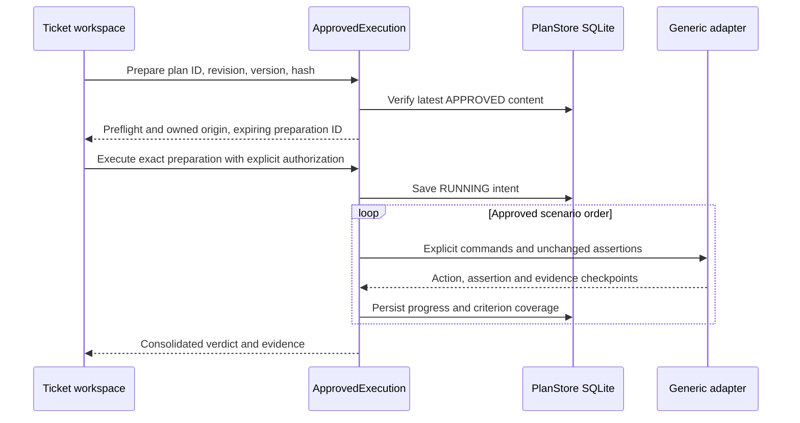
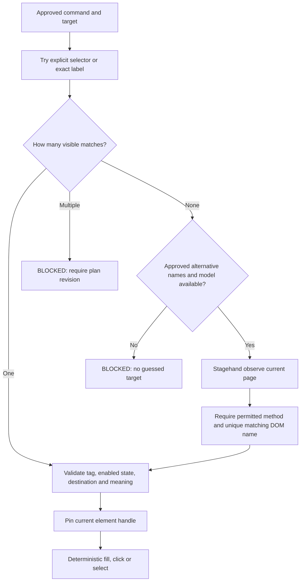
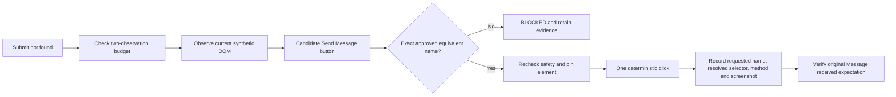
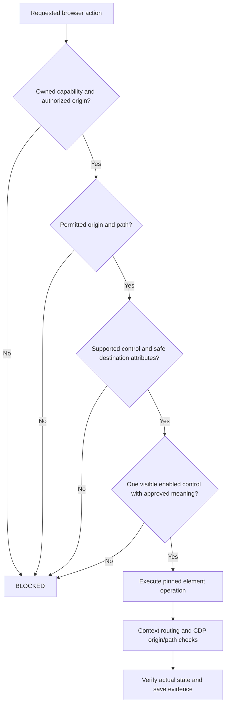
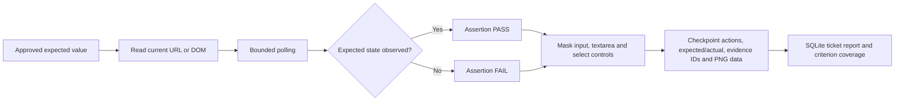
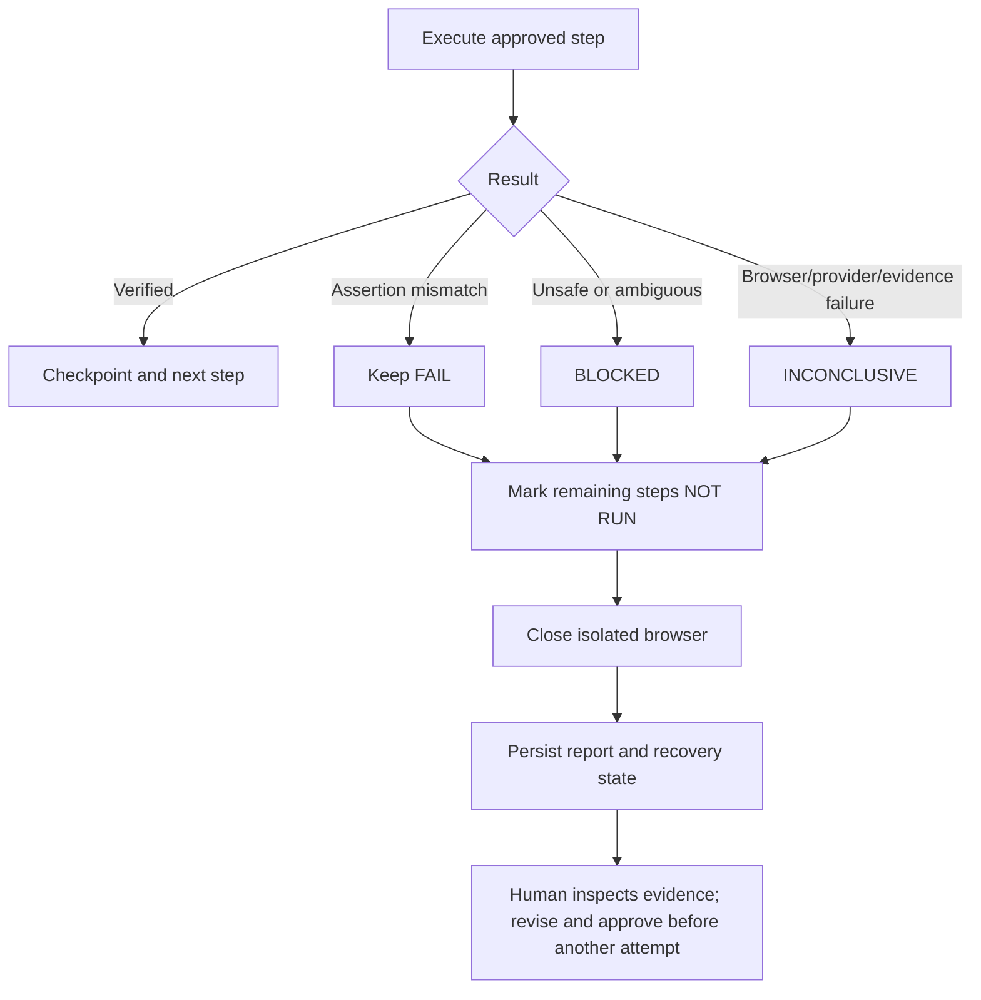

# Milestone 5 — Generic QA execution

## Phase 0: inspected approach (before implementation)

The old compatibility checker accepts only `/login`, two credential selectors and three assertion selectors. The M3 runner also checks `login-form`, POST `/login`, and waits for a login-specific redirect. The execution coordinator always creates an owned login fixture. These restrictions make an approved registration plan impossible to execute.

| Responsibility | Decision | Reason |
| --- | --- | --- |
| Browser launch, isolated profile, origin interception | Reuse browser.mjs | Stagehand and Playwright already provide browser control |
| Observation | Reuse Stagehand 4.3 observe | It understands unfamiliar DOM structures |
| Actions | Reuse deterministic locator methods | No unrestricted natural-language act or agent execution |
| Approval hashes, revisions, SQLite reports | Reuse unchanged | Approval remains bound to exact content |
| Legacy M3 scenario suite | Keep unchanged | Preserve original login regression coverage |
| Typed commands, target validation, bounded adaptation | Build small adapter | These are QA authorization rules |
| Assertion verdicts and screenshots | Extend existing report shape | Real DOM measurements establish results |
| Controlled registration and contact applications | Build local fixtures | Real mutations require a trusted test environment |

Installed Stagehand 4.3.0 `dist/index.d.mts` exposes `observe(instruction, {page,cache,timeout})` and `act(string | Action, options)`. The installed `index.mjs` forwards these to RPC; it does not offer an application-specific authorization callback. Existing browser.mjs sets `selfHeal:false`. The adapter will use observe proposals and deterministic actions only. The public API cannot prove business safety from labels. Consequently execution stays limited to owned synthetic applications, with explicit origin authorization; arbitrary external application mutation remains blocked.

```mermaid
flowchart LR
  Review[Reviewed revision and hash] --> Preflight[Parse explicit operations and expectations]
  Preflight --> Permission[One-use owned origin approval]
  Permission --> Adapter[Generic sequential adapter]
  Adapter --> Discovery[Stagehand observation when needed]
  Discovery --> Gate[Validate unique target and approved meaning]
  Gate --> Browser[Existing browser locator methods]
  Browser --> Assert[Measure actual DOM and URL]
  Assert --> Store[Existing SQLite report and ticket UI]
```

A command names what to do. An assertion names what must be true afterward. Stagehand can help find the button; it cannot decide that an unexpected confirmation message is the correct business result. Adaptation will accept only names explicitly allowed in the approved target, and will never change assertions. Missing information stops execution.

Implementation order: add typed adapter and controlled applications; wire exact-plan preflight and UI; exercise real browsers and negative cases; complete walkthrough and verification receipts. No additional dependencies or milestones are planned.

## How to follow the implementation

Start in `electron/approved-execution.mjs`. The desktop asks it to prepare an exact approved revision. It checks plan identity, opens the owned test server, and returns a five-minute, one-use preparation capability. The checkbox authorizes synthetic changes at that exact origin. Execution checks the revision again, checks the preparation's environment and origin, saves an execution intent, then runs scenarios sequentially. Each scenario starts a fresh Chromium process. Nothing about one scenario's cookies or local storage is reused by another.

### M5.1: operations and target resolution

`electron/generic-execution.mjs` is the adapter. It accepts a bounded plan with an ID, name and at most 40 steps. Commands are NAVIGATE, OBSERVE, FILL, CLICK, SELECT, ASSERT_VISIBLE, ASSERT_TEXT, ASSERT_URL, ASSERT_ENABLED and CAPTURE_EVIDENCE. Compiled final assertions also use `{kind:"assert", assertion:{...}}`. Unknown properties and operations are rejected by strict Zod schemas. FILL requires an explicit value, including an explicitly empty value when a test intends one. SELECT requires an existing unique native option value. Nothing generates missing data.

Targets may use an explicit selector, an exact accessible label, or a role with an exact name. An input can therefore be located by `{"label":"Email"}` on a contact page and by `{"label":"Email address"}` on a registration page. The adapter has no registration/contact/login selector branching. Its only legacy translation binds already-declared valid/invalid synthetic accounts to the existing credential constants.

Stagehand supplies intelligence about where a control is in a previously unfamiliar document. QASpider supplies the approved operation, input, permissible equivalent names, URL policy, action budget, assertion and verdict. The adapter never calls `agent`, unrestricted `act`, AI JavaScript, shell or SQL. Static DOM inspection callbacks are application code; model output is never evaluated as code. Proposal arguments are not used to supply values. CLICK proposals must have no arguments; FILL and SELECT use the approved plan's value.

### M5.2: bounded adaptation and safety

Consider an approved Submit button whose permitted alternatives include Send Message. On `/contact-changed`, the direct exact-name search finds nothing. One Stagehand observation may propose the actual button. QASpider checks its method, resolves its selector against the current main page, requires exactly one visible target and verifies its real accessible/text name against the approved names. It checks policy again and pins the element before executing. A proposal for Delete account, a hidden control or two equally valid buttons cannot pass. An observation alone grants no permission.

Approval is requested before execution through the existing ticket workspace checkbox. The main process binds it to an exact prepared origin, environment, revision and hash. No interactive approval wizard is needed: changes outside that scope are denied and require a revised plan or a separately implemented trusted environment binding. Test plan approval and browser authorization remain separate concepts.

The default bound is 40 compiled operations, two observation calls, 15 seconds per observation, four seconds per action, 1.5 seconds per assertion, five seconds per screenshot, and 90 seconds for a scenario. Expiring a scenario closes its browser; no browser action is retried as a recovery strategy. The existing provider has its own process deadline, and the coordinator aborts inference when the runner finishes. Browser startup retains its existing 20-second navigation timeout. Cleanup and startup can add time beyond the scenario deadline; this is not a hard real-time process supervisor.

### M5.3: assertions, evidence and verdicts

Assertions read actual browser state through Playwright. URL checks compare complete resolved URLs; text checks compare trimmed visible element text; `present:false` checks that a declared text is absent; visibility checks can require true or false; enabled checks read the real enabled state of one control. Form-validation messages are ordinary text assertions on a declared message element. Arbitrary business predicates that cannot be represented this way remain unsupported and block preflight. No business outcome is generated during execution.

PASS requires every compiled step to pass, at least one actual assertion, screenshot evidence and successful browser closure. A failed assertion stays FAIL even if screenshots, persistence or cleanup later fail. BLOCKED means permission, ownership, compatibility or target validation prevented execution. INCONCLUSIVE means a browser, provider, timeout or evidence failure prevented verification. NOT RUN records each remaining operation after the first stopping result. The consolidated ticket cannot pass while any mandatory criterion remains unverified.

## Major files and their contracts

| File | Why it exists and caller | Input → output | Failures, storage and testing |
| --- | --- | --- | --- |
| `electron/generic-execution.mjs` (new) | Generic runner called by ApprovedExecution; exports schemas, URL checks, target resolution and measurements | Explicit plan + owned fixture + authorization + browser options → M3-shaped report with adaptations | Strict parsing, bounded calls, early stop, pinned controls, fresh browser, redacted checkpoints; no own database. Unit contracts and real-browser negative tests cover it |
| `electron/plan-compatibility.mjs` (modified) | Preflight called during preparation and execution | Immutable approved snapshot → per-scenario checks and explicit compiled plan | Legacy schemas tried first to preserve M3 compatibility; generic schemas support new commands; unsupported prose, conflicting assertion kinds/values and unverified preconditions block execution. No inference, no storage. Approval tests and generic preflight tests |
| `electron/approved-execution.mjs` (modified) | Coordinator called by main-process IPC | Revision identity, then prepared identity + authorized exact environment/origin → consolidated report | Revalidates approval, preserves scenario order, persists intent and progress using existing PlanStore. Redacts generic fill values even in embedded approved snapshots. Checks PASS evidence; closes fixture; aborts provider inference. Unit and Electron persistence tests |
| `electron/browser.mjs` (modified) | Existing Stagehand session service called by capture, M2, M3 and M5 | URL + existing options + optional internal request policy → session and close function | Optional policy is installed before navigation; context routes cover popups/subframes, WebSockets are closed, CDP checks each request origin/path. Violations prevent M5 PASS. No change to default M1–M3 behavior. Browser regressions and M5 redirect tests |
| `electron/controlled-fixture.mjs` (modified) | Server lifetime capability called by coordinator and tests | No renderer URL → owned object, origin, immutable permitted paths and close | WeakSet ownership cannot be forged by renderer input. Removes ownership on close. Adds application paths and empty favicon. Ownership and origin-denial tests |
| `demo/qa-apps.mjs` (new) | Registration/contact request handler called by demo server | Controlled GET request/response → local HTML and synthetic in-page form results | Registration uses main/form/labels/select; contact uses sections/fieldset/output; changed variation changes hierarchy and button name. No external services, real accounts or persistent submissions. Positive/negative browser tests |
| `demo/server.mjs` (modified) | Existing local fixture HTTP server | Requests → original login flow or new synthetic apps | Preserves CSP, synthetic account validation and login cookies; empty favicon response. Existing login regressions remain required |
| `electron/main.mjs` (modified) | Existing Electron entry point | Authenticated local IPC → coordinator with existing provider | Reuses frame validation, one active execution, shutdown cleanup and isolated provider gate. No new IPC channels or remote settings. Electron smoke tests |
| `src/ApprovedExecution.tsx` (modified) | Existing ticket review workspace renders this section | Approved snapshot, preparation and persisted reports → preflight, authorization, polled progress, actions, adaptations, screenshots and report JSON | Displays request failures and durable progress. Documents generic JSON examples. No separate Review Center. Electron prepares, executes and reloads evidence |
| `src/execution-types.ts` (modified) | Renderer/bridge TypeScript contracts | Environment, report action and adaptation records | Adds owned QA environment and resolved/adaptation fields; checked by desktop typecheck |
| `tests/fixtures/generic-plan.mjs` (new) | Shared explicit synthetic plan builders | Declared operations → approved-plan fixture data | No AI generation or guessed expected results. Feeds integration and Electron tests |
| `tests/generic-execution.test.mjs` (new) | Unit contract coverage | Explicit invalid/valid command samples → assertions | Covers ownership, schema, path denial, ambiguity, unavailable provider and unchanged expectations |
| `tests/generic-execution.spec.mjs` (new) | Real Stagehand Chromium and Electron integration | Owned applications and explicitly approved plans → receipts/PNGs | Covers registration/contact successes and negative cases, deliberate FAIL, changed-label synthetic observer, sensitive links, redirect, missing browser, report persistence, credential masking and UI reload |
| `scripts/verify-generic-live.mjs` (new) | Explicit live validation, run manually | Existing isolated Codex provider + synthetic changed-label application → live receipt | Counts real model calls; no mock fallback. Writes `validation/desktop-m5-live.json` and ignored PNGs; nonzero exit on unsuccessful adaptation |
| `validation/desktop-m5-browser.json`, `validation/desktop-m5-live.json` (new) | Inspectable verification receipts | Real test reports → timestamped sanitized metadata | Browser record explicitly distinguishes synthetic observation from live inference. PNGs and SQLite remain in ignored private artifact directories |
| `validation/m2-isolation-recheck.json` (updated by required verifier) | Existing provider gate manifest | Synthetic baseline and post-change verifier → hashes | Raw wire requests and process receipts remain private under `.qaspider/provider-validation/`; no saved receipt bypasses runtime isolation |

Unchanged modules include PlanStore, plan review/revision hashing, ticket schemas/planning, the M3 scenario suite, action-policy for the standalone observation workspace, provider implementation, Electron preload and existing IPC channel names. No dependency was added; no license review was necessary beyond the existing dependency inventory.

## Controlled validation and limits

Registration covers empty fields, duplicate synthetic email rejection, successful registration and a native select. Contact covers empty fields, invalid email, a successful synthetic submission and a deliberately incorrect success assertion. The changed contact page has a different wrapper hierarchy and Send Message button. The same adapter executes all three pages. A synthetic proposal test checks adaptation deterministically; a separate live run must establish the real observation behavior.

Screenshots mask form controls. Generic values are redacted from action results, adaptation metadata, checkpoints and embedded approved-plan snapshots before execution reports are stored. The original approved revision stays unchanged in the existing local plan store: it must contain the exact reviewed input. Do not enter production credentials. Redaction replaces known input literals; it is not a detector for arbitrary secrets reflected elsewhere in an untrusted app, encoded values, unknown tokens or sensitive screenshot text. The controlled pages do not reflect submitted input values.

This milestone deliberately does **not** authorize arbitrary production websites. The owned WeakSet capability and immutable path list are the restricted alternative to an API-level business-safety guarantee that Stagehand cannot provide. All enabled mutations affect synthetic local test applications. The fixture's path list is trusted application configuration; it is not obtained from DOM text or the model. The adapter rejects file uploads, contenteditable controls, downloads, new-window/form overrides, cross-origin destinations, unknown commands and unverified preconditions. It supports native controls; shadow/iframe/custom widgets requiring new execution methods remain unsupported.

The browser controls are application request restrictions, not an OS/network sandbox. Chromium internal traffic, service-worker lifecycle, WebRTC, native browser bugs and DNS/network attacks are not proven contained by public Stagehand APIs. The owned fixtures use no workers, embedded remote content or real backend mutations. Context/CDP routing is tested for navigation and sensitive path denial, but this does not prove arbitrary hostile-page containment. Production-site authorization and a hardened network/process sandbox are outside M5. Blocking unavailable providers cannot be interpreted as a successful test. No automatic retry or expectation rewrite repairs an unexpected business result.

## Learning walkthrough

1. Open the ticket workspace and review the JSON example. Create or revise an explicit plan; describe the business result in the ticket and keep that result in the approved assertions.
2. For registration validation, declare NAVIGATE `/registration`, CLICK the Create account button, and expect text `Name and email are required` at `#result`. The empty submission is intentional; no invented name/email is filled.
3. Preflight parses these commands without launching actions. Unknown preconditions or prose block the scenario. Approval still binds to the exact revision hash.
4. Prepare execution, inspect the local origin, and authorize synthetic test changes. This permission is one-use and expires after five minutes.
5. During execution, watch saved scenario progress. Inspect expected versus actual values and resolved action targets. Each scenario uses a separate browser.
6. For the changed contact test, explicitly allow `Send Message` as a Submit alternative in the approved target. The live receipt shows Stagehand observation; the adapter verifies the actual button and then performs the click. The expected `Message received` text stays unchanged.
7. Try an intentionally wrong expected message. The assertion is FAIL, later actions are NOT RUN, and the ticket cannot pass. Inspect its screenshot and report rather than rewriting the expectation during execution.
8. Close and reopen the desktop. SQLite restores the report and screenshots. A browser or process failure produces interrupted/inconclusive state with retained evidence, never an unsupported PASS.

Reproduce with `npm run desktop:test`, `npm run desktop:smoke`, `npm run typecheck --workspace @qaspider/desktop`, `npm run typecheck`, `npm test`, and `npm run verify:provider`. Real model validation is explicitly `node apps/desktop/scripts/verify-generic-live.mjs`; it uses only the owned synthetic changed-label application and the existing provider. It is not part of the deterministic regression suite.

## Completion report

M5.1 introduces the generic typed adapter and replaces the default login-only execution runner. It reuses Stagehand launch/observation and Playwright locator operations, leaving the legacy login suite intact. M5.2 adds at most two observations, explicitly approved equivalent names, rechecked control semantics and destinations, pinned element actions, bounded deadlines and adaptation evidence. M5.3 adds generic DOM assertions, masked evidence, report redaction, exact revision/criterion reporting and existing-workspace progress, resolved targets and adaptation history.

No dependency, agent framework, browser driver, navigation graph, cloud service, scheduler or application memory system was added. The major-file table above is the complete implementation walkthrough; README links here. Historical M4 receipts are not used as proof of current M5 behavior.

Live evidence is in `validation/desktop-m5-live.json`: real Stagehand 4.3 browser, existing isolated Codex provider, one real model generation, one Submit → Send Message adaptation, PASS after measuring Message received, and a closed browser. The live receipt explicitly sets `liveModelInference:true` and `provider.synthetic:false`. Its masked screenshot references point into `test-results/desktop-live/m5/`.

Deterministic browser evidence is in `validation/desktop-m5-browser.json`. It explicitly declares synthetic observation proposals for adaptation/budget cases, with actual Chromium operations and DOM measurements. Successful registration/contact runs are PASS; deliberately wrong business expectations stay FAIL; permission and ambiguity cases are BLOCKED; missing browsers/redirect failures are INCONCLUSIVE; stopped operations are NOT RUN. This distinction is essential: a synthetic observer tests the gate but does not demonstrate model intelligence.

Desktop screenshots:

- `test-results/desktop-live/m5/desktop-preflight.png`: compatibility results and prepared owned QA environment.
- `test-results/desktop-live/m5/desktop-report.png`: consolidated PASS, approved hash and two verified criteria.
- `test-results/desktop-live/m5/live-4.png`: evidence for the real adapted click.
- `test-results/desktop-live/m5/live-5.png`: the original expected result verified after adaptation.

Browser reports also retain masked screenshots for deliberate failures. The Electron test closes/reopens the app and verifies the restored report and an actual screenshot image. These generated PNGs and test SQLite databases are intentionally ignored rather than committed. They are available in the working environment.

Recommendation: approve M5 for the owned synthetic test environments and supported native-control/assertion vocabulary. Do not interpret this as approval for arbitrary production mutations or a hostile-page security sandbox. The limits described above are unresolved boundaries, not features claimed complete. Stop at M5; persistent cross-ticket knowledge and further orchestration remain unstarted.

Final verification: **83 desktop unit tests, 76 repository tests and 42 real-browser/Electron tests passed**. Desktop and repository typechecks passed. Desktop and repository builds passed. Required synthetic provider isolation verification passed both before and after the browser-policy work; the post-change receipt confirms zero tools, process timeout/cancellation exits and sanitized context. `git diff --check` passed. Aggregate metadata is stored in `validation/desktop-m5-verification.json`.

The 22 recorded M5 browser scenarios contain 8 PASS, 2 deliberate FAIL, 9 BLOCKED and 3 INCONCLUSIVE outcomes. These are successful checks of expected verdict behavior, not 22 passing QA scenarios. The separate live inference scenario is PASS. Initial development failures (legacy parsing and favicon scope) were corrected and the complete 42-test suite reran successfully. The restricted sandbox could not bind loopback servers, so fixture/browser verification ran with the required execution permission.

## Final M5 acceptance verification — 10/10

The final audit reran **44 browser/Electron tests, 83 desktop unit tests, 76 repository tests and both typechecks**, all passing. Two additional real-browser tests close the evidence gaps between an intentionally incorrect assertion and an actual injected product defect, and between returning adaptation metadata and retaining it across a SQLite restart. Runtime implementation was unchanged during this audit.

| Check | Result | Evidence |
| --- | --- | --- |
| Two structurally different applications use the same generic adapter | VERIFIED | Registration/contact cases both call runGenericScenario; adapter has no application-specific selector branches |
| Stagehand discovers unfamiliar controls without fixture-specific selectors | VERIFIED | Refreshed live model receipt supplies a discovered XPath for the changed contact button; approved target has no selector |
| Safe operational UI changes can be handled and recorded | VERIFIED | Submit → explicitly approved Send Message; unique actual DOM name and method verified, adaptation linked to screenshot |
| Consequential actions cannot bypass authorization | VERIFIED within owned test scope | Explicit owned capability and authorization, exact prepared origin/environment/revision and one-use expiry; forged/unauthorized requests rejected |
| Actual browser assertions determine PASS or FAIL | VERIFIED | DOM text, URL, visibility and enabled measurements; wrong observations fail independently of model output |
| A deliberate product failure remains FAIL with evidence | VERIFIED | New test injects Delivery failed into the valid contact submission; approved Message received expectation unchanged; ticket FAIL, screenshot and report survive SQLite restart |
| Unsupported steps and missing provider states are reported accurately | VERIFIED | Unknown commands and required-but-unavailable adaptation BLOCKED; browser failure INCONCLUSIVE; later operations NOT RUN |
| Approved plan revision and original expectations remain immutable | VERIFIED | Entire saved snapshot compared before/after execution and restart in both new tests; stale hashes/tampered content rejected by existing unit cases |
| Screenshots, adaptation history and consolidated reports are retained | VERIFIED | New adaptation test reopens SQLite and compares complete report, adaptation/evidence link and approved snapshot; existing Electron reload verifies screenshots |
| Previous desktop tests pass and a live Stagehand run is demonstrated | VERIFIED | 44 browser/Electron + 83 desktop + 76 root tests pass; refreshed live receipt has one real model call, one adaptation and PASS |

Machine-readable audit: `validation/desktop-m5-final-checklist.json`. Fresh live receipt: `validation/desktop-m5-live.json`. Product-defect screenshot: `test-results/desktop-live/m5/product-defect.png`. Additional full report exports: `test-results/desktop-live/m5/product-defect-report.json` and `test-results/desktop-live/m5/adaptation-persistence-report.json`. These exports omit inline PNG bytes; SQLite retains them, and the product screenshot is exported separately.

“Safe” here means the enabled owned synthetic application scope. Alternative meanings must be explicitly approved. This audit does not establish arbitrary production-site authorization or full hostile-page containment. M5 is ready for final approval within that scope; later milestones remain unstarted.
