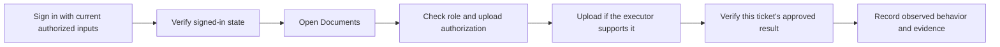
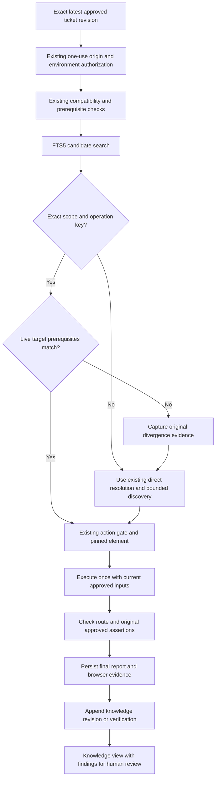
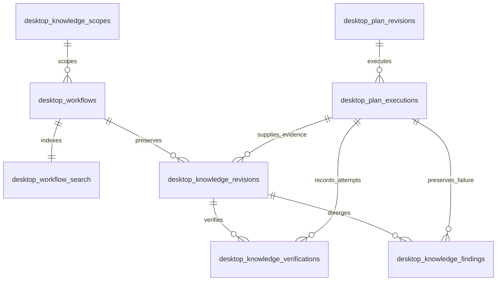
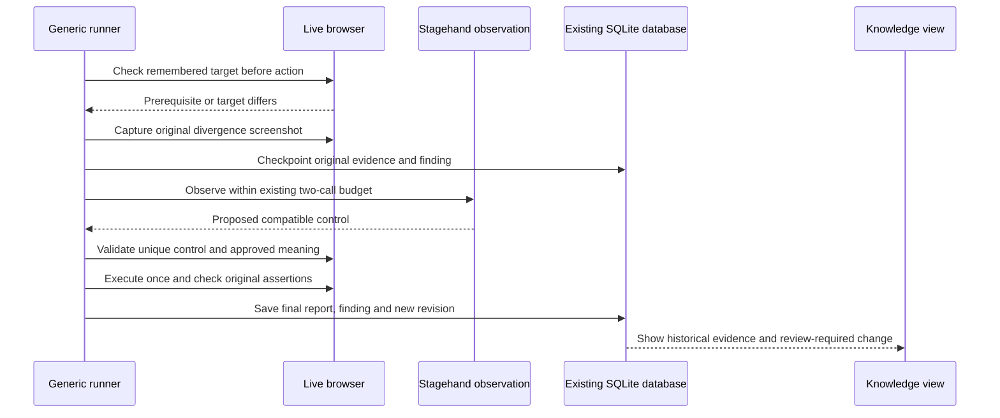

# Milestone 6 — Persistent application intelligence

M6 adds evidence-backed operational workflows to the existing desktop SQLite database. Approved ticket execution can retrieve compatible knowledge, check live prerequisites, replay deterministic operations and retain unexpected changes for human review. Stagehand 4.3 still performs unfamiliar-page discovery. Existing approval, action authorization, browser isolation, assertions and evidence remain responsible for execution safety and verdicts.

## What application knowledge means

Imagine two tickets that both need to sign in, open Documents and upload a synthetic document. Ticket A discovers the navigation and verifies it. Ticket B can use that verified navigation, provided it belongs to the same project, environment, application and role. Ticket B still supplies its own authorized inputs and approved expected results.

Chat history records what someone said. A cached action remembers a selector or an inference result. Application knowledge records an operation together with its scope, prerequisites, observed browser state, verification history, execution evidence and revisions. An observation alone is only a candidate.

A QA editor may see Upload while a viewer cannot. Production and QA may have different navigation or data. Reusing a QA editor's knowledge for a production viewer would be incorrect, even if the ticket descriptions sound similar. Scope is an eligibility condition, not a ranking preference.



This login-to-upload example explains the model. M6 preserves M5's supported operations: file upload remains unsupported. The executable demonstration uses registration and synthetic contact forms, including a button that needs Stagehand discovery. No upload engine, general memory framework or production execution capability was added.

## Architecture review: reuse M1–M5

| Existing module | Responsibility retained |
| --- | --- |
| M1 `electron/browser.mjs` | Launch Stagehand/Chromium, limit requests and clean up isolated sessions |
| M2 `electron/codex-provider.mjs` | Text-only structured inference through the existing isolated Codex CLI adapter |
| M3 `scenario-runner.mjs`, `scenarios.mjs` | Original controlled-login suite, redaction and evidence conventions |
| M4.1 `ticket-planner.mjs`, shared ticket schemas | Ticket interpretation and proposal validation |
| M4.2 `plan-store.mjs`, `shared/plan-review.mjs` | SQLite plans, immutable approvals, numbered revisions and hashes |
| M4.3 `approved-execution.mjs`, `plan-compatibility.mjs` | Exact approved execution, prerequisite compilation, durable reports and coverage |
| M5 `generic-execution.mjs` | Bounded observations, deterministic operations, live target gates, assertions and screenshots |
| Existing React cards and preload/IPC checks | Consistent desktop presentation and main-process access checks |

The older CLI has `packages/storage/src/learning.ts` and governed navigation-graph learning tables. Desktop M1–M5 intentionally do not own that graph. M6 therefore extends the desktop's **existing** `desktop-plans.sqlite` connection rather than importing an unrelated graph repository or creating another database. There are no new dependencies.

## Follow one execution



The coordinator chooses scope from its trusted fixture binding. Renderer requests cannot choose a project, role, application or arbitrary origin. Current scope values are:

- Project: `qaspider-controlled`.
- Environment: the existing authorized `owned-login-fixture` or `owned-qa-fixtures` binding.
- Role: `synthetic-tester`.
- Application: `owned-qa-apps-v1`.

Random loopback ports identify each authorized execution, not a new application identity. Only the trusted owned-fixture binding permits the stable scope to span ports and restarts. This does not establish a configuration system for external applications or additional roles. Changing any of the four fields rejects retrieval; browser authorization is still checked separately.

## SQLite relationships

`PlanStore` uses Node 24's existing `node:sqlite` connection. Opening a version 0 or 1 database adds the knowledge tables in a transaction and advances `user_version` to 2. Existing plans and reports stay in place. An unsupported future version fails closed. FTS5 must be available; there is no unscoped fallback search.



| Record | What it stores |
| --- | --- |
| `desktop_knowledge_scopes` | Unique project/environment/role/application tuple |
| `desktop_workflows` | Scope reference, operation fingerprint and short workflow description |
| `desktop_workflow_search` | FTS5 index over path, workflow description and operation names |
| `desktop_knowledge_revisions` | Number, VERIFIED/CANDIDATE status, ordered step records, source execution/scenario and timestamp |
| `desktop_knowledge_verifications` | Which revision was exercised, execution/scenario, outcome, reused count and measured metrics |
| `desktop_knowledge_findings` | Original revision, divergent step, execution/scenario, original screenshot reference and review reason |

Each `steps_json` array contains individual numbered step records: operation kind, resolved selector when applicable, before-state path and target fingerprint, after-state path and evidence ID. Workflows are bounded to 40 compiled operations. A small ordered JSON array avoids another copy of the existing execution-step schema; SQL relationships remain at the workflow/revision/verification level.

An execution row already references the ticket's plan ID and approved revision. Its report contains scenario IDs and screenshot IDs. Knowledge links to those records instead of copying PNG data, ticket requirements or reports. SQL foreign keys protect execution references; `KnowledgeStore.record()` checks scenario and screenshot membership in the saved report.

Revisions, verifications and findings have database triggers rejecting UPDATE and DELETE. Successful reuse adds a verification instead of rewriting the revision. A failed attempt adds a candidate revision. A recovered operational change adds a new verified revision while keeping the earlier evidence and finding. A latest candidate cannot fall back to an older verified revision.

## Search and compatibility

FTS5 is SQLite's text-search index. For example, searching `contact-changed` finds indexed contact workflows without scanning every report. `searchTerms()` turns bounded text into quoted literal tokens and binds the MATCH expression as a SQL parameter; search input cannot become SQL or an arbitrary FTS operator expression.

Automatic execution search uses the approved initial route. FTS only supplies candidates. `find()` additionally requires exact project, environment, role, application and operation fingerprint; latest revision must be VERIFIED and have no finding against it.

`operationKey()` normalizes the existing plan schemas and hashes the ordered operation structures, declared targets, alternatives and assertions. It excludes ticket ID, title and fill literals. Values always come from the current approved ticket; no input is replayed from knowledge. The matching policy is deliberately conservative: a different approved assertion or operation order requires new verification rather than borrowing a similar workflow. Titles and semantic similarity grant no execution permission.

Before replaying a remembered target, the runner checks:

1. The operation number and kind agree.
2. The current route matches the recorded prerequisite.
3. The selector resolves to one visible control.
4. A SHA-256 fingerprint of tag, input type, enabled/read-only state, destination attributes and names agrees.
5. The existing action gate rechecks ownership, authorization, origin, unique enabled state, approved names and safe destinations, then pins the current element.

The fingerprint contains no field values. A remembered selector is still untrusted execution input until the normal gate accepts it. After the operation, the current route must match the recorded post-state. Existing compiled assertions between operations also run normally. A remembered workflow never skips an explicit OBSERVE command or an assertion required by the approved plan.

## Observed behavior and approved expectations

Observed behavior says what the browser actually did. An approved expectation says what the product must do. These are stored and handled separately.

For example, an approved contact ticket expects `Message received`. If the page actually displays `Delivery failed`, the report retains both values and the screenshot, returns FAIL and records a finding against the remembered workflow. The knowledge revision is CANDIDATE. The original ticket, approval hash and expected text remain unchanged.

A workflow is VERIFIED only after a completed, uninterrupted attempt has a passing scenario and result, every compiled step passes with evidence, at least one actual assertion executes, every learned step has its own evidence reference, and the browser closes successfully. The source report must be durably saved and match a real approved revision and scope. An isolated Stagehand observation cannot meet these conditions.

Inputs, raw credentials, provider prompts, CLI output and screenshots are absent from knowledge tables. Only current authorized plan inputs reach actions. Known fill literals are also checked before storing operational records. Existing execution-report redaction, private database permissions, symlink checks and masked screenshots remain in effect. The approved source plan still contains its exact reviewed inputs as before; the supported applications use synthetic data.

## Unexpected changes and revisions



The regression test changes the known contact button from **Send Message** to **Send request** on the same route. Both names were explicitly allowed in the approved operation. Its live fingerprint changes. Before any replacement action or observation, the runner saves a separate `step-divergence` screenshot. It then uses the existing Stagehand observation budget and validates the proposed selector against the real DOM and original approved names.

If a changed operation declares only a selector and no approved control meaning, execution is BLOCKED before adaptation or action; an old selector cannot authorize a changed control. When a labeled operation has an approved compatible meaning and the unchanged business assertion passes, revision 2 becomes VERIFIED. Revision 1 and its original successful execution remain intact, and the finding remains visible even though execution recovered. A business failure creates a CANDIDATE instead. Post-action route changes stop execution; they never trigger another click. Action errors stop execution without retry. If original divergence evidence cannot be captured, execution stops rather than proceeding with an unrecorded repair.

Knowledge recording is transactional and follows the final execution save. A crash between those two saves can leave an execution with no new knowledge, which is safe: it does not promote partial observations. Existing restart recovery marks unfinished browser runs inconclusive. M6 does not automatically rerun them or synthesize missing evidence.

## Important files and functions

| File | Important entry points and purpose |
| --- | --- |
| `electron/knowledge.sql` | Small additive schema, FTS5 index and existing execution foreign keys |
| `electron/knowledge.mjs` | `fixtureKnowledgeScope()` binds trusted application scope; `operationKey()` fingerprints compatibility; `KnowledgeStore.find()` retrieves eligible knowledge; `record()` validates persisted evidence and appends history; `list()` supplies inspection data |
| `electron/plan-store.mjs` | Opens the existing private SQLite database, installs M6 transactionally and exposes `store.knowledge` |
| `electron/approved-execution.mjs` | Retrieves knowledge only after exact approval and authorization checks; passes it to the runner; records knowledge after durable completed reports; surfaces recording failures in the saved scenario |
| `electron/generic-execution.mjs` | Live prerequisite fingerprints, deterministic replay, original divergence capture, bounded discovery, unchanged assertions and measured reuse/discovery metrics |
| `electron/codex-provider.mjs` | `cliUsage()` parses numeric `turn.completed` counters and attaches supported response usage; prompts, CLI flags, context construction and isolation policy are unchanged |
| `electron/main.mjs`, `preload.cjs` | Read-only knowledge search and evidence lookup, retaining existing desktop-frame validation and serialization |
| `src/Knowledge.tsx`, `src/main.tsx`, `src/style.css` | Searchable workflow cards, applicability, status, revisions, findings, verification metrics and linked original screenshots in the existing desktop style |
| `tests/fixtures/knowledge-plan.mjs` | Explicit reviewed synthetic scenarios shared by the tests and benchmark |
| `tests/knowledge.test.mjs` | Token accounting, missing counters and operation compatibility contracts |
| `tests/knowledge.spec.mjs` | Real Chromium and Electron tests for learning, reuse, restart, scope, evidence history, business failure and UI inspection |
| `scripts/benchmark-knowledge.mjs` | Three real inference comparisons, changed-UI detection and preserved business FAIL; no mock fallback |

## Stagehand caching versus QASpider knowledge

The installed Stagehand 4.3 declarations (`node_modules/@browserbasehq/stagehand/dist/index.d.mts`, `CachingSchema`, `CacheMetadataSchema`, `ActionSchema`) expose caching for act/observe/extract, optional hit-count thresholds, cache-hit metadata and token savings. `observe()` supplies action objects that can be replayed deterministically. Those existing capabilities already solve browser discovery and repeated action/inference work; M6 does not reimplement them.

QASpider adds the QA application relationships: trusted project/environment/role applicability, exact approved operation compatibility, execution evidence, operational verification, durable revisions and visible unexpected changes. These relationships cannot be inferred merely from a cached selector being returned. Business assertions remain owned by approved tickets.

The existing desktop browser has `cache:false` and `selfHeal:false`; observations also use `cache:false`. The benchmark therefore measures QASpider's cross-ticket knowledge reuse with Stagehand's inference cache disabled. It does not establish that QASpider is faster than Stagehand caching or compare two competing caching implementations.

## Measured benchmark

Run from the repository root:

```sh
npm run benchmark:knowledge --workspace @qaspider/desktop
```

Requires the existing authenticated, isolation-compatible Codex CLI and Chromium. It uses only owned synthetic QA pages. Isolation probes are synthetic and must pass before real page inference. There is no substitute model or synthetic observation fallback in this script.

The final receipt is `validation/desktop-m6-benchmark.json`. Three serial samples use identical contact commands, inputs and approved assertions on the same controlled page. Each cold comparison disables knowledge reading while keeping the same evidence/persistence instrumentation. Ticket A learns in a separate database; Ticket B executes after closing and reopening it. The unrelated registration scenario runs in every pair as well.

| Mean over 3 samples | Without memory | Ticket A, learning | Ticket B after restart |
| --- | ---: | ---: | ---: |
| Real AI calls, contact scenario | 1 | 1 | 0 |
| CLI-reported total tokens, contact scenario | 10,686.33 | 10,686.33 | 0 |
| Browser discovery time | 8,416.40 ms | 5,825.60 ms | 0 ms |
| Reused operations | 0 | 0 | 3 |
| Total two-scenario wall time | 10,661.52 ms | 8,407.60 ms | 1,957.29 ms |
| Ticket outcome | PASS | PASS | PASS |

These measurements show fewer discovery calls and lower measured time for this eligible repeated workflow. Three samples on one local machine, with variable model latency and concurrent verification load, do not establish a general performance guarantee. Direct deterministic controls already use zero AI calls; M6 cannot reduce them below zero. The learned fills are counted as reused operations but do not themselves account for AI savings; avoiding the repeated button discovery accounts for the one-call reduction.

`totalTokens` is CLI `input_tokens + output_tokens`; cached input is already included and is not added twice. Usage is measured at actual model callbacks. Missing usage becomes `null` rather than an invented zero. Synthetic observation tests are labeled separately and never used to claim real inference savings. Capability probes are excluded from scenario AI/token counters; wall timing starts after the benchmark's initial provider capability validation.

The additional real inference UI-change case records **one unexpected change**, **one AI call**, **10,690 tokens**, **6,159.95 ms discovery**, **two reused operations**, and PASS only after the original `Message received` expectation is verified. The follow-up business-defect case records **one finding**, **zero AI calls**, **three reused operations**, and **FAIL** with observed `Delivery failed`. Revision history is VERIFIED → VERIFIED → CANDIDATE; the original evidence remains linked.

## Screenshots and verification

Inspect local artifacts:

- `test-results/desktop-live/m6/knowledge-view.png`: Knowledge applicability, status and visible unexpected-change finding.
- `test-results/desktop-live/m6/knowledge-evidence.png`: expanded revision history and original divergence evidence.
- `test-results/desktop-live/m6/changed-5-divergence.png`: original changed-button state before discovery.
- `test-results/desktop-live/m6/defect-5.png`: preserved business-failure screenshot.
- `test-results/desktop-live/m6/benchmark/`: exported screenshots from real inference benchmark runs; exact filenames are in its validation receipt.
- `test-results/desktop-live/m6/synthetic-change.json`: explicitly labeled real-browser test with synthetic observation proposals.

SQLite databases, raw provider wire receipts and browser artifact exports remain private/ignored. The tracked M6 benchmark and verification receipts contain sanitized measurements and evidence references. Historical M4/M5 receipts are preserved; regression tests may regenerate them locally, but M6 does not replace historical milestone records with its own results.

Verification commands:

```sh
npm run desktop:test
npm test
npm run typecheck
npm run typecheck --workspace @qaspider/desktop
npm run desktop:smoke
npm run verify:provider
```

The mandatory synthetic provider verifier passed before and after the usage-only adapter change, with zero tools, sanitized context and verified timeout/cancellation process exits. Private receipts remain under `.qaspider/provider-validation/`; `validation/m2-isolation-recheck.json` retains the tracked hash manifest. Final verification passed **86 desktop unit tests, 76 repository tests and 49 real-browser/Electron tests**, both typechecks, both builds and `git diff --check`. The repository rerun used `npm test -- --maxWorkers=2` after two authentication tests exceeded their five-second limit during concurrent checks; no test timeout or application code was changed to obtain that pass. See `validation/desktop-m6-verification.json` for acceptance checks.

## Scope and remaining limits

The existing owned synthetic development/QA environment restriction remains. External project configuration, new roles, file uploads, arbitrary custom widgets, automatic business-requirement changes and retrying consequential actions are outside M6. Prerequisite checks cover the recorded route, control characteristics and explicit approved intermediate assertions; they do not prove arbitrary hidden application state. Changed expectations or different operation sequences deliberately miss the compatibility lookup. Findings remain visible for human review; M6 adds no automatic review-resolution or approval workflow.

M6 stops here. Further development requires approval.
