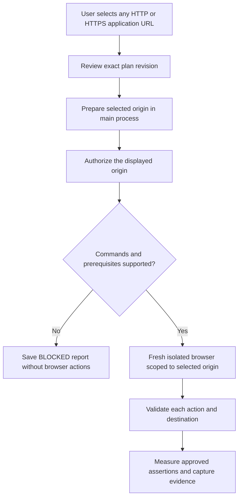
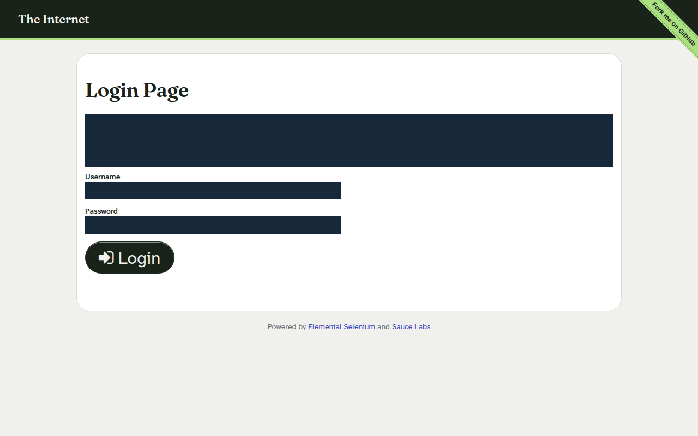
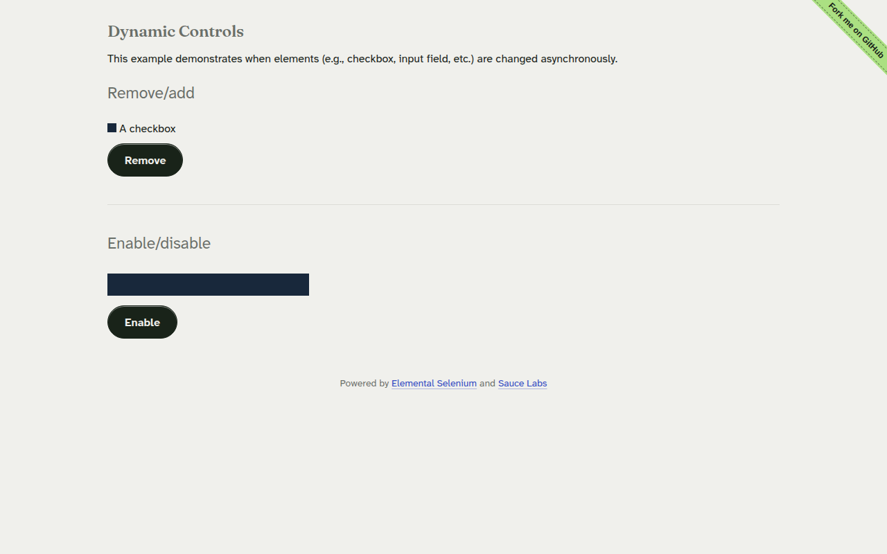
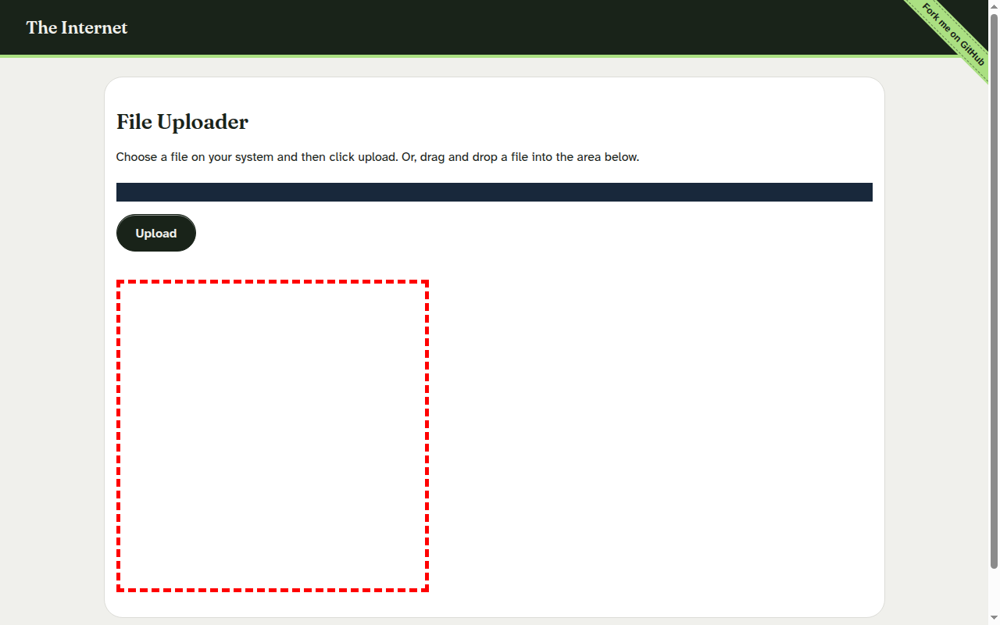

# M7.1 — Public demo website validation

Validated on 25 October 2026 against [The Internet](https://the-internet.herokuapp.com/), using the installed QASpider Desktop, Stagehand 4.3, local Chromium and the existing isolated Codex CLI provider. This validation found integration blockers. It does **not** establish that the public website's login or asynchronous controls pass their business requirements.

The [machine-readable receipt](../../validation/desktop-m7.1-public.json) preserves actual proposals, review hashes, compatibility checks, blocked execution reports, discovery results and measurements. The [retained screenshots](../../validation/desktop-m7.1-evidence/) include SHA-256 hashes in that receipt. Private SQLite databases and provider receipts remain ignored under `.qaspider/`.

## Results at a glance

| Ticket or check | Outcome | What actually happened |
| --- | --- | --- |
| Preparation: target availability | PASS | Home, login, Dynamic Controls and Upload loaded in real Chromium; successful captures returned HTTP 200. |
| Preparation: documented credentials | PASS | The login page supplies demo credentials. Their values were neither entered nor copied into plans, evidence or this report. |
| A: valid login reaches secure area | BLOCKED | Login is a form submission. The observation policy rejects it; the approved conceptual plan also fails compatibility before browser execution. |
| A: invalid login rejected | BLOCKED | No credentials were entered and no login submitted. |
| A: incorrect login shows visible error | BLOCKED | An actual rejected login is necessary to assess this; no submission was permitted. |
| B: remove checkbox | BLOCKED | Stagehand discovered Remove, but the observation workspace rejected its form-contained button. No click occurred. |
| B: add checkbox | BLOCKED | Removal was not executed, so the required starting state was not established. |
| B: enable input and enter text | BLOCKED | Stagehand discovered Enable, but the observation workspace rejected its form-contained button. No text was entered. |
| B: disable input and prevent entry | BLOCKED | The prerequisite enabled state was not established. |
| C: file selection control exposed | PASS, inspection only | Real DOM inspection found a visible `input[type="file"]`. No chooser was opened. |
| C: upload action exposed | PASS, inspection only | A visible `input[type="submit"]` exposes Upload. It was not activated. |
| C: approved-plan execution | BLOCKED | The generated prose plan is not executable by the explicit-command adapter. Its inspection PASS results are separate evidence, not an executor PASS. |
| Knowledge: plans and reports survive restart | PASS | Electron was actually closed and relaunched; saved plans and empty knowledge results agreed. Approved plans and blocked reports persisted. |
| Knowledge: verified public workflow replay | BLOCKED | No public workflow completed approved execution with passing assertions and evidence. There is no eligible learned workflow to replay. |
| Knowledge: memory on/off performance | INCONCLUSIVE | No compatible verified public workflow or desktop memory toggle was available. Savings and replay durations are unknown. |
| Public website's business correctness | INCONCLUSIVE | The blocked interactions provide no evidence of an application defect. |

**PASS** means the stated check was observed. **FAIL** would mean an executed assertion contradicted its approved expectation. **BLOCKED** means policy, compatibility or a prerequisite prevented the test. **INCONCLUSIVE** means there is insufficient evidence for a verdict. No public business assertion returned FAIL, because none reached execution.

## The origin correction requested during validation

The original approved-ticket coordinator could prepare only its own loopback fixtures. During this milestone the user explicitly requested that origins have no default allowlist restriction. The desktop now accepts **any user-selected HTTP or HTTPS origin** in the approved execution panel. Leave the URL empty to use the existing local demo.

No hostname or public-site selector mapping was added to the application. A selected origin is prepared in the main process, bound to the exact approved plan identity, expires after five minutes and can be used once. A forged renderer object cannot grant execution authority. Preparation itself makes no website request.

Each browser run still enforces its selected origin, including redirect hops. Cross-origin requests remain blocked. Credentials embedded in URLs remain invalid. Plan approval, action authorization, control validation, bounded discovery, assertions, evidence and browser cleanup remain enabled. Choosing an origin does not grant permission for every possible action on it.



The existing local demo keeps its trusted path restrictions and legacy account bindings. Selected applications use their own origin-derived knowledge identity; changing hostname, scheme or port changes that identity. A path change on the same origin preserves it. Selected applications cannot borrow local-demo prerequisites or its knowledge scope. The scope represents an isolated browser, not a configurable authenticated role or tenant; richer project/environment/role configuration remains future work.

Only origin configuration and its integration were changed. No provider adapter, new automation framework, browser engine, automatic plan translator or learning subsystem was introduced. External submit buttons remain blocked by the selected-application action policy. Local-demo submission behavior remains covered by existing regressions.

## How the validation ran

The initial driver launched real Electron and used its existing preload/IPC operations for planning, Stagehand observation, knowledge inspection and restart checks. Evidence-only inspection used the existing `openBrowserSession()` helper with exact-origin request filtering. That inspection read the DOM and captured screenshots; it executed no business actions and did not substitute for an approved-plan run.

Traffic was serial and low volume: seven browser navigations across the validation scripts, including the evidence correction, plus preliminary read-only website checks. Subresource requests were not counted, so seven is not a total HTTP-request count. There were no login submissions, file selections, uploads, stress tests or parallel website interactions. The public website was not changed.

The first login evidence lookup used an exact accessible name of Login. The real button includes an icon in its accessible name, so that lookup timed out after 30 seconds. The evidence harness was corrected to recognize the observed accessible name, then retried once. This was a harness lookup error, not a product login failure. The second review driver also initially attempted coverage confirmation while assumption edits had returned the plan to DRAFT. It resumed with the existing required review-state ordering; no application review rules were changed.

The login page publishes its password in ordinary page prose. Masking only password inputs would leave it visible. Evidence therefore masks both the instruction heading and input controls before saving the PNG. No model observation was made on the login page. Dynamic Controls supplied the unfamiliar-page context for Stagehand.



## Ticket A — Login review and policy result

The existing planner produced six conceptual scenarios covering valid access, invalid rejection and visible errors. Review confirmed the intended expectations and setup without claiming that login worked. Under the user's instruction to review and approve the exact revision, the validation agent used the existing review API; its existing audit label is `local-user`.

Revision 1 was approved with hash:

```text
d177e46819e80b3dff5bae774eed37e2e2e9a68a42759e0f7dc8d3e66533637a
```

The selected HTTPS origin prepared successfully. Executing that exact approved revision produced a durable BLOCKED report: conceptual prose cannot be parsed into explicit browser commands, and the generated preconditions have no verified configuration binding. No scenario runner was invoked. Separately, inspection of the actual Login button returned `allowed: false` under the existing observation policy because it is a form control. There was no attempt to bypass either restriction.

Approval confirms reviewed intent; it does not turn natural-language instructions into executable operations. The approved adapter currently requires explicit JSON commands and assertions. This milestone did not supply a fixture-specific translator or weaken that requirement to manufacture a passing login.

## Ticket B — Dynamic Controls discovery

Stagehand successfully discovered the live Remove and Enable buttons and returned two click proposals. The receipt retains its actual XPath proposals as observations. They were not installed as application selector mappings.

Both controls are visible, enabled buttons of type `button`, inside forms. The observation workspace's older policy rejects **all** form-contained controls, including these buttons that do not themselves submit a form. This is a real integration limitation. The generic approved runner can validate a type-button action on a selected origin, as demonstrated by a separate local regression, but the public conceptual plan still cannot reach that runner.



The proposed Dynamic Controls revision remains IN_REVIEW. Its assumptions about scenario-specific initial states and complete execution setup were not confirmed merely to obtain approval. Its six proposed scenarios include prerequisites such as an already-removed checkbox or already-enabled input. The current runner starts a fresh browser per scenario, so those states need explicit approved setup; an earlier scenario's state cannot be assumed to carry over.

No Remove, Add, Enable or Disable click occurred. No state transition or successful input entry was claimed. Consequently there are no transition durations or passing business assertions to report.

The existing generic assertion engine polls live visibility/enabled/text/URL state at 75 ms intervals with a default 1,500 ms deadline. The observation workspace polls its supported text/URL assertions at 100 ms intervals with a 4,000 ms deadline. Those are bounded state checks, not fixed sleeps used as success evidence. Neither reached a public action in this run. The adequacy of their deadlines for this site's asynchronous transitions is **unmeasured**. The observation workspace also lacks enabled-state assertions, and the generic schema lacks a field-value assertion to prove entered text. These are capability gaps, not reasons to replace entry checks with a weaker enabled-only PASS.

## Ticket C — Upload preflight

DOM inspection found a native visible file input, an additional file input for the page's drag/drop area, and a visible submit input labeled Upload. The final screenshot deliberately masks file controls while leaving the Upload label visible. The receipt records the measured visibility booleans.



The two acceptance criteria pass as **read-only control inspection**. No file was selected or submitted. Generic FILL explicitly rejects file inputs, there is no approved upload command, and the observation action inspector supports argument-free links/buttons rather than a native file chooser or submit input. File upload remains an unsupported product interaction.

The conceptual preflight plan was reviewed and approved as revision 1 with hash:

```text
68343b3426363b8fd63464ff2818eb909980fe0b0188c21f3b0afe7035baf3c1
```

Its approved execution report is BLOCKED for unsupported prose and unbound preconditions. The DOM inspection results are not attributed to that blocked execution.

## Knowledge validation and its limits

M6's rule remains appropriate: discovery alone is not verified knowledge. A workflow needs completed approved execution, passing assertions, per-step evidence, successful cleanup and a matching scope before it can be VERIFIED.

```mermaid
flowchart LR
  Discover[Stagehand discovers controls] --> Proposals[Untrusted action proposals]
  Proposals --> Reviewed[Exact reviewed executable plan]
  Reviewed --> Execute[Permitted operations and live assertions]
  Execute --> Evidence[Completed passing evidence]
  Evidence --> Verified[Verified scoped knowledge]
  Verified --> Restart[Restart Desktop]
  Restart --> Match[Check scope and live prerequisites]
  Match --> Reuse[Replay current approved inputs]
```



This public validation stopped before the completed-passing-evidence step. Knowledge was empty before and after actual Electron restarts. It would be incorrect to insert the discovered XPath proposals into knowledge tables or label them verified to complete the benchmark.

| Measurement | Observed result |
| --- | --- |
| Verified public workflows | 0 |
| Reused public action steps | 0; no replay was eligible |
| Verified-knowledge run after restart | BLOCKED |
| Memory-enabled execution duration | Unavailable |
| Memory-disabled execution duration | Unavailable |
| AI calls/tokens saved through public memory | Unknown, not zero-cost proof |
| Public knowledge-to-execution screenshot links | Not testable: no verified public knowledge record exists |
| Plan/report persistence across restart | Verified through actual Desktop IPC |
| Scope rules | Unit regressions verify origin, scheme and port separation, same-origin path stability and rejection of forged/expired execution capabilities |
| Existing M6 scope/evidence regressions | Passed; they use controlled fixtures and are not public-site replay measurements |

No public page was modified to create an artificial change-detection demonstration. There are no public divergence findings or revision-change claims.

## Measured time and inference

| Operation | Duration |
| --- | ---: |
| Initial validation driver, including capture lookup timeout, three plans, discovery and restart | 187.583 s |
| Login plan generation | 66.244 s |
| Dynamic Controls plan generation | 47.964 s |
| Upload preflight plan generation | 20.446 s |
| Stagehand Dynamic Controls observation, including its browser/provider setup | 9.257 s |
| Corrected login evidence capture | 3.041 s |
| Corrected upload evidence capture | 2.955 s |
| Exact login revision blocked-execution request | 0.044 s |
| Exact upload revision blocked-execution request | 0.015 s |
| Successful review-driver resume, including restart verification | 1.544 s |

These measurements overlap: plan and discovery durations are included in the initial driver's time; the evidence corrections occurred in an earlier review-driver attempt. Do not add the rows as an end-to-end benchmark. Blocked execution timings cover compatibility checks and persistence, not browser performance.

Three real plan requests and one real Stagehand observation request succeeded. The provider was `codex-cli`, model `gpt-6.1-sol`, with no synthetic inference fallback. The existing isolation probe passed before inference. Planning/observation IPC does not expose underlying provider-call or token counters, so those counts remain **unknown** in this report. Existing generic-runner metrics were unavailable because no public scenario reached that runner. Synthetic isolation probes and fixture regressions are not public AI usage measurements.

## Findings for further development

| Finding | Consequence and next development need |
| --- | --- |
| Owned-only execution target | Addressed by the explicitly requested arbitrary-origin configuration; per-run origin boundaries remain enforced. |
| Observation policy rejects every form-contained button | Public non-submit dynamic controls are blocked even though their DOM type is `button`; review action policy without permitting unauthorized submissions. |
| Prose proposal versus explicit-command executor | A reviewed conceptual plan cannot run directly. A supported explicit-plan authoring/review path is needed; no automatic interpretation was added here. |
| Immutable generated preconditions have no public binding | Editing steps does not bind generated prerequisites such as a removed checkbox. Add explicit, reviewable setup/configuration rather than matching site-specific strings. |
| Field-value assertion absent | Enabled state alone cannot prove that entry succeeded or that disabled input resisted entry. |
| File selection/upload unsupported | Inspecting a file input is possible; interacting with it requires a separately designed capability. |
| Password displayed in page prose | Input-only screenshot masking does not cover secrets published elsewhere on a page. The validation harness masked that text; the general product gap remains. |
| Planning/observation usage hidden | Surface existing provider usage counters if per-ticket AI accounting is required. |
| No Desktop memory comparison control | Public memory on/off benchmarking remains unavailable through existing desktop workflows. |

## Regression checks and reproduction

All existing regressions passed: **88 desktop unit tests**, **50 real browser/Electron tests** including the new selected-origin regression, and **76 repository tests**. Both root and desktop typechecks and the desktop build passed. The new browser regression verifies a permitted type-button state change, blocked external form submission with zero POST requests, and rejection after the selected-origin capability is closed. Historical M4.3/M5 receipt files rewritten by their test suites were restored to their original tracked contents.

```sh
npm run desktop:build
npm run typecheck --workspace @qaspider/desktop
npm run desktop:test
npm run desktop:smoke
npm run typecheck
npm test
```

The public drivers are opt-in and require the existing authenticated Codex CLI, Chromium and an Electron display. Run them sequentially from the repository root; they use a dedicated ignored desktop database. The review driver resumes the saved proposals from the first driver. Its assumption notes are specific to these inspected proposals and should be reviewed before reusing it with newly generated proposals.

```sh
node apps/desktop/scripts/validate-public-demo.mjs
node apps/desktop/scripts/review-public-demo.mjs
```

The scripts retain detailed working screenshots under `test-results/desktop-live/m7.1/`. The selected final captures in `validation/desktop-m7.1-evidence/` are the reviewed retained artifacts from this run; a rerun does not silently replace that retained snapshot.

M7.1 validation ends here for review. The blockers above remain open; they have not been expanded into another implementation milestone.
