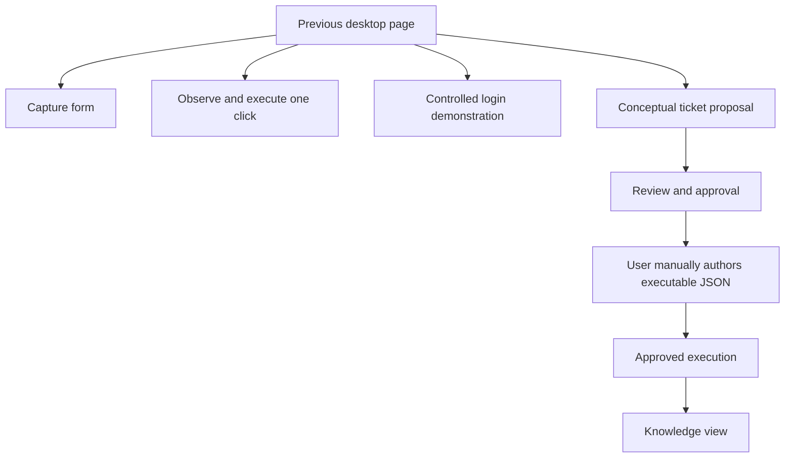
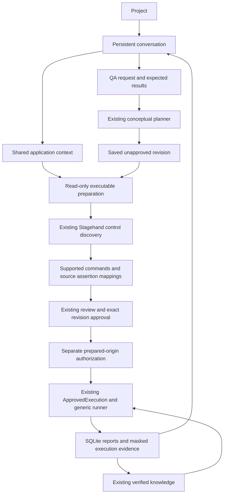
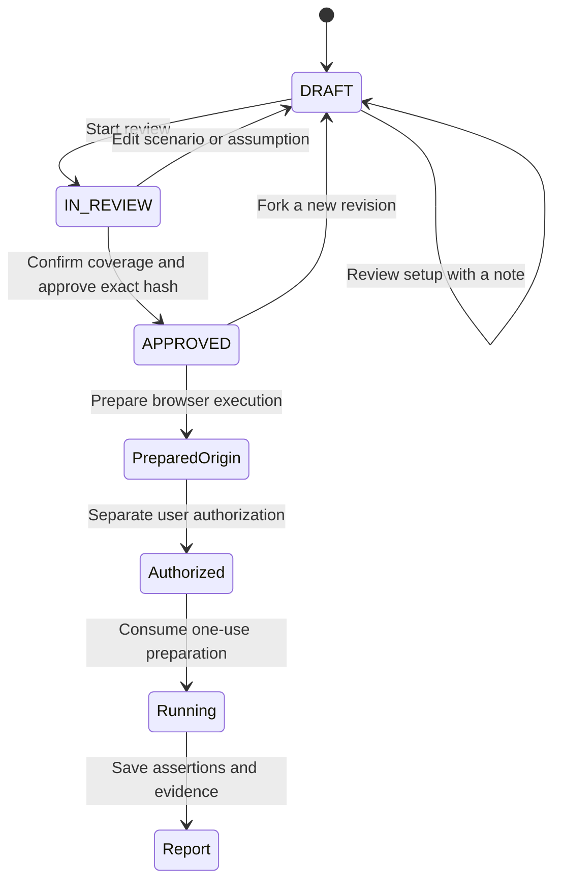
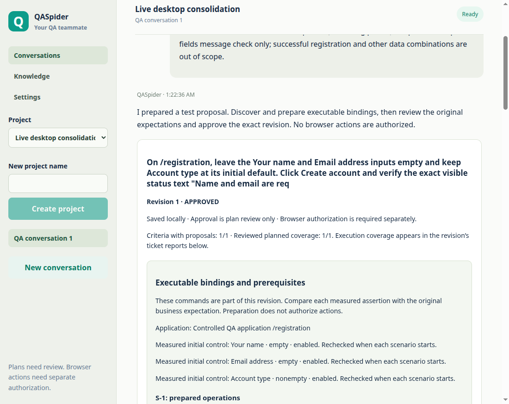
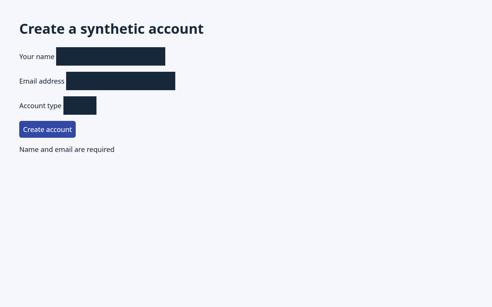
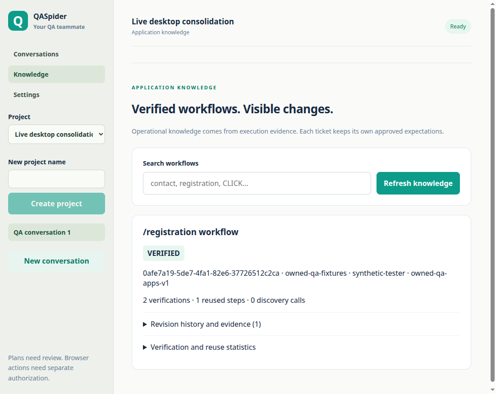

# M8 — Desktop consolidation

Validated on 26 October 2026 (India time). This milestone implements the approved six-step consolidation of M1–M7.1. It adds no dependencies, agent framework, website-specific selector mappings, or new browser engine. No commit was created.

## What changed for a user

Desktop now opens a project-scoped conversation instead of a page of milestone demonstrations. A conversation keeps its website context, user requests, linked test plans, and linked execution reports. Knowledge and Settings are secondary views. The existing review, approval, execution, SQLite, Stagehand, safety, and evidence services remain responsible for their original work.

The previous desktop remains available through **Settings → Developer tools and migration fallback → Open legacy workspace**. `QASPIDER_DESKTOP_LEGACY_UI=1 npm run desktop` opens it directly. **Return to chat** restores the normal workspace.

## Before and after

Previously the user coordinated four separate browser entry points. Capture and observation results lived in memory, the login demonstration used trusted fixtures, and ticket execution used durable SQLite reports. The conceptual planner deliberately generated prose while the executor required explicit commands.



The conversation now links these durable artifacts. Executable preparation connects a conceptual proposal to the existing runner before approval. The legacy demonstrations are hidden from the normal workspace, with their underlying services and regressions retained.



This is a small main-process application service over the existing modules. React renders messages and cards; it never becomes the browser executor or the authority for an approval.

## Six internal checkpoints

| Checkpoint | Implementation and verification |
| --- | --- |
| 1. Chat shell and fallback | Project/conversation sidebar; inline plan cards; separate Knowledge and Settings; legacy shell retained. Existing historical UI tests explicitly select the fallback. |
| 2. Durable project conversations | Additive SQLite tables link messages to existing plan/report IDs. Prior plans and reports are associated with a Legacy workspace. Migration backup, restart, and unchanged approval tests cover preservation. |
| 3. Shared context and status | One application context per conversation; exact prepared context checked at execution. Main-process operation status is readable during work. Read-only artifact retrieval remains available while mutations are serialized. |
| 4. Executable preparation | Stagehand discovers controls without clicking. The existing provider proposes bounded typed bindings; the strict command/assertion schemas and live DOM checks validate them. Bindings, setup mappings, initial state booleans, and human review notes participate in the revision hash. |
| 5. Shared execution helpers | Preparation and generic execution share control-shape policy. Legacy and generic execution share masked screenshots. Chat and approved execution share report rendering. Older execution services remain intact. |
| 6. Validation and retirement of normal duplicate entry points | Real Electron end-to-end tests, a real-provider controlled-app demonstration, restart/reuse checks, typechecks, isolation checks, and regression suites were run. Diagnostic workflows are available through the fallback rather than mounted in the normal conversation. |

## How executable preparation works

The original business proposal remains unchanged. Preparation saves a separate executable binding inside the **unapproved review content**. That binding contains the application/project context, ordered commands, original-to-measured assertion mappings, prerequisite mappings, blockers, and measured initial control state.

1. Open the conversation's selected HTTP(S) page, or an owned controlled application.
2. Use Stagehand observation to discover controls. No business action executes during preparation.
3. Inspect standard status, alert, output, and heading regions for assertion targets. Record control empty/enabled booleans; do not include input values.
4. Ask the existing isolated provider for supported bindings using only supplied control IDs and inspected assertion selectors. Include the original assumptions and their human review decisions.
5. Validate against existing command and assertion schemas. Exact text/URL expectations must have source support. Unknown controls, guessed assertion selectors, unsupported control types, unbound setup, and public submissions remain blocked.
6. Show the mappings alongside the original expectations. A human must review executable setup with a note, resolve assumptions, confirm planned coverage, and approve the exact revision.

The inference request uses an equivalent `anyOf` representation for assertion variants with distinct literal kinds. Zod's emitted `oneOf`/default annotations were incompatible with the live inference request. The original strict Zod validator still checks the response; this format conversion does not relax assertion types or values.



Scenario/assumption edits invalidate executable bindings and affected coverage. Changing application context prevents old approved bindings from executing. Stale revisions cannot initiate discovery. Each execution still checks the latest approved revision, exact hash, preparation identity, origin, expiry, and authorization. Measured initial control states are rechecked after initial navigation and before business actions; a mismatch blocks execution rather than becoming a passing setup assertion.

## Trying the normal UI

Start with `npm run desktop`. Create a project, select **New conversation**, set **Application**, and save the application context. For the owned controlled demonstration choose `/registration`.

Example request:

> On /registration, leave the Your name and Email address inputs empty and keep Account type at its initial default. Click Create account and verify the exact visible status text "Name and email are required" (no trailing period). Scope is this required-fields message check only; successful registration and other data combinations are out of scope.

Select **Prepare test plan**. Review setup assumptions using the existing decision controls. Select **Prepare executable draft**, inspect every command and original assertion mapping, and save an **Executable binding review note**. Start review, confirm each criterion's planned coverage with a note, and select **Approve Plan**.

Then select **Prepare approved execution**, inspect compatibility and the actual prepared origin, check the separate authorization checkbox, and select **Execute Approved Plan**. The report appears as a linked conversation artifact. Open Knowledge to inspect verified workflows and original screenshots.

Preparation can fail or retain blockers. Resolve the missing facts in a new request or a newly prepared/reviewed draft; approval never translates unsupported behavior into permission.

## Actual desktop demonstration

Two forms of validation are distinguished:

- The deterministic Electron regression uses real Electron, Chromium, Stagehand, and Codex CLI transport with explicitly synthetic model responses. It creates its project and plan through the new UI rather than seeding an approved plan.
- The opt-in live driver uses the existing signed-in Codex CLI with real inference. It also creates and reviews its plan through the actual desktop UI. Its target is only the existing owned synthetic registration application.

The real-provider run completed in approximately **49.96 seconds**, including planning, grounding, review, two executions, and a desktop restart. Its first run passed four assertions and saved six screenshots; its repeated run after restart passed the same assertions with the same approval hash and reused one verified click target.

| Live measurement | Initial execution | Repeated after restart |
| --- | --- | --- |
| Outcome | PASS | PASS |
| Scenario duration | 1.896 s | 1.622 s |
| Assertions | 4 | 4 |
| Reused action steps | 0 | 1 |
| Execution discovery calls | 0 | 0 |
| Execution AI calls / tokens | 0 / 0 | 0 / 0 |

Grounding happened before approval, so these execution-only zero counters do **not** mean the complete workflow used no AI. Aggregate planning/grounding token counts are not persisted by the current IPC contracts and remain unknown. These two samples establish reuse, not a general performance improvement.

The live approval hash was `3b1f534476b5b9709dee18d8a0b5a8754a5e8ce39d7033fc961d43b018e233d5`. Plans, conversation messages, report links, original expectations, screenshots, and verified knowledge survived a real Electron restart. The fixture received a different random port after restart; its trusted stable application identity preserved compatible reuse within the same project. New projects use their own project UUID for knowledge retrieval, while historical unlinked artifacts keep their former scopes.

Earlier live validation attempts stopped before approval/execution: one exposed the incompatible inference schema, and another correctly requested missing setup evidence and assumption definitions. The demonstration request was clarified before generating a new draft to distinguish empty text inputs from a native select's default. No approved expectation was changed to obtain PASS.

**Public login execution was not demonstrated.** Selected-website form submission remains prohibited by the existing policy. Nothing in this milestone makes the public login acceptance criteria pass.

Retained screenshots and exact receipt IDs are listed in [the validation receipt](../../validation/desktop-consolidation.json).







## Storage preservation and rollback

New tables are `desktop_projects`, `desktop_conversations`, `desktop_messages`, `desktop_conversation_plans`, `desktop_settings`, and `desktop_additive_migrations`. They use the existing PlanStore connection. Existing plan, revision, approval, execution, screenshot and knowledge tables are not rebuilt or dropped. The additive migration ledger is separate from the existing `user_version` compatibility gate.

Before extending an existing database, an online SQLite `VACUUM INTO` snapshot is created in its private `desktop-backups/` directory. The backup is permission `0600`, its directory is `0700`, and an independent read-only connection checks SQLite integrity before migration proceeds. Failure to back up aborts opening the store. New empty databases need no historical backup. Private databases and snapshots are never included in tracked evidence.

Use the legacy shell for an immediate UI rollback. It uses the same updated services and database, so new evidence is retained. Do not delete additive tables to switch screens.

For a binary rollback to a pre-consolidation version, first close Desktop and retain a separate copy of the complete current private data directory. Use a **copy** of the pre-migration backup with the older binary; do not overwrite current data. New executable review content is not understood by older binaries. Keep the current database for returning to the consolidated version and retaining post-migration artifacts. There is no destructive automatic down-migration.

## Retained, merged, hidden, removed, and missing

| Decision | Result |
| --- | --- |
| KEEP | Existing Stagehand/local Chromium integration, provider isolation, SQLite repositories, conceptual planner, review/approval checks, exact origin capabilities, one-use authorization preparation, generic/legacy execution services, assertions, evidence and knowledge eligibility. |
| MERGE | Shared application context/status, executable draft coordination, control-shape policy, masked execution screenshots, report rendering, conversation references to plan/report records. |
| HIDE | Standalone capture, one-click observation, controlled login scenarios, deliberate failure option, milestone labels, raw proposal/report diagnostics and JSON authoring in the legacy developer workspace. |
| REMOVE | The identity assertion wrapper and identity string replacement identified in the audit. No underlying browser/execution/learning service was deleted. |
| MISSING / LIMITED | Public submissions, uploads, password/secret-reference entry, field-value assertions, full multi-page grounding, query/fragment navigation bindings, free-form conversational follow-up interpretation, normal run cancellation, and aggregate planning/grounding usage accounting remain limitations. Unsupported URL state is rejected rather than silently discarded. |

The observation workspace's older form-contained-button policy remains unchanged. Its semantics differ from the generic runner's policy; consolidation shares compatible primitives without silently broadening that older flow. Settings expose existing provider/model/browser options and describe safety, without an option to disable authorization or origin boundaries.

New requests are independent ticket proposals inside a persistent conversation. Follow-up messages do not silently edit an approved plan; use the review/fork controls and explicit complete requirements. Knowledge reuse is operational compatibility, not permission to reuse another ticket's business expectations.

## Verification and security

| Final gate | Result |
| --- | --- |
| Desktop unit tests | PASS — 104 tests |
| Desktop real browser / Electron tests | PASS — 53 tests |
| Root unit tests | PASS — 76 tests |
| Desktop and root typechecks | PASS |
| Desktop and root builds | PASS |
| Synthetic provider isolation, before and after | PASS — tools disabled; timeout and cancellation processes exited; context sanitization verified |
| Live provider through the new desktop UI | PASS — owned controlled application only, including restart and reuse |
| Legacy root browser smoke | 13 PASS / 6 FAIL with installed Chrome; the same six failures reproduce at unchanged HEAD |

The validation receipt records the final command outcomes, counts and screenshot hashes. Desktop regressions cover the new complete UI flow, initial prerequisite mismatch before clicks, migration backup integrity, preservation of old approvals/reports, project/conversation isolation, changed context, source assertion preservation, stale revisions, and provider failure without an invented plan.

The legacy root browser smoke suite is **not fully green** in this environment. With the installed Chrome, 13 of 19 tests passed and six failed. The same six failures were reproduced from an untouched `HEAD` archive: missing old Studio controls, an ambiguous legacy Message label, and CLI/MCP replay failures. The original root configuration also expects an absent downloaded Playwright browser. No dependencies were installed and no unrelated Studio/CLI code was changed to hide these failures.

Security behavior retained: isolated renderer/preload; validated sender frame and bounded IPC schemas; serialized mutations; exact approved revision checks; separate explicit browser authorization; fresh scenario browsers; selected-origin scope; bounded discovery; no unreviewed retries or replacement expectations; input-masked execution screenshots; append-only verified knowledge with original evidence links; and fail-closed provider isolation.

Input masking does not redact sensitive text printed elsewhere on a page. Use authorized test data and do not put passwords into requests. Existing fresh-session cookie checks and third-party resource restrictions can still block unfamiliar websites. This milestone does not claim a general browser network sandbox.

Reproduce the normal gates from the repository root:

```sh
npm run typecheck --workspace @qaspider/desktop
npm run desktop:test
npm run desktop:smoke
npm run typecheck
npm test
npm run verify:provider
```

The live demonstration is explicit opt-in and uses a dedicated ignored data directory:

```sh
npm run desktop:build
node apps/desktop/scripts/verify-consolidation-live.mjs
```

Implementation stops here for final review. Remaining safety/capability changes require their own explicit scope.

## File map

All application paths below are relative to `apps/desktop/`; the receipt also lists exact changed paths.

| Files | Responsibility |
| --- | --- |
| `src/ChatDesktop.tsx`, `src/chat-types.ts` | Project/conversation navigation, shared context and operation display, inline artifact loading, Settings and legacy switch. |
| `src/main.tsx`, `src/style.css` | Default chat shell, retained legacy mount, responsive layout and persistent navigation. |
| `src/PlanReview.tsx`, `src/review-types.ts`, `shared/plan-review.mjs` | Executable binding review, initial state display, source mappings, approval blockers, typed review content and invalidation. |
| `src/ApprovedExecution.tsx`, `src/execution-types.ts`, `src/Knowledge.tsx` | Reused execution controls, shared report cards and execution metrics, linked evidence and project-filtered knowledge. |
| `electron/conversations.mjs` | Backup-before-migration, additive project/conversation/message/settings tables, historical associations and artifact links. |
| `electron/desktop-service.mjs`, `electron/executable-draft.mjs` | Thin coordination of requests and read-only Stagehand/provider grounding; strict command and prerequisite preparation. |
| `electron/main.mjs`, `electron/preload.cjs` | Fixed validated IPC methods, serialized mutations, read-only progress, effective settings and explicit Node-side synthetic test injection. |
| `electron/plan-store.mjs`, `electron/plan-compatibility.mjs` | Existing revision persistence with additive binding preparation; independent source assertion checks and executable compatibility. |
| `electron/approved-execution.mjs`, `electron/generic-execution.mjs` | Existing execution with reviewed-context matching, project knowledge scope, initial control rechecks and conversation report links. |
| `electron/control-policy.mjs`, `electron/evidence.mjs`, `electron/scenario-runner.mjs` | Shared generic control-shape checks and shared execution screenshot masking; legacy runner retained. |
| `tests/consolidation.test.mjs`, `tests/consolidation.spec.mjs`, `playwright.config.ts` | Migration, integrity and preparation regressions; real UI workflow and restart/reuse; explicit legacy mode for historical UI suites. |
| `scripts/verify-consolidation-live.mjs` | Opt-in real-provider desktop demonstration with explicit review and separate authorization. |
| `README.md`, `MILESTONE-8.md` | Normal UI guide, architecture, migration details, validation and limitations. |
| Root `validation/desktop-consolidation.json`, `validation/desktop-consolidation-evidence/*`, `validation/m2-isolation-recheck.json` | Sanitized validation summaries, reviewed actual screenshots and the required refreshed synthetic provider manifest. |
