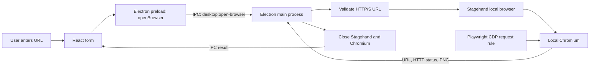

# QASpider Desktop — Milestone 1

A local desktop application that visits one development/QA URL, captures a screenshot, reports the result and closes its browser. No inference provider, API key, Docker, database or server process is required.

## Run it

From the repository root, using Node 24:

```sh
npm ci
npm run desktop
```

Install Chrome or Chromium locally first. Stagehand finds standard Chrome installations; `CHROME_PATH` selects another executable. For example on Linux:

```sh
CHROME_PATH=/usr/bin/google-chrome npm run desktop
```

Electron 45 downloads its desktop runtime on first use if it is not already installed. This and `npm ci` require network access. Browser capture itself uses the installed local browser. A graphical desktop is required for Electron and the default visible browser. Use `QASPIDER_DESKTOP_HEADLESS=1` to hide only the capture browser; Electron still needs a display. No sandbox-disabling flags are added by the application.

Start your target application separately, enter a URL such as `http://localhost:3000/login`, then click **Open Browser**. Chromium opens briefly, loads the page, captures a 1280 × 800 viewport and closes. The desktop shows the visited URL, HTTP status and screenshot. A successful capture verifies that the page loaded; it does not assert business behavior. An HTTP 404/500 is displayed as a failure with screenshot evidence.

Visible Linux captures use Chromium's built-in `--ui-toolkit=fallback` option. Native GTK theme initialization can crash with `SIGTRAP` when desktop font-setting schemas are missing, before Chrome opens its debugging port. The fallback avoids that native-theme dependency without changing system settings or disabling the browser sandbox. Headless captures and other operating systems keep their normal toolkit selection. See [Chromium's toolkit selection implementation](https://chromium.googlesource.com/chromium/src/+/main/ui/linux/linux_ui_factory.cc).

## What the frameworks do

Electron packages web technology into a desktop application. Its main process is Node.js: it can start Chromium and access operating-system resources. Its renderer is the Chromium process that displays our UI. The target application is loaded in a separate browser, never inside the desktop UI.

React describes what the UI should display. When `busy` changes to `true`, React updates the button and status. When the result arrives, React displays the screenshot. React does not start processes or navigate the test browser.

Vite converts React/TypeScript and CSS into the static files Electron loads. `base: './'` makes asset paths work with Electron's local `file:` URL. This milestone uses a build-and-launch workflow rather than a separate development server.

Stagehand supplies the local browser lifecycle and browser automation API. It can support AI actions in future, but here only ordinary browser methods run. We call `localBrowser.launch()`, `Stagehand.create({ browser })`, `page.goto()`, `page.url()` and `page.screenshot()`. There are no `act`, `observe`, `extract` or model calls.

Playwright, already present in the repository, supplies a small Chromium DevTools Protocol (CDP) connection for the page's request policy. CDP is Chromium's automation protocol. The policy checks the exact origin before requests and redirect hops proceed. Stagehand 4.3's domain policy rejects `localhost`, and Playwright's high-level route callback does not cover every redirect hop, so this explicit CDP rule is necessary for this milestone's URL scope.

Electron IPC is message passing between the renderer and main process. The preload script exposes one operation, `window.qaspider.openBrowser(url)`. React can call that operation but has no Node.js `require`, arbitrary filesystem API or unrestricted IPC access.



## What happens on a click

1. `App.openBrowser()` clears the old result, sets `busy = true`, and sends the form value through the preload bridge.
2. The IPC handler verifies that the caller is the main frame of our exact local UI file. It rejects another request while a capture is running.
3. `validateTarget()` parses the URL and accepts HTTP(S) without embedded username/password. It rejects malformed values, other protocols and input longer than 4096 characters before starting a browser.
4. `captureTarget()` launches a fresh local Chromium profile, initializes Stagehand without a model and installs the page request rule through Playwright CDP.
5. Stagehand navigates with a 20-second timeout and waits for `load`. It reads the final URL and checks that its origin still matches the entered origin. It captures a viewport PNG with a 10-second timeout.
6. The `finally` block closes the Stagehand session and the Chromium handle, including when navigation or initialization fails. It attempts Chromium cleanup even if Stagehand cleanup fails. Chromium's shutdown also disconnects Playwright. Cleanup errors become visible failures.
7. The result crosses IPC as plain data. React displays it and enables the button for another capture. Closing the desktop during a capture waits for that capture and its cleanup before Electron exits.

For `http://localhost:3000/login`, the allowed origin is `http://localhost:3000`. A redirect to `/dashboard` is allowed. A redirect to `http://localhost:3001/` or `https://another.example/` is blocked before that page request reaches the destination. Cross-origin main-page assets are also blocked, so pages relying on a CDN can appear incomplete. The request rule is a capture scope control, not a general network sandbox: workers, WebSockets, popups and out-of-process frames are not a comprehensive network isolation boundary. Only test applications you intend to visit.

Example result, after browser resources have been released:

```js
{
  status: 'success',
  visitedUrl: 'http://localhost:3000/login',
  httpStatus: 200,
  screenshot: 'data:image/png;base64,iVBOR...',
  message: 'Page captured.'
}
```

If Chromium cannot start, the result contains `status: 'error'` and a message beginning with `browser startup:`. If the application is unreachable, the message begins with `navigation:`. The screenshot is not written to disk or a database by the app; it stays in memory until another capture or app exit.

## File and function walkthrough

| File | Responsibility and example |
| --- | --- |
| `package.json` | Declares the desktop workspace and exact framework releases. `start` builds the UI then runs `electron .`; `main` identifies the Electron entry file. Root `npm run desktop` delegates here. |
| `electron/main.mjs` | `createWindow()` creates the isolated Electron renderer and loads the built local UI. The `desktop:open-browser` handler validates the sender, enforces one active run, and calls `captureTarget()`. `before-quit` waits for an active capture's cleanup. Window navigation, new renderer windows and permission requests are denied. `app.whenReady().then(...)` registers startup without blocking Electron readiness with top-level await. |
| `electron/preload.cjs` | Exposes only `openBrowser(url)` through `contextBridge`. Calling `window.qaspider.openBrowser('http://localhost:3000')` invokes the fixed IPC channel. It never exposes `ipcRenderer` itself. CommonJS works in the sandboxed preload. |
| `electron/browser.mjs` | `validateTarget(input)` returns a normalized `URL` or throws a readable validation error. `captureTarget(input, options, dependencies)` owns the single capture operation and its cleanup. `options.executablePath` is Node-side configuration; `options.headless` supports smoke tests. The default dependencies are the real Stagehand and Playwright frameworks; tests substitute failures to verify error cleanup. The request listener continues exact-origin requests and rejects others. If applying that decision fails, it closes the browser. |
| `src/main.tsx` | `App()` owns `url`, `busy` and `result`. Its `openBrowser(event)` handles submit, awaits the preload operation, catches IPC failures and resets the busy state in `finally`. `CaptureResult` describes plain result data; the global `Window` declaration gives TypeScript the preload API shape. `createRoot()` mounts React into `#root`. |
| `src/style.css` | Small desktop layout using the existing teal/ink visual palette, responsive form, status and screenshot. No old graph or Studio styles are imported. |
| `index.html` | Hosts the React root and a Content Security Policy. The UI permits its built scripts/styles and screenshot data URLs, and disallows direct network connections. The target page's scripts execute in separate Chromium, not in this renderer. |
| `vite.config.ts` | Builds static renderer files under this workspace's ignored `dist/` directory with relative asset URLs. |
| `tsconfig.json` | Checks React and the JavaScript browser service, including installed Stagehand API types. It uses bundler module resolution for React/Vite. |
| `vitest.config.ts` | Runs only this milestone's focused browser-service unit tests. |
| `tests/browser.test.mjs` | `fixture()` substitutes framework dependencies to exercise startup, initialization, navigation, screenshot and cleanup failures. Also checks URL validation, scope rules, HTTP error evidence and absence of model configuration. |
| `playwright.config.ts` | Runs desktop smoke tests with one worker and local artifact output. No old benchmark service or login infrastructure is needed. |
| `tests/desktop.spec.mjs` | `listen()` starts synthetic loopback fixtures; `launch()` starts the real Electron app with provider-key environment variables removed. Tests cover actual IPC, renderer isolation, PNG display, retries, HTTP errors, cross-origin redirects, missing Chromium, real Stagehand browser closure, concurrent-request rejection and graceful quit during capture. |
| `DEPENDENCY_LICENSES.md` | Inventory of actual installed runtime and development dependency manifest licenses, including versions. |
| Root `package.json` / `package-lock.json` | Add desktop entry commands, record reproducible dependency resolution and pin patched Zod 4.6.7 through an npm override. |
| Root `validation/m2-isolation-recheck.json` | Refreshed by the repository-mandated synthetic provider verification; private receipts remain ignored under `.qaspider/provider-validation/`. The desktop does not import the provider adapter. |

## Compatibility and licenses

Verified on 2026-10-25 against npm metadata, installed declarations and actual local-browser execution:

| Dependency | Version | License / compatibility |
| --- | --- | --- |
| Stagehand | 4.3.0 | MIT; Node >=22.18.0; current v4 factory API |
| Electron | 45.0.0 | MIT; embeds Node 24.22.0, satisfying Stagehand |
| React / React DOM | 19.3.1 | MIT; reused repository versions |
| Vite | 8.3.5 | MIT; reused repository version |
| Playwright / Playwright Test | 1.64.1 | Apache-2.0; reused repository version |
| Vitest | 4.1.12 | MIT; reused installed repository tooling |
| Zod | 4.6.7 | MIT; override replaces Stagehand's vulnerable exact 4.4.3 dependency |

The repository already has an Apache-2.0 license. It has not been relicensed. The installed dependency review found MIT, Apache-2.0, ISC, BSD-2-Clause, BSD-3-Clause and MPL-2.0. MPL-2.0 appears in Vite's Lightning CSS build dependency and has file-level source obligations if that dependency is modified/distributed; do not describe the entire stack as MIT-only. Preserve upstream notices and Electron's bundled `LICENSES.chromium.html` when distributing binaries. The locally installed Chrome/Chromium also has its own third-party licenses. See [the complete manifest inventory](DEPENDENCY_LICENSES.md).

`npm audit` still reports existing VitePress/Vite 5/esbuild documentation-tooling advisories. The desktop does not use that Vite 5 development server. Updating the historical documentation stack is outside this milestone.

The root Zod override is intentional: Stagehand's original manifest pins 4.4.3. npm 11's `npm ls zod` reports the deduplicated 4.6.7 as `invalid` against that original pin, even though a fresh `npm ci --ignore-scripts` successfully installs the overridden version. The fresh SDK import, installed API typecheck and actual desktop tests pass with 4.6.7. Keep the override when installing from this workspace.

Sources: [Stagehand browser factories](https://github.com/browserbase/stagehand/blob/main/packages/docs/v4/configuration/browser.mdx), [Stagehand package](https://www.npmjs.com/package/@browserbasehq/stagehand), [Electron 45 runtime versions](https://releases.electronjs.org/release/v45.0.0), [Zod advisory](https://github.com/advisories/GHSA-mrhx-c7xc-m3w5).

## Verification commands

From the repository root:

```sh
npm run desktop:build
npm run typecheck --workspace @qaspider/desktop
npm run desktop:test
npm run desktop:smoke
npm run typecheck
npm test
npm run verify:provider
```

Desktop smoke tests require local Chrome/Chromium and a desktop display. Playwright's Electron test launcher adds its own automation flags, including `--no-sandbox`; that test-launcher behavior does not change the app's `sandbox: true` renderer preference or normal launch flags. The smoke suite records a screenshot under `test-results/desktop/window.png` and uses synthetic local HTTP fixtures. The legacy provider verifier also uses only synthetic loopback data.

Verified result: 16 desktop unit tests, 6 real desktop smoke tests (including visible Chromium) and 76 existing repository tests passed. Both desktop/root typechecks and the post-change synthetic provider verifier passed. A fresh dependency install with lifecycle scripts disabled and a fresh Stagehand import also passed. Runtime-only npm audit reported zero vulnerabilities; the full audit retains three existing documentation-tooling findings.

## Milestone boundary

The old UI shell, API client and components import graph, knowledge, Studio or orchestrator concepts, so none are migrated. Reused infrastructure is the npm workspace layout, React/Vite/TypeScript toolchain, Vitest/Playwright conventions and visual palette. The root legacy workflows remain available as reference; they do not run when starting the desktop.

This milestone adds no autonomous discovery, LLM configuration, provider SDK, LangGraph, SQLite, custom navigation graph, worker pool, knowledge engine, orchestrator or installer packaging. Any next milestone requires explicit approval and inference work requires provider selection and validation first.
