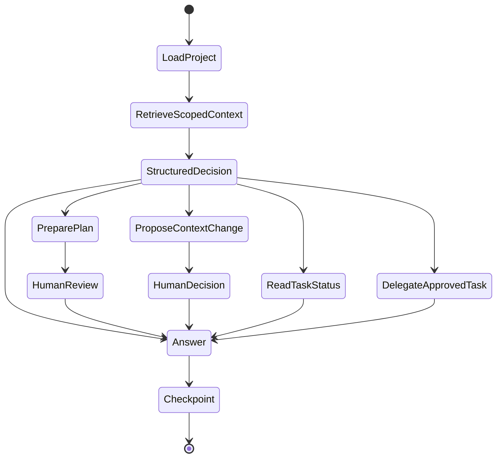
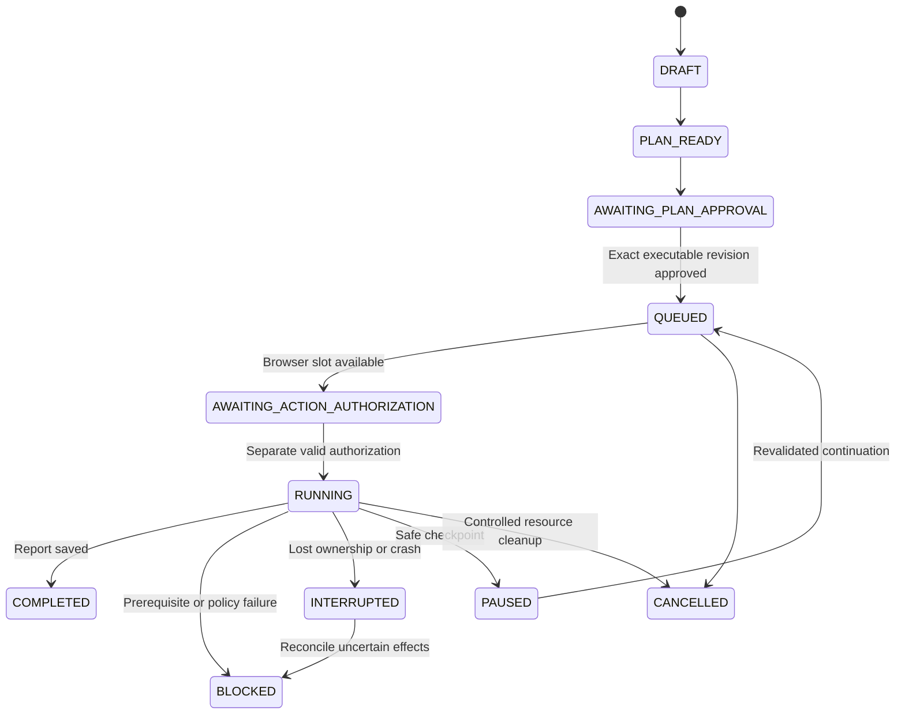

# VNext agent lifecycle and service contracts

Status: the read-only LangGraph Project Main Agent is implemented; Testing Graph and task delegation remain pending. [Main Agent checkpoint](vnext-main-agent.md) describes the current four-node graph, actual tools, typed IPC, failure states and persistence. The broader graph contracts later in this document remain future designs. Existing M8 planning/execution remain usable.

## Implemented project lifecycle

Project creation inserts the existing project row, a unique agent UUID and initial profile history in one transaction. Activation loads the project, conversations and profile. No process or model is launched for an inactive project. Rename, notes, skips and archive each increment the optimistic profile version and append history. Restore keeps the same agent ID. UI project/conversation switching clears the unsent task composer to avoid carrying one project's draft into another.

Onboarding uses six explicit topics: purpose, domain, roles, environments, sources and setup. A saved description answers purpose; a topic-labelled note answers that topic. The next prompt excludes answered/skipped topics; a later note can answer a skipped topic. This profile form remains deterministic intake; the separate Main Agent chat now reads its saved user context. Chat does not automatically extract profile facts. It does not infer role permissions or authorize URLs. For example, saving “Receptionists and clinicians use this application” under roles records a USER_STATEMENT and advances the optional question to environments. It does not change executor permissions.

## Current contracts

All channels retain main-frame URL validation, context isolation and the existing mutation lock.

| Contract | Input | Output / failure | Caller |
| --- | --- | --- | --- |
| `createProject` | title 1–200 chars, optional description <=4000 | UUID; strict validation/transaction failure | Existing sidebar via fixed preload IPC |
| `projectProfile` | project UUID or legacy | Profile, agent ID, version, latest 100 scoped notes and next prompt; missing/invalid ID rejected | Renderer/read-only IPC |
| `updateProject` | project UUID, positive expected version, strict discriminated action | Updated profile; stale version or archived edit rejected | `ProjectDetails` through serialized IPC |
| profile action | title and description | Rename/update, preserved history | Profile form |
| note action | known topic, text 1–4000 | USER_STATEMENT note; cannot supply authority or identity | Context note form |
| skip action | known topic | Durable optional skip | Skip button |
| archive action | boolean | Reversible organizational state | Archive/restore button |

`ProjectProfiles.initialize` is internal: project creation and migration call it inside transactions. `get` performs scoped SQL and computes the next prompt without model inference. `mutate` validates once, loads the expected project, applies a bounded action and records history atomically. Renderer error replies currently use the existing generic review envelope; detailed stale/archive errors exist at the service layer. No new agent-callable execution tool is exposed.

Tests: `project-profile.test.mjs` covers migration/backup failure, restart identity, context isolation, stale updates, provenance restrictions, optional onboarding and archive/restore. `project-profile.spec.mjs` covers actual Electron controls, project switching, draft clearing and restart. `consolidation` tests retain the existing full plan/review/authorization/report flow.

## Future expanded supervisor graph

The intended thread is scoped to project/conversation, with a separate thread for each approved task. Nodes wrap existing services. Structured provider decisions select an allowlisted operation; strict schemas and explicit project ownership validate it before dispatch. The model cannot invoke arbitrary code or approve plans. Unknown decisions block rather than degrade into a generic execution tool. Status answers must query durable tasks and cite saved report IDs, not infer progress from chat text.

## Planned Testing Agent and recovery

These are target task states; they are separate from scenario PASS/FAIL/BLOCKED verdicts. COMPLETED can include failing assertions. One reusable task graph receives only approved assignment references; no special registration/login agents. Queue events persist assignment, lease ownership, authorization request, step progress and report references with idempotency keys. The supervisor polls records only when useful; it does not spend model calls watching a worker.

LangGraph checkpoints persist continuation, not permissions. A crash after a click may leave an uncertain external effect even when a graph node has no completed checkpoint. Recovery must reconcile durable QASpider action identity before resuming, invalidate old browser ownership and require fresh authorization. Never automatically rerun that click. The current runner lacks a full cancellation contract; adding one and validating cleanup precedes advertising cancellation or PAUSED states.

## Initial runtime feasibility result (subsequently resolved)

The current Main Agent uses the official saver with a node:sqlite driver adapter, proven in both runtimes; no native addon rebuild is required. The following records the initial failure that motivated that decision. See [the compatibility investigation](vnext-main-agent.md).

An isolated installation of LangGraph 1.5.2, core 1.3.0 and SQLite saver 1.1.0 passed actual Node 24.11.1 graph invocation, close/reopen continuation (count 1 → 2) and separate-thread isolation (count 1). Under Electron 45.0.0's Node 24.22.0, the same native SQLite build failed: ABI 137 versus required ABI 150. This is an unresolved packaging gate, not evidence that LangGraph cannot support Electron. Next evaluate a reproducible Electron-native rebuild or a supported isolated Node worker and test packaged deployment. Do not install/rebuild the repository's shared native module blindly, since root Node tools may need its existing ABI. No LangGraph dependency has been adopted in this checkpoint, and provider structured-decision integration has not yet been tested.

## Proposed graph tool contracts (not exposed yet)

The future transport envelope should be a strict `{ projectId, conversationId, requestId, operation, input }`. The dispatcher must derive ownership from the stored conversation/assignment, compare every referenced artifact's project, and return a bounded discriminated `{ status, value }` or `{ status, blockerCode, artifactRefs }`. A model-provided project ID is a claim to validate, not authorization. No tool accepts executable JavaScript, raw SQL, an arbitrary filesystem path or a replacement expected result.

| Graph / operation | Validated input | Bounded result | Authority owner |
| --- | --- | --- | --- |
| Supervisor / read project | Stored conversation identity | Profile revision, non-sensitive environment/role references | Profile service |
| Supervisor / retrieve context | Query <=500 chars, allowed category/scope, bounded result count | Text excerpts with source/document/criterion/report IDs and authority | Project memory service |
| Supervisor / prepare proposal | Original task/source IDs, explicit acceptance criteria | Existing unapproved plan/revision ID plus missing facts | Existing planner/store |
| Supervisor / prepare executable draft | Plan ID, exact draft revision/version | Existing binding revision and blockers | `DesktopService.prepare` and `ExecutableDraft` |
| Supervisor / read review | Owned plan/revision reference | Approval issues, current status and exact revision reference | Existing PlanStore |
| Supervisor / delegate | Owned approved revision/hash plus task scope references | New or idempotently existing task/thread ID, QUEUED or blocked | Future task registry; rechecks approval |
| Supervisor / task status | Owned task IDs, bounded list | Actual lifecycle, latest persisted event, blockers and report IDs | Future task store |
| Supervisor / propose settings | Allowlisted non-secret values and expected config revision | Human-reviewable proposal; never automatic security change | Settings validation/human decision |
| Testing / validate assignment | Task ID and durable assignment identity | Current exact revision compatibility and knowledge references | Task store + existing approval checks |
| Testing / request browser lease | Task/assignment ID | Lease reference or queue position; no renderer-selected owner | Future single-worker queue |
| Testing / prepare execution | Task ID, exact approved revision, authorized environment reference | Existing prepared-origin reference and authorization request | Existing ApprovedExecution |
| Testing / execute | Matching lease and fresh separate human authorization reference | Existing report reference/progress; never a model verdict | Existing ApprovedExecution/generic runner |
| Testing / retrieve report | Owned task/report ID | Saved assertion results and bounded evidence references | Existing execution repository |
| Testing / propose knowledge | Completed report/scenario/step IDs | Eligible candidate/revision IDs or rejection reason | Existing M6 eligibility plus future graph validator |
| Either / request cancellation | Owned task ID and expected task version | Cancellation-requested or terminal state | Future worker cleanup contract |

The supervisor can request delegation only after human approval; the Testing Agent cannot approve anything. Neither graph creates a PASS result. Duplicate request IDs should resolve to the same durable event/assignment where the operation is idempotent. For execution, uncertain prior effects require reconciliation rather than idempotent replay of a browser action.
