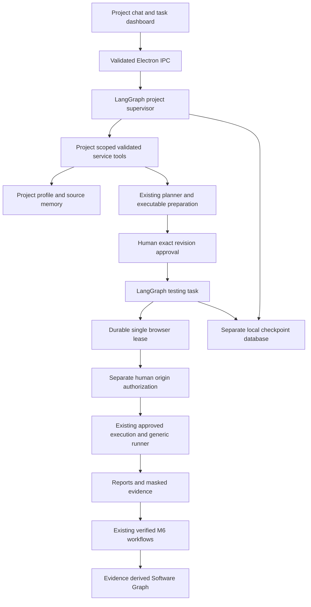

# QASpider VNext architecture and implementation plan

Initial audit: 26 October 2026 (India), before implementation. Current checkpoint: the read-only Project Main Agent is implemented. See [Main Agent decision, graph and interfaces](vnext-main-agent.md) for the resolved SQLite compatibility approach, scoped tools and verification. Broader supervisor planning/delegation, Testing Agents and Software Graph remain future work. The audit and original phase order below are retained for context.

## Repository findings

The clean working tree already contains M8 consolidation. `ChatDesktop.tsx` is the normal shell; the milestone demonstrations are behind the legacy route. `ConversationStore` already owns projects, conversations, messages and plan/report associations. `DesktopService.send` treats every message as a ticket, so it is not a conversational supervisor. `ExecutableDraft` already grounds typed commands with Stagehand before exact revision review. `ApprovedExecution` already enforces separate, one-use prepared-origin authorization and invokes the generic runner. These integrations must be reused.

The actual gaps are project profile/rename/archive and stable supervisor identity; general conversation; source intake; category-aware memory; task identities/events/leases; durable graph continuation; scheduling/cancellation; evidence-derived Software Graph; and the corresponding UI. All mutations currently share `activeRun` in `main.mjs`; read-only retrieval works during execution, but independent chat does not. The M6 `find` operation scopes before FTS eligibility; the legacy `list` IPC returns a global bounded list which the renderer filters. This is not a complete backend project authorization boundary and must be corrected before exposing retrieval as agent tools.

## Build versus reuse

| Concern | Existing owner | Decision |
| --- | --- | --- |
| Renderer/IPC | React, Electron sandbox/preload, fixed handlers | Extend, preserve sender validation |
| Projects/conversations | `conversations.mjs` | Add profile companion tables and optimistic revisions |
| Planning | `ticket-planner.mjs`, M4 review/store | Reuse unchanged; supervisor coordinates later |
| Executable grounding | `executable-draft.mjs`, control policy | Reuse; do not reimplement |
| Approval | immutable originals/approved revisions, exact hash | Keep authoritative outside agent state |
| Browser authorization | `approved-execution.mjs`, target capabilities | Keep separate and non-resumable |
| Execution/assertions | M5 generic runner, Stagehand 4.3 | Keep; add controlled scheduling later |
| Evidence | masked screenshots, SQLite reports | Keep artifact references in agent state |
| Verified memory | M6 SQLite/FTS5 revisions and evidence | Extend categories; avoid duplicate workflows |
| Agent continuation | absent | Adopt LangGraph after isolated runtime feasibility probe |
| Task queue/events/leases | absent | Small local SQLite registry; one browser owner |
| Source parsing | absent | Evaluate maintained PDF/DOCX/XLSX/CSV parsers with bounds |
| Software Graph | absent | SQLite relationships derived from M6 evidence |

## Target boundaries

The diagram is a target, not a claim that the graphs or queue exist. QASpider owns authority: checkpoints describe progress, while plan hashes, permissions, task leases and reports decide whether an action may run. A resumed graph cannot turn an expired authorization into permission.

## Dependency feasibility gate

Registry inspection found `@langchain/langgraph` 1.5.2 (MIT, Node >=18), `@langchain/langgraph-checkpoint-sqlite` 1.1.0 (MIT, Node >=18, better-sqlite3 ^12.10.0), and `@langchain/core` 1.3.0 (MIT, Node >=20). Graph peers require core ^1.1.48 and Zod ^3.25.32 or ^4.2.0; the repository uses Node 24.11.1 and Zod 4.6.7. Registry compatibility alone does not establish Electron compatibility. Probe graph invocation, SQLite close/reopen, thread separation and the actual Electron ABI before adding dependencies. Keep native checkpointer storage separate from `desktop-plans.sqlite`.

Official references: [LangGraph source and license](https://github.com/langchain-ai/langgraphjs), [persistence/checkpointer documentation](https://github.com/langchain-ai/langgraphjs/blob/main/docs/docs/concepts/persistence.md), [nodes and deterministic service dispatch](https://docs.langchain.com/oss/javascript/langgraph/thinking-in-langgraph). LangGraph nodes are JavaScript functions, so the CLI need not expose native tool calls. The proposed adapter asks the existing isolated provider for a validated structured decision and deterministically dispatches allowlisted services. Actual compatibility still needs a synthetic provider integration test. Do not add an API-key requirement.

## Ordered implementation and recoverable checkpoint

1. Phase 0: document actual architecture, ownership, migration risks and dependency feasibility before code.
2. Phase 1: additive project profiles, stable logical supervisor identity, rename/archive/restore, explicit user-sourced onboarding notes, progressive optional prompts, persistence and isolation tests, desktop controls. This is the intended bounded implementation checkpoint for this session; do not present it as a model-backed Main Agent.
3. Phase 2: the authorized read-only Project Main Agent slice now supplies a persistent supervisor graph, bounded context, scoped QA/report/knowledge reads and structured provider decisions. Planning/delegation/configuration tools remain future scope. Provider isolation is required before/after context changes.
4. Phase 3: bounded original-file intake and established parsers with exact source locations; no document instructions become authority.
5. Phase 4: integrate source/context references with existing grounded draft review; preserve original requirements and approval hashes.
6. Phase 5: task registry/events, testing graph, lease queue, controlled cancellation and restart reconciliation. Split read/chat work from the browser mutation lock only after browser ownership is explicit.
7. Phase 6: scoped graph nodes/edges/revisions backed by M6 evidence, stale/divergence records and verified route revalidation.
8. Phase 7: extend this same shell with intake, tasks, graph and safe settings; retain fallback.
9. Phase 8: demonstrate scenarios A–H with honest synthetic/live classification and measured counters. Existing M8 receipts are historical baseline evidence, not VNext acceptance.

## Migration and implementation risks

An M8 database already has consolidation tables, so its existing backup helper skips further migrations. New schema must get its own pre-migration snapshot gate and ledger marker, checked before writes. Use the existing online `VACUUM INTO`, private directory/file modes and read-only integrity validation. New companion tables avoid changing positional inserts into historical tables. Migration must create exactly one stable supervisor identity per existing project and preserve every approval/report ID.

Onboarding information is user-provided context, not verified behavior or approved expectations. Profile updates need optimistic version checks and append-only source history. Archive is reversible organization, not deletion or action authorization revocation. Do not claim full credential detection: keep secrets out of the intake UI and postpone feeding these notes to a model until context policy is validated.

Validation at the checkpoint: migration snapshots/reopen/idempotence, stable identity, cross-project note isolation, stale writes, archive/restore, unchanged approvals, renderer typecheck/build, unit regressions and real Electron UI persistence. Broader workflow assertions remain pending until implemented. No automatic commit, push, release or publication.
