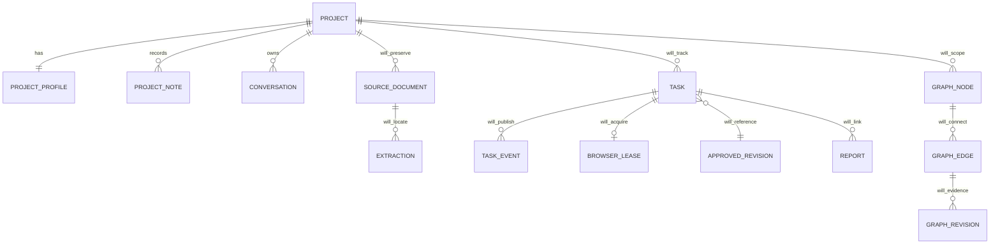

# VNext data model

Status: project foundation and read-only Main Agent checkpoint. The agent tables/checkpoints described below are installed; task/source/Software Graph entities remain designs. See [Main Agent data flow](vnext-main-agent.md).

## Installed ownership

`PlanStore` continues to own one `node:sqlite` connection, transactions and historical approval/report integrity. `ConversationStore` owns existing project/conversation/message/artifact associations. `ProjectProfiles` adds companion records; it never alters plan content, hashes, report identities or M6 scopes.

| Table | Key and content | Ownership and authority |
| --- | --- | --- |
| `desktop_projects` | Existing project ID, title, creation timestamp | User project organization |
| `desktop_project_profiles` | Project FK, unique agent UUID, description, archived flag, version, skipped topics, updated timestamp | Logical supervisor identity; no running model process |
| `desktop_project_notes` | Note UUID, project FK, topic, body, fixed USER_STATEMENT authority, timestamp | User-provided context; never VERIFIED |
| `desktop_project_profile_history` | Project FK + revision, original mutation JSON, timestamp | Initial profile and subsequent changes retained |
| `desktop_conversations` | Existing conversation ID/project FK, selected context and optimistic version | Existing application context for planning/execution |
| `desktop_messages` | Existing immutable message identity and optional plan/report links | Original task text and saved responses |
| `desktop_plan_*` | Existing originals, revisions, approvals, events, execution JSON | Authoritative human approval and actual evidence |
| `desktop_knowledge_*` | Existing scoped workflows, revisions, verification/findings, FTS index | Evidence-backed operational memory |

The profile version is independent of conversation context version and plan revision. Example: renaming Clinic QA increments profile version; changing its selected URL increments conversation version; changing an assertion creates a different review hash. Profile context does not currently enter model prompts or approval content. Before Phase 4 uses new environment/role/configuration references for execution, those references must join approval hashing and compatibility checks.

## Migration

`PlanStore` calls `backupBeforeProjectFoundation` before any schema write when an existing conversation database lacks the `vnext-project-foundation-1` marker. `VACUUM INTO` snapshots go into private `desktop-backups/` with directory mode 0700 and file mode 0600. An independent read-only connection checks integrity. Failure aborts opening the store. New empty databases require no historical snapshot. Pre-M8 databases use their original consolidation snapshot and need no second snapshot during that same open.

The migration creates three tables and a project-note index in an immediate transaction, backfills one agent UUID and initial history record per existing project, then writes the additive ledger marker. Reopening preserves identities and creates no extra snapshot. Existing `user_version` handling is untouched. The legacy project gets an identity but remains read-only through the new profile mutation API.

All profile updates use validated input and an expected version inside `PlanStore.atomic`. A stale write rolls back without adding notes or history. Archive retains every association; it blocks new conversations/profile edits until restored, but it is not an execution permission revocation mechanism.

## Main Agent storage

`desktop_agent_threads` links an existing conversation/project/supervisor identity to a stable server-derived thread ID. `desktop_agent_turns` links UUID request identities to existing user/assistant message IDs, terminal inference status, source references, timings and reported usage. Messages are not copied into another authoritative transcript. The lazy Main Agent migration uses a private integrity-checked snapshot before additive schema changes, and the ledger marker `vnext-main-agent-1`; it preserves approval hashes and all earlier tables.

The separate private `agent-checkpoints.sqlite` contains official SqliteSaver `checkpoints` and `writes` tables. Its state contains only turn references and graph phase. It has no plan authority, browser leases or authorization. A process restart reconciles RUNNING chat turns as INTERRUPTED without replaying inference. Opening history does not invoke the graph.

## Planned entities

Planned task events need an idempotency key, task/project/thread IDs, timestamp and artifact references. A lease requires a unique owner, expiry and explicit uncertainty state after a crash. Checkpointer tables belong in a separate database and never become the authority for a browser lease or action identity. Documents need immutable original-file revisions, parser/version metadata and page/paragraph/sheet-cell references. Reuse M6 workflow/evidence IDs instead of copying their records into another memory subsystem.

## Retrieval and limits

`ProjectProfiles.get(projectId)` predicates notes by exact project ID before returning at most the latest 100. Its answered-topic query considers the full note history, so old answers do not become missing merely because the display is bounded. Notes and profile history remain user-sourced context; the Main Agent now retrieves a bounded sanitized selection without changing their authority. Scoped M6 FTS workflow retrieval is read-only. Broader category-aware fact retrieval, document references, formal role/environment entities, validity/dispute states and history browsing remain pending. SQLite writes preserve history through this service; this is not cryptographic tamper resistance against someone controlling the local database.
