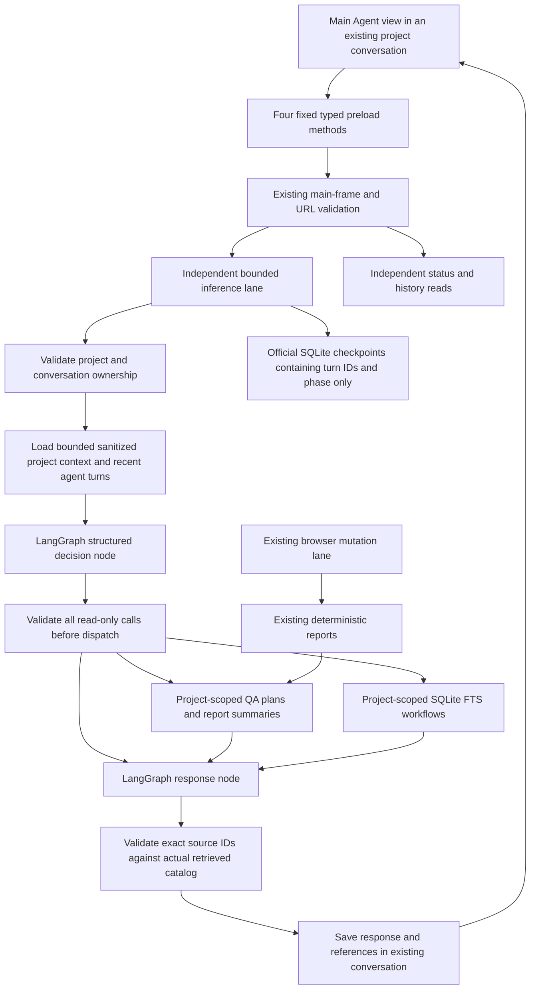

# Project Main Agent checkpoint — implementation decision and plan

Scope authorized on 26 October 2026 (India): a read-only LangGraph Project Main Agent in the existing Desktop. Testing Subagents, ingestion, queues and Software Graph implementation are excluded.

## Persistence investigation and decision

The prior feasibility receipt identifies official SQLite saver 1.1.0's `better-sqlite3` binary as the failure: Node 24.11.1 uses ABI 137; Electron 45.0.0 embeds Node 24.22.0 with ABI 150. Electron-native rebuilding is supported but requires its own headers/toolchain/artifacts for every target/runtime. Rebuilding the shared workspace copy can break root Node tools. An external system-Node process could use ABI 137, but requires discovering/shipping/managing another runtime. Electron utility processes and worker threads use Electron's runtime, so merely moving the same native binary there does not resolve the ABI mismatch.

An alternative `langgraph-checkpoint-sqlite-native` 0.0.2 exists, but is an early independent implementation. Instead test the official `SqliteSaver` public constructor with a small driver adapter backed by QASpider's existing `node:sqlite`. The official saver retains checkpoint SQL, serialization, versioning, pending writes and history; the adapter supplies synchronous prepare/pragma/transaction methods only. No custom checkpointer, second database server, native rebuild or external Node runtime. Pin the saver version and test its actual interface in Node and actual Electron before adoption. Keep checkpoints in a separate private SQLite file and preserve QASpider's existing authoritative conversation/approval/report tables.

Sources: [Electron native module ABI/rebuilding](https://www.electronjs.org/docs/latest/tutorial/using-native-node-modules), [Electron utility processes](https://www.electronjs.org/docs/latest/api/utility-process), [official SQLite saver implementation](https://github.com/langchain-ai/langgraphjs/blob/main/libs/checkpoint-sqlite/src/index.ts), [LangGraph persistence](https://github.com/langchain-ai/langgraphjs/blob/main/docs/docs/concepts/persistence.md). Package versions/licenses are also checked from the npm registry and installed package sources. Runtime results and limitations will be appended after verification.

## Implementation order

1. Establish required provider isolation baseline before new model context construction.
2. Verify the official saver with node:sqlite in both runtimes, including restart, thread isolation, pending writes and history.
3. Add scoped durable chat turns/references and stable per-conversation threads derived from existing supervisor identities. Back up existing stores before additive migration. Persist safe status/error records and recover unfinished turns as interrupted; do not automatically repeat model work.
4. Build one bounded LangGraph: retrieve context → structured read-only decision → validated tool dispatch → grounded response → durable finalization. No browser/review/settings mutation tools. Checkpoints hold turn/artifact references rather than raw conversation or report text.
5. Expose fixed typed start/send/history/status IPC with existing frame protections. A separate bounded inference lane must not own or release browser resources and must leave status reads responsive. Hold no SQLite transaction across awaits.
6. Add a minimal Main Agent chat tab in the existing project conversation, retaining the established QA plan controls and legacy route.
7. Test scoped stored-data tools, invalid decisions, missing provider, input/context sanitization, restarts, concurrency with existing browser operations, actual Electron UI and a clearly identified real-model demonstration. Update documentation, screenshots and receipts, then stop for checkpoint review.

## Implemented graph and data flow

The official saver plus driver adapter passed Node and actual Electron. `agent-checkpoints.sqlite` is separate from `desktop-plans.sqlite`; `checkpoints` and `writes` are the official saver's tables. Authoritative user/assistant messages remain in `desktop_messages`. Two additive tables associate a conversation with its stable supervisor/thread and each inference turn with message IDs, status, citations and usage. A pre-migration private snapshot is checked before these tables are installed.

One reusable graph has four nodes: `retrieve_context`, `structured_decision`, `read_tools`, `respond`. It performs one model call for a direct contextual answer, or two for a read-tool answer. There is no recursive agent/tool loop. All tool arguments are validated before any dispatch. Checkpoint state contains `turnId` and `phase`, not prompts, profile notes, model answers, screenshots or raw reports. The inference scratch map is ephemeral; history and citations live in QASpider's database. Thread IDs derive from the existing supervisor UUID plus conversation UUID and cannot be supplied by the renderer/model.

On reopen, unfinished turns become INTERRUPTED with an honest saved explanation. No graph invocation occurs when merely opening history. New explicit messages start new turns in the same thread; they do not resume old pending model work. Shutdown aborts the bounded inference, waits for its finalization and closes checkpoints before closing application storage. Browser resources remain owned by the existing services.

## Current interfaces

| IPC / caller | Strict input | Result and failure |
| --- | --- | --- |
| `agentStart` / `AgentChat` mount | projectId, conversationId UUIDs | Validate ownership, create/reuse server-derived thread, return latest 50 turns |
| `agentSend` / composer | scope, UUID requestId, text 1–6000 chars | Persist accepted input, start bounded async inference, return immediately; duplicate request identity returns existing history |
| `agentHistory` / polling | exact scope | Latest 50 turns, saved source catalog and metrics; no cross-project conversation access |
| `agentStatus` / polling | exact scope | Current inference phase and actual scoped QA-plan/report summaries; no invented Testing Agent/queue states |

The existing IPC sender guard still rejects foreign frames. New agent handlers may run independently of the browser mutation lock because they cannot call an executor or mutate plans/settings. One inference lane permits one active reply at a time; concurrent distinct sends are rejected, not queued. Browser operations retain their original serialization. Provider settings cannot change during a reply. Read-only status/history/configuration/plan retrieval remain callable while inference and browser capture are pending.

| Model-selected tool | Arguments | Server result |
| --- | --- | --- |
| `list_qa` | planId=null, reportId=null, query=null | Latest 10 owned QA plans, review status/scenario count and up to 2 actual report refs per plan |
| `read_report` | exact planId and reportId UUIDs, query=null | Project-joined report status/verdict, up to 20 scenario summaries, assertion/evidence counts; foreign references return unavailable |
| `search_knowledge` | query <=500 chars, IDs=null | Up to 8 project-filtered FTS workflow revisions with environment/role/application, verification/divergence and original execution/scenario refs |

No model tool accepts project IDs, SQL, JavaScript, file paths, browser commands, approvals, settings changes or replacement expectations. Tool projections are schema-validated, at most 14,000 characters and 30 source refs. SQL projects report summaries without loading screenshot payloads into the model context. The model must cite only actual catalog IDs; invented IDs fail the turn. Valid citations do not prove every sentence is correct: natural-language explanations remain AI output, and the saved runner report/status panel remains authoritative for QA verdicts.

## Context and privacy

The model receives project title/description, up to 10 recent topic notes (500 chars each), selected application context without URL credentials/query/fragment, and up to 6 completed agent turns (10,000 characters total). The entire inference payload is capped at 90,000 UTF-8 bytes, below the existing provider limit. Oversize context fails explicitly rather than expanding retrieval. History displayed in Desktop is bounded to the latest 50 turns; older messages stay stored. General QA planning payloads/raw page dumps are not copied into Main Agent context.

Credential-shaped user inputs are rejected before persistence. Retrieved text and saved model replies redact recognized password/token/cookie/key patterns and URL credentials/state. This is conservative best-effort text sanitization, not comprehensive secret recognition or encryption. Arbitrary secrets embedded in ordinary prose remain a limitation; use authorized test data and references. Credentials remain in the existing CLI sign-in flow, never entered as chat configuration. Project notes are user statements, not verified requirements. Chat does not automatically edit project facts or turn user prose into an approved test.

An adversarial environment test exposed that upstream child graph callbacks can re-enable ambient tracing despite a `tracingEnabled:false` context. The implementation therefore fails closed **before provider preparation/inference** if external LangSmith/LangChain/OTel tracing is enabled. It also supplies a local-only tracing context and empty callbacks. The test uses synthetic project data; no production project context was used. This gate avoids relying on an insufficient upstream override. No cloud tracing service is required or enabled by this checkpoint.

## Important files

| File / functions | Why it exists, callers, failures, state and tests |
| --- | --- |
| `electron/agent-checkpoints.mjs`: `checkpointDriver`, `openAgentCheckpoints` | Main Agent opens the official saver with a narrow node:sqlite driver. Validates private paths/modes; closes on initialization failure. Official saver owns checkpoint SQL/serialization. Runtime probe and interrupt/history/pending-write unit test cover it. |
| `electron/agent-store.mjs`: `AgentStore.start/begin/history/complete` | Called by the Main Agent service. Checks project ownership, performs additive migration/snapshot, links existing message IDs, preserves request identity/status/sources/usage, reconciles unfinished turns. Immediate transactions never span inference awaits. Restart/isolation/idempotency tests cover it. |
| `electron/agent-context.mjs`: `AgentReadTools.scope/context/dispatch` | Called only by validated graph nodes/status retrieval. Applies project predicates before selecting data; bounded projections omit raw inputs and screenshots. Dispatch rejects unsupported tools/extra fields. Cross-project, FTS/report and sanitization tests cover it. |
| `electron/main-agent.mjs`: `ProjectMainAgent.send/run/status/close` | Owns one inference lane and the four-node graph. Validates structured provider output and source catalog, uses existing CLI isolation, records honest terminal states, aborts on shutdown. No executor imports. Unit and actual Electron tests cover lifecycle, failures, status availability and immutable approvals. |
| `src/AgentChat.tsx` | Calls the four typed methods, polls every 600ms, renders safe text/source labels/loading/errors and saved QA status. Per-conversation component keys clear unsent drafts on switching. Real Electron test and live driver cover it. |
| `scripts/verify-main-agent-live.mjs` | Explicit real-CLI demonstration using synthetic project data and a genuine saved report from the existing controlled browser runner. Asserts project separation, stored tool refs, exact history/thread persistence and unchanged approval hash. Emits sanitized screenshots/receipt. |

## Limits and deferred work

This checkpoint has no Testing Subagents, task registry, scheduler, document ingestion, Software Graph writes, browser-action tools, plan edits or settings proposals. QA “tasks” here are existing saved plan/report summaries, not a new task lifecycle. Workflow search can display observations from multiple roles/environments within an owned project, labelled with scope; it grants no reuse permission. The existing executor must still check exact compatibility and separate authorization for any future action.

The compatibility adapter intentionally implements only the synchronous driver methods used by pinned SqliteSaver 1.1.0. A saver upgrade requires rerunning Node/Electron, pending writes, interrupt/resume, history and transaction tests. The unused better-sqlite3 dependency still appears transitively in the official package; Desktop does not construct it. No additional native build is required for Main Agent persistence. Packaging/distribution beyond the repository's existing source-based Desktop launch is not newly claimed.

Current error states: UNAVAILABLE for no provider/preparation failure/external tracing; ERROR for invalid output, unavailable citations, oversized context or inference failure; INTERRUPTED for shutdown/restart; COMPLETED means a valid chat response was saved, not that a QA scenario passed. No automatic retries after an interrupted turn. No token streaming or user-facing chat cancellation control yet; shutdown cancellation remains supported by the existing CLI process boundary.
