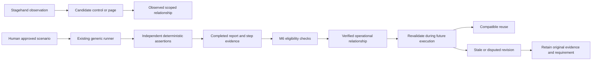

# VNext Software Graph

Status: design only. This checkpoint creates no Software Graph tables, promotes no graph entries and claims no verified navigation learning. Existing M6 workflows/revisions/evidence remain intact.

## Source of truth

Reuse `KnowledgeStore.record`, completed execution reports, step evidence and divergence findings. Existing eligible workflow reuse already checks project, environment, role, application and operation compatibility. A graph is an index of relationships justified by those records; it must not become a second browser explorer, alternate runner or store of business expectations.

An XPath found on a page establishes a candidate target only. A passing exact-message assertion does not by itself prove every navigation relationship around that control. Promotion must identify the approved scenario/step, actual transition, relevant assertion and evidence artifact.

## Planned records

Nodes: ROLE, PAGE, UI_STATE, CONTROL, FEATURE, WORKFLOW. Edges: CAN_ACCESS, NAVIGATES_TO, OPENS, REQUIRES, PART_OF, TRANSITIONS_TO. Each revision needs project/application/environment/role scope, stable logical identity, candidate/observed/verified/stale/disputed status, source report/scenario/step and original evidence reference. Avoid copying screenshots into graph state. Only scoped user facts/documented requirements may describe business intent, and their authority remains distinct from graph observations.

Example: an approved controlled-app task clicks a menu and independently verifies the destination URL and heading. Its saved transition may justify PAGE → NAVIGATES_TO → PAGE for that project's synthetic tester role. Merely observing the menu cannot justify CAN_ACCESS for an administrator. If the next task finds a changed control fingerprint, store a divergence revision and retain the old verified report; do not change the expected destination to match a regression.

## Retrieval and validation gates

Filter project, environment, application and role before path search. Follow only eligible verified transitions whose prerequisites match the approved task. Return source IDs with the route. Revalidate live targets through existing control policy and bounded Stagehand discovery. Missing/stale knowledge can block or request discovery; it never authorizes an action.

Pending tests must cover cross-project/environment/role rejection, unsupported edge promotion, duplicate-event idempotency, failed/unexecuted assertion exclusion, observed-only selectors, revision history, verified reuse and changed-UI divergence. Required scenario E remains pending; historical M8 reuse receipts demonstrate M6 behavior only.
